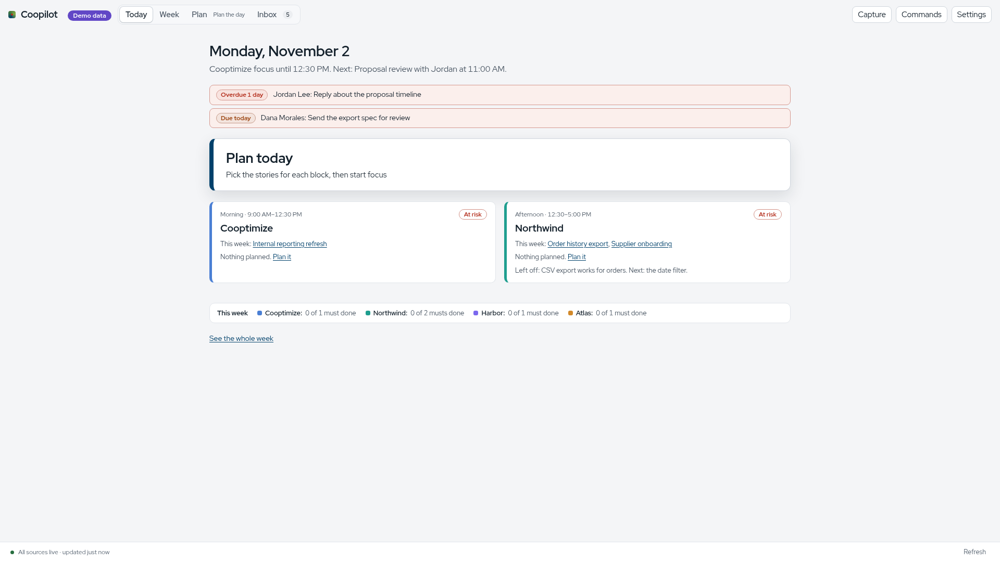
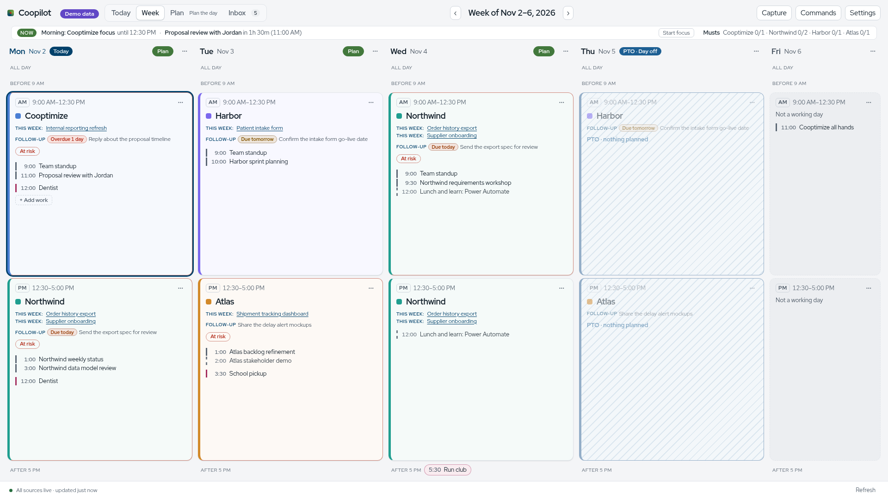

# 01. Product

Coopilot is built around one person's week. It answers three questions: what is my week, what fits in each block, and what do I owe people. It is built for one Cooptimizer today. The goal is nothing person-specific in code; the exceptions are the install files in `system/`, which hard-code the author's paths ([docs/roadmap.md](../../docs/roadmap.md#built-for-any-cooptimizer)).

## The daily rhythm

Four rituals, each a mode in the UI. None is forced: a mode shows a small dot when it is due and a ✓ when done for that day or week ([plan/modes.ts](../../plan/modes.ts), [ui/ModeSwitch.tsx](../../ui/ModeSwitch.tsx)).

| Ritual | Where | When | What happens |
|---|---|---|---|
| Plan the week | Week › Plan the week (W) | End of the week, for next week | Each client's week list of DevOps features and stories, Must and Nice to have, in stack rank order, with a fit check against the client's budget. Commit when done. [ui/PlanWeek.tsx](../../ui/PlanWeek.tsx), [actions/weekplan-actions.ts](../../actions/weekplan-actions.ts) |
| Plan the day | Today › Plan (P) | Morning, for today or the next workday | Turn each block's free time into committed picks (DevOps items, draft stories, intentions, follow-ups). After commit, "Timebox my day" can place picks into free gaps. [ui/PlanDay.tsx](../../ui/PlanDay.tsx), [actions/plan-actions.ts](../../actions/plan-actions.ts) |
| Check-in | Today › Check-in (M) | Midday | Today's picks, time left per slot after meetings, what no longer fits, walk-on work. [ui/CheckIn.tsx](../../ui/CheckIn.tsx) |
| Close out | Today › Close out (E) | End of day | Picks done or not, resume notes ("where I left off"), open follow-ups, then commit. [ui/CloseOut.tsx](../../ui/CloseOut.tsx), [actions/closeout-actions.ts](../../actions/closeout-actions.ts) |

Reminders for each ritual come from the server, not the window, so they fire even when the window is closed. They go through one notifier with a switch per kind, quiet hours outside working hours and on PTO days, and are held during focus ([server/main.ts](../../server/main.ts), [actions/notifier.ts](../../actions/notifier.ts), [plan/notify.ts](../../plan/notify.ts)).

Two longer rituals sit in Roadmap › Plan ahead: "Look ahead 4 weeks" every other Thursday once next week is planned, and a monthly direction review on the first Thursday ([plan/rituals.ts](../../plan/rituals.ts)).

Between rituals there is **focus**: a server-side timer on one pick, a calm focus screen, optional focus sounds, and (if allowed) a Teams status of Busy or Do not disturb that clears when the session ends ([actions/timer-actions.ts](../../actions/timer-actions.ts), [ui/FocusScreen.tsx](../../ui/FocusScreen.tsx), [actions/presence-actions.ts](../../actions/presence-actions.ts)).

## Navigation

Four tabs in the top bar, keys 1 to 4. Each tab has a mode switch at the right of its header. Every place has an address (`#/...`) so browser back and reopening land in the same place ([ui/nav.ts](../../ui/nav.ts)).

| Tab | Modes | What it shows |
|---|---|---|
| Today (1 or T) | Now · Plan · Check-in · Close out | What's now and next, anything urgent, one Start focus, today's blocks with committed features and picks |
| Week (2) | Week · Plan the week | Every half-day of the week; next week's plan by client |
| Roadmap (3) | Roadmap · Plan ahead | Features and epics I own or contribute to, each with one state and a plain reason; a 12-week timeline |
| Inbox (4 or L) | (one view) | Open follow-ups and unsorted captures in one list: overdue, due soon, then the rest |

P toggles the current tab's planning mode. Planning modes show a green Done that saves and returns to the view mode ([ui/nav.ts](../../ui/nav.ts) `toggleP`, `afterDone`). Two full-window overlays sit on top of any tab: the focus screen and Settings.

## Principles

These come from [CLAUDE.md](../../CLAUDE.md#principles) and the hard rules there. Each one has code behind it.

**DevOps first.** If it isn't in DevOps, it isn't planned yet. Week lists come from DevOps items in stack rank order. Readiness flags nudge toward a healthy backlog ("Feature needs stories", "Block needs work", "No target date") without blocking anything ([plan/weekplan.ts](../../plan/weekplan.ts) `ReadinessKind`). Draft stories and draft features live locally until "Create in DevOps" writes them ([actions/devops-write-actions.ts](../../actions/devops-write-actions.ts)).

**AI suggests but never executes.** There is no AI provider in the code today. A search of the repo for provider SDKs or API calls finds none. The action registry is the allowlist a future chat panel would call ([actions/registry.ts](../../actions/registry.ts), header comment), and every outside write needs a server-held preview and a confirm ([06-write-framework.md](06-write-framework.md)).

**The core works without AI.** Every view and rule is deterministic code: risk rules ([week/risks.ts](../../week/risks.ts)), follow-up rules ([plan/followups.ts](../../plan/followups.ts)), capture routing ([plan/capture.ts](../../plan/capture.ts)).

**Client boundaries.** Client data stays scoped to its client in views and drafts. Picks, week items, drafts and timeboxes each carry a `client_key` (optional on follow-ups and captures) ([store/plan-store.ts](../../store/plan-store.ts) migrations). DevOps reads and writes go to one client's org per call with that client's PAT ([sources/devops/source.ts](../../sources/devops/source.ts), [sources/devops/write.ts](../../sources/devops/write.ts)). Two Dataverse accounts with the same client key are refused rather than merged ([sources/dataverse/source.ts](../../sources/dataverse/source.ts) `devopsTargets`). See [07-security-and-privacy.md](07-security-and-privacy.md#client-isolation).

**Nothing machine-specific in core modules.** `week/`, `plan/`, `actions/` and `sources/` avoid OS calls. Keyring, browser launch, notify-send, playerctl and Hyprland sit behind host adapters in `secrets/`, `server/` and `system/` ([CLAUDE.md](../../CLAUDE.md#principles)). One known exception: `actions/` imports the pure Edge launch-argument builder in `links/edge.ts` (open question Q63).

**Re-planning never feels like failure.** Musts are a target, not a contract: one click moves them; a slip offers "I'll make it up" with borrowed time instead of a red mark ([actions/registry.ts](../../actions/registry.ts) `weekplan.set_tier`, `pick.make_up`).
