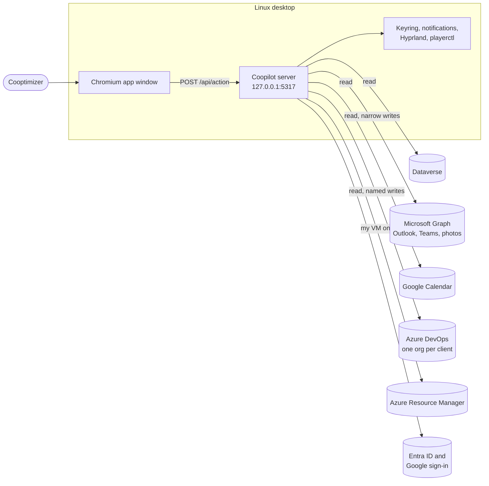
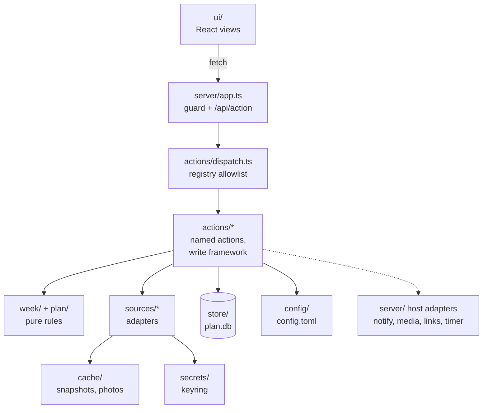
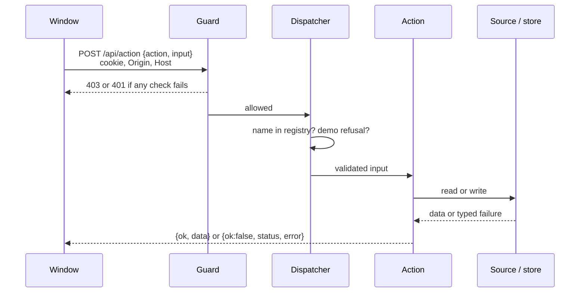

# 02. Architecture

One process, one codebase, one person's machine. A Node 26 server (TypeScript run directly by Node, no build step for the server) listens on `127.0.0.1` and serves a React UI built by Vite. The UI talks to the server through one endpoint, `POST /api/action`, which runs named actions. Actions call pure planning code and source adapters, and read and write a local SQLite plan store. Sources: [server/main.ts](../../server/main.ts), [server/app.ts](../../server/app.ts), [package.json](../../package.json).

Runtime dependencies are three: `react`, `react-dom` and `smol-toml` (config parsing). SQLite is Node's built-in `node:sqlite`; HTTP is built-in `fetch`; OAuth is hand-written on `crypto` and `http` with no MSAL or Google library ([package.json](../../package.json), [sources/oauth/oauth.ts](../../sources/oauth/oauth.ts), decision D48 in [docs/decisions.md](../../docs/decisions.md)).

## System context

What Coopilot talks to. Arrows point from the caller. Everything outside the "Linux desktop" box is a remote service; everything inside runs as the signed-in Linux user.

## Containers

Inside the server. Solid arrows are calls; the dotted arrow is the host adapter boundary.

- **Browser UI** ([ui/](../../ui/)): React 19. Holds no secrets and makes no outside calls; the Content Security Policy allows only `'self'` for scripts and connections ([server/app.ts](../../server/app.ts) `baseHeaders`).
- **Local server** ([server/app.ts](../../server/app.ts)): every request passes the guard (loopback Host, same-origin Origin, per-launch token) before anything else. See [07-security-and-privacy.md](07-security-and-privacy.md).
- **Action layer** ([actions/](../../actions/)): one registry of 122 named actions ([actions/registry.ts](../../actions/registry.ts)). The dispatcher rejects unknown names and bad input ([actions/dispatch.ts](../../actions/dispatch.ts)).
- **Pure logic** ([week/](../../week/), [plan/](../../plan/)): no I/O, no tokens, no clock unless passed in.
- **Source adapters** ([sources/](../../sources/)): each returns normalized data or a typed failure, never raw HTTP errors.
- **Plan store** ([store/plan-store.ts](../../store/plan-store.ts)): SQLite in `~/.local/share/coopilot/plan.db`.
- **Config** ([config/](../../config/)): `~/.config/coopilot/config.toml`, validated per field.
- **Cache** ([cache/](../../cache/)): `~/.cache/coopilot`, last good snapshot per source, profile photos.
- **Keyring** ([secrets/keyring.ts](../../secrets/keyring.ts)): Secret Service through `secret-tool`, service `coopilot`.
- **systemd user service** ([system/coopilot.service](../../system/coopilot.service)): builds the UI, then runs the server with `--no-open`.
- **Launcher and global shortcuts** ([system/coopilot-open](../../system/coopilot-open), [system/Coopilot.desktop](../../system/Coopilot.desktop)): one script for the app launcher, login autostart, Super + Alt + C (open) and Super + Alt + N (capture). The key bindings themselves live in the user's Hyprland config, which this repo does not contain (Not verified from code).

## One request, end to end

Bodies over 64 KB and non-JSON content types are refused ([server/app.ts](../../server/app.ts) `readBody`, content-type check).

## Module map

Reconciled against the real tree on this branch. The rule column is what each folder holds to.

| Folder | What it holds | Rule it follows |
|---|---|---|
| [ui/](../../ui/) | React views, menus, keyboard rules, tokens and themes | Calls only `/api/action`; no secrets, no outside calls |
| [actions/](../../actions/) | Registry, dispatcher, named actions, write framework (Outlook, DevOps, Azure, Teams) | Every action is in the registry; outside writes only through preview, confirm, read back, log |
| [week/](../../week/) | Normalize, half-day slots, risk rules, PTO days, free time, followed clients | Pure: no I/O, no tokens |
| [plan/](../../plan/) | Planning rules: fit, estimating, follow-up rules, timeboxes, sync decisions, VM and presence rules, Roadmap states | Pure: no I/O, no tokens |
| [store/](../../store/) | SQLite plan store, migrations, export | Only Coopilot's own plan; never written to outside systems |
| [sources/](../../sources/) | Dataverse, Graph, Google, DevOps, Azure adapters; OAuth; demo sources | Return normalized data or a typed failure; never log tokens or bodies |
| [secrets/](../../secrets/) | Keyring access | The only module that touches secrets; values through stdin, never argv |
| [config/](../../config/) | Config load, per-field validation, comment-keeping edits with backups, Settings sections | Non-secret settings only |
| [cache/](../../cache/) | Last good snapshot per source; profile photo cache | Normalized fields only; no secrets |
| [server/](../../server/) | HTTP host and guard, reminders, timer tick, desktop notifications, media, browser detection, demo context | Host adapters for OS integrations live here |
| [log/](../../log/) | Structured logger | Closed set of fields; no headers or bodies |
| [links/](../../links/) | Edge install and profile detection, DevOps link validation, launch arguments | Pure |
| [system/](../../system/) | systemd unit, `coopilot-open`, launcher and autostart entries, icon | Installed copies live in `~/.config` and `~/.local` |
| [fixtures/](../../fixtures/) | Sample week for tests and for calendars with no config section | Fake data only |
| [e2e/](../../e2e/) | Browser tests against a throwaway demo-mode server | Never touch real config, store or service |
| [scripts/](../../scripts/) | Screenshot and demo walkthrough scripts, plan export, Edge profile listing, open window | Run by hand; not part of the server |
| [assets/brand/](../../assets/brand/) | Brand marks and icons (step 17.5, being integrated) | Not wired into the UI on this branch (Not verified) |
| [docs/](../../docs/) | Spec, decisions, open questions, roadmap, design notes, demo script and screenshots | Screenshots from demo mode only |

Differences from the map in [CLAUDE.md](../../CLAUDE.md#architecture-map): the map does not list `scripts/`, `assets/` or `docs/`, and `sources/` also holds two small shared files (`sources/sample.ts`, `sources/when.ts`). These are listed in [90-doc-gaps.md](90-doc-gaps.md).

## Processes and timers

The server runs a few loops of its own ([server/main.ts](../../server/main.ts)):

| Loop | Every | What it does |
|---|---|---|
| Reminders tick | 30 s | Plan the day, Check-in, Close out, week nudges, Plan ahead rituals, follow-ups due, expiring secrets, VM morning prompt and auto-shutdown restore |
| Timer tick | 5 s | Ends focus sessions on time, warns 5 minutes ahead, flushes held notifications, closes notifications whose reason is gone, keeps Teams status in step with focus |
| Calendar refresh | 5 min while a timer runs | Reloads today's calendars to keep meeting warnings fresh |

No reminders run while demo mode is on.
