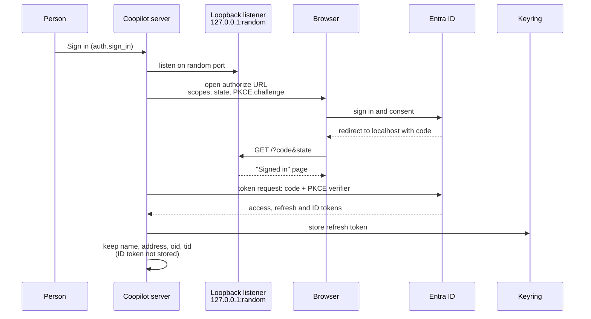
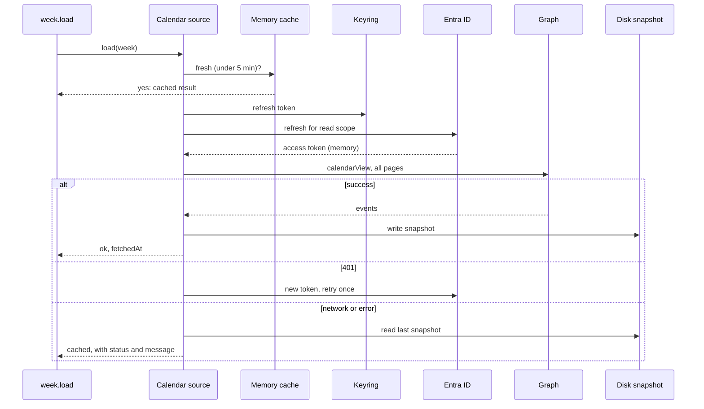

# 03. Sources and auth

Coopilot reads from five outside systems and writes to three of them (Graph, DevOps and Azure Resource Manager) in narrow, named ways. Each source fails on its own: one source down never blanks the others ([sources/calendar/source.ts](../../sources/calendar/source.ts), [sources/dataverse/source.ts](../../sources/dataverse/source.ts), [sources/devops/source.ts](../../sources/devops/source.ts)).

## Summary

| System | Identity | Reads | Writes | Fresh for | Offline |
|---|---|---|---|---|---|
| Dataverse | App-only (client credentials) as an application user | My focus time, my PTO (dates and title), my client list and their DevOps settings, teammates (name, work email, Entra object ID), who works on a client, teammates' PTO dates | None | 5 min in memory, then last good snapshot on disk | Last snapshot, marked as cached |
| Microsoft Graph (Outlook) | Delegated, the signed-in person | My calendar for the week; attendees of my meetings in a client's domain; free/busy and working hours of teammates | Coopilot's own events, my own no-attendee events, help invites, RSVPs | 5 min in memory, then snapshot | Last snapshot |
| Microsoft Graph (Teams, photos) | Delegated, same sign-in | My presence; teammates' presence for people on screen; profile photos | My own preferred presence during focus | Presence never kept; photos 7 days | Initials instead of photos; no presence |
| Google Calendar | Delegated, desktop OAuth | Events in the configured calendars for the week | None | 5 min in memory, then snapshot | Last snapshot |
| Azure DevOps | Company read PAT from Dataverse (reads); my personal write PAT per client (writes) | Open work items assigned to me; features and epics above them; process metadata | State, comment, create from draft, target date and start date, and their undos | 5 min in memory, metadata 1 h, then snapshot | Last snapshot per client |
| Azure Resource Manager | Delegated, same Microsoft sign-in | VMs tagged as mine; my confirmed VM's power state and auto-shutdown schedule | Start, deallocate, auto-shutdown daily time and status, for my confirmed VM only | Read on demand | VM chip shows Unknown |

All tokens are held in memory only. Refresh tokens and app secrets live in the OS keyring ([07-security-and-privacy.md](07-security-and-privacy.md#secrets)).

## Dataverse

**Auth.** OAuth 2.0 client credentials against `login.microsoftonline.com/<tenant-id>` with a client secret read from the keyring (account `dataverse-client-secret`) and scope `<environment-url>/.default` ([sources/dataverse/source.ts](../../sources/dataverse/source.ts) `getToken`). The identity is an application user named "Coopilot Dataverse Reader" with a custom role "Coopilot Reader" (decision D25 in [docs/decisions.md](../../docs/decisions.md)). The early spec preferred a certificate; the code uses a client secret (see [90-doc-gaps.md](90-doc-gaps.md)).

**Permissions.** Read at organization depth on Focus Time, Account, User and Account Worker (D25), plus the Time Off Tracker tables for PTO (Not verified: the role contents are configured in Dataverse, not in this repo). Placing the application user in a child business unit with no inherited roles is recommended in [docs/spec.md](../../docs/spec.md) section 0b.

**What is read.** Every query selects named columns only ([sources/dataverse/source.ts](../../sources/dataverse/source.ts)):

| Query | Table | Columns (names only) | Filter |
|---|---|---|---|
| My focus patterns | Focus Time | id, account, system user, account worker, start and end date, Mon to Thu day part, state | Rows linked to me, overlapping the week |
| Client names | Account | account id, name, reporting nickname | Accounts on my patterns |
| DevOps targets | Account Worker, Account | DevOps email; DevOps org, project id and name, and the DevOps token column (reads only) | Accounts I am an active Account Worker on |
| My PTO | Time Off Tracker and detail rows | dates and title, never hours (D105) | My rows |
| Teammates | User | system user id, full name, work email, Entra object ID | Enabled, licensed, not application users, with an email |
| Client team | Focus Time, Account Worker | user, account, dates, day parts | One of my clients |
| Team PTO | Time Off Tracker and detail rows | employee, start and end date, detail dates (no title) | Every active tracker in the date range; only who and date are kept |
| Resolve me | User | system user id | My work email from config |

**Writes.** None. No code path sends a write to Dataverse.

**The DevOps PAT column.** `devopsTargets` is the only query that selects the token column, only for clients I follow, only for accounts where I am an active Account Worker, and wraps each value in a `Pat` object at once. The write path calls it with `withPat: false`, so the column is not even selected ([sources/dataverse/source.ts](../../sources/dataverse/source.ts) `devopsTargets`, decision D60). Column security on that field is off in Dataverse today (open question Q16).

**Refresh and caching.** Results are kept 5 minutes in memory per week; the last good result is written to `~/.cache/coopilot/dataverse/<week>.json` and served when a live read fails. Teammate and client-team reads are memory only, never on disk.

**Failures in the UI.** A missing secret, rejected secret, wrong tenant or client id, unknown table or column, locked keyring and network failure each map to a plain message and a fix action ("open_settings") in the status bar ([sources/dataverse/source.ts](../../sources/dataverse/source.ts) `getToken`, `mapHttpError`, `schemaMessage`; [ui/status.ts](../../ui/status.ts)). A paging failure fails the whole read rather than showing part of it (`getAll`).

## Microsoft Graph: Outlook, Teams presence, photos

**Auth.** One Microsoft sign-in (step 15.4): authorization code with PKCE (S256) through a one-shot listener on `127.0.0.1` on a random port, in the default browser, against the "Coopilot Desktop" public client registration. No client secret. The refresh token goes to keyring account `outlook-refresh-token`. Access tokens are requested per scope set and kept in memory, renewed 5 minutes before expiry ([sources/oauth/oauth.ts](../../sources/oauth/oauth.ts)).

**Scopes**, each asked for only when its feature is turned on ([sources/oauth/oauth.ts](../../sources/oauth/oauth.ts) `microsoftProvider`, `connect`):

| Scope set | Scopes | For | Consent (per code comments) |
|---|---|---|---|
| Read | `Calendars.ReadBasic`, `offline_access` | My calendar, attendees of my meetings, teammates' free/busy | User |
| Identity | `openid profile email` with the read scope | Who signed in (name, address, object id, tenant id from the ID token) | User |
| Write | `Calendars.ReadWrite` | Coopilot's events, own events, help invites, RSVPs | User, unless the tenant blocks it (Q67) |
| Presence | `Presence.ReadWrite`, `Presence.Read.All` | My status during focus; teammates' presence | User ("no admin consent") |
| Photos | `ProfilePhoto.Read.All` | Profile photos | Admin consent in Entra |
| Azure | `https://management.azure.com/user_impersonation` | My VM | Not verified |

The browser visit asks for every enabled scope set at once; later refreshes ask for one resource each. A token error that needs a new browser visit (consent required, MFA) shows as "needs you to sign in again" ([sources/oauth/oauth.ts](../../sources/oauth/oauth.ts) `needsInteraction`).

**What is read.**

- My calendar: `GET /me/calendarView` for the week, fields `subject, start, end, isAllDay, showAs, responseStatus, isCancelled`, with immutable ids. Cancelled and declined events are dropped ([sources/graph/source.ts](../../sources/graph/source.ts), [sources/graph/normalize.ts](../../sources/graph/normalize.ts)). Next-page links to any other host are refused.
- Who suggestions: `GET /me/calendarView?$select=attendees`, keeping only names and addresses in a client's domain, never stored ([sources/graph/people.ts](../../sources/graph/people.ts)).
- Teammates' free/busy: `POST /me/calendar/getSchedule` in batches of 20; only availability and working hours are parsed; subjects and locations are never kept, logged or shown ([sources/graph/schedule.ts](../../sources/graph/schedule.ts)).
- Presence: my own (`/me/presence`) and teammates' (`POST /communications/getPresencesByUserId`, batched, for the people on screen), read as a word only ([sources/graph/presence.ts](../../sources/graph/presence.ts)).
- Photos: `/me/photos/96x96` and `/users/<object-id>/photos/96x96` ([sources/graph/photos.ts](../../sources/graph/photos.ts)).

**What is written.** Only through the write framework ([06-write-framework.md](06-write-framework.md)): events Coopilot created (marker required), my own events with no other attendees (time and show as only), help invites to allowed domains and their cancel, RSVP to meetings someone else organizes, and my own preferred presence ([sources/graph/write.ts](../../sources/graph/write.ts), [sources/graph/presence.ts](../../sources/graph/presence.ts)).

**Refresh and caching.** Calendar results: 5 minutes in memory, last good snapshot in `~/.cache/coopilot/outlook/<week>.json` ([sources/calendar/source.ts](../../sources/calendar/source.ts)). Photos: 7 days in `~/.cache/coopilot/photos` under hashed file names, cleared on sign-out ([cache/photos.ts](../../cache/photos.ts), [actions/account.ts](../../actions/account.ts)). Presence: never cached; the UI reads it every 2 minutes while the window is visible, held only in component memory ([ui/Presence.tsx](../../ui/Presence.tsx), `PRESENCE_REFRESH_MS` in [plan/presence.ts](../../plan/presence.ts)).

**Failures in the UI.** Not connected shows Connect; expired or revoked shows "Outlook needs reconnecting" with cached data; 403 shows "refused access: check the calendar permission"; a partial page set shows an error and uses none of it ([sources/calendar/source.ts](../../sources/calendar/source.ts) `map`). Without photo consent the UI shows initials.

## Google Calendar

**Auth.** Desktop OAuth client with PKCE through a loopback listener on `127.0.0.1`; the client secret comes from keyring account `google-client-secret`, the refresh token goes to `google-refresh-token` ([sources/oauth/oauth.ts](../../sources/oauth/oauth.ts) `googleProvider`).

**Scope.** `calendar.events.readonly`.

**What is read.** `events.list` for each calendar id in `[google] calendars`, single events, fields `id, status, summary, transparency, start, end, attendees(self, responseStatus)` ([sources/google/source.ts](../../sources/google/source.ts)). Google events are treated as personal.

**Writes.** None.

**Caching and failures.** Same shell as Outlook (5 minutes in memory, snapshot in `~/.cache/coopilot/google/`). A calendar id that does not exist shows "Google calendar not found: check google.calendars in config". While the Google app stays in Testing status, Google ends the sign-in after 7 days and the status bar asks to reconnect (open question Q12).

## Azure DevOps

**Auth, reads.** The company read PAT per client, from Dataverse, used only to build a Basic Authorization header to `https://dev.azure.com/<client-devops-org>/`, then dropped. It prints as `[PAT]` everywhere ([sources/devops/pat.ts](../../sources/devops/pat.ts), [sources/devops/source.ts](../../sources/devops/source.ts)).

**Auth, writes.** My personal write PAT per client (scope Work Items, Read and write), entered in Settings > Clients, stored in keyring account `devops-write-pat:<client-slug>-<hash>`, and checked against my DevOps identity (`_apis/connectionData`) before it is saved. Without it the client stays read-only ([secrets/keyring.ts](../../secrets/keyring.ts), [actions/devops-write-actions.ts](../../actions/devops-write-actions.ts), decisions D250 and D258).

**What is read** (API version 7.1) ([sources/devops/source.ts](../../sources/devops/source.ts), [sources/devops/normalize.ts](../../sources/devops/normalize.ts)):

- Process metadata: process configuration (backlog levels), work item types and states, fields (to find the order, size and target date fields).
- A WIQL query: items in the project assigned to my DevOps email whose state is not in a Completed or Removed category, ordered by the backlog order field.
- Batch reads of those items (id, title, type, state, parent, changed date, link), plus parents up to 4 levels and children 2 levels down.

Only clients I follow are fetched (decision D144). Each client is fetched, fails and is cached on its own.

**Caching.** Results 5 minutes in memory (a forced refresh at most once a minute), metadata 1 hour, last good snapshot in `~/.cache/coopilot/devops/<client-slug>-<hash>.json`.

**Failures.** Per client: "DevOps PAT expired or invalid", "No access to DevOps project", Dataverse unreachable, and so on, each on that client's row. Other clients are unaffected.

## Azure Resource Manager (my VM)

**Auth.** The same Microsoft sign-in, scope `user_impersonation` on Resource Manager. Coopilot acts as the signed-in person, so their own Azure RBAC decides what works ([sources/azure/client.ts](../../sources/azure/client.ts), [sources/oauth/oauth.ts](../../sources/oauth/oauth.ts)).

**What is read.** Resource Graph query for VMs whose Owner tag (configurable) matches the signed-in person's display name; the confirmed VM's details and instance view (power state); its auto-shutdown schedule (`shutdown-computevm-<vm-name>`). API versions: Compute 2026-04-01, Resource Graph 2024-04-01, schedules 2018-09-15.

**What is written.** Start, deallocate, and the auto-shutdown schedule's daily time and status (a full PUT), for the one VM the person confirmed. Every call takes the VM from the plan store, never from the request; any other VM is refused ([actions/vm-actions.ts](../../actions/vm-actions.ts) header).

**Failures and offline.** Errors carry a kind, HTTP status and Azure error code, never Azure's message text. The VM chip shows Unknown when status can't be read. A start or stop not visible within 15 minutes is logged as timed out.

## Sequence: the Microsoft sign-in

Sources: [sources/oauth/oauth.ts](../../sources/oauth/oauth.ts) `connect`, `waitForCode`; [actions/account.ts](../../actions/account.ts). The listener accepts only a GET to `/` with the matching state and a loopback Host, and gives up after 5 minutes.

## Sequence: one refresh cycle (Outlook shown)

Sources: [sources/calendar/source.ts](../../sources/calendar/source.ts), [cache/snapshots.ts](../../cache/snapshots.ts).
