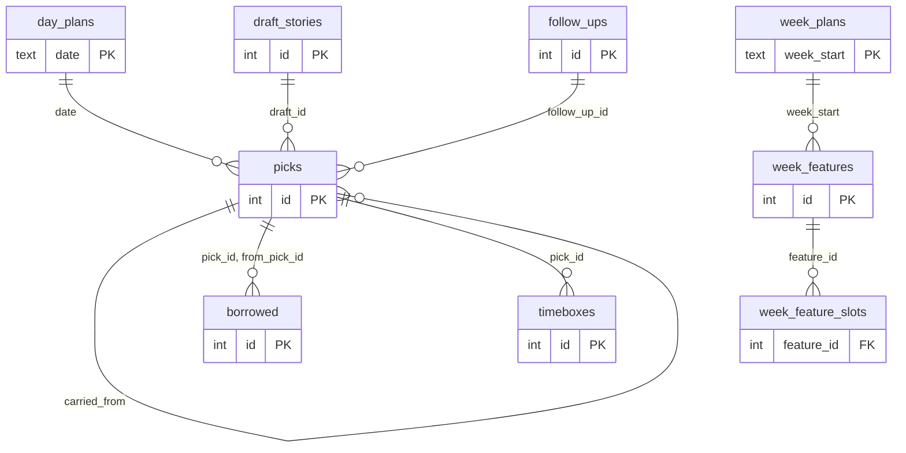
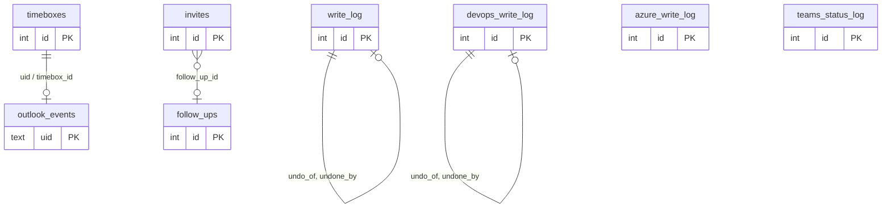

# 04. Data and persistence

Everything Coopilot keeps lives in these places under the user's home folder, all private to that user. Nothing is kept on a server.

| What | Where | Mode | Source |
|---|---|---|---|
| Plan store (SQLite) | `~/.local/share/coopilot/plan.db` (XDG data) | file 0600, folder 0700 | [store/plan-store.ts](../../store/plan-store.ts), [config/load.ts](../../config/load.ts) |
| Config | `~/.config/coopilot/config.toml` | 0600 | [config/load.ts](../../config/load.ts) |
| Cache | `~/.cache/coopilot/` | files 0600, folders 0700 | [cache/snapshots.ts](../../cache/snapshots.ts), [cache/photos.ts](../../cache/photos.ts) |
| Secrets | OS keyring, service `coopilot` | Secret Service | [secrets/keyring.ts](../../secrets/keyring.ts) |
| Launch link (per run) | `$XDG_RUNTIME_DIR/coopilot/launch.json` | 0600 | [server/main.ts](../../server/main.ts) |

## SQLite plan store

Node's built-in `node:sqlite`, WAL journal, foreign keys on. Every change runs in a `BEGIN IMMEDIATE` transaction. Timestamps are zoned strings with offset and zone ([store/plan-store.ts](../../store/plan-store.ts) `createPlanStore`; decision D71).

**Current schema version: 20.** The version is the number of entries in `MIGRATIONS`, recorded one row per applied migration in `schema_migrations`.

### Tables

Generated by reading all 20 migrations in [store/plan-store.ts](../../store/plan-store.ts). The `notes` table (migration 7) was dropped in migration 11, and `loops` was renamed `follow_ups`.

| Table | Purpose | Since |
|---|---|---|
| `day_plans` | One row per planned day: committed and closed-out times | 1, 5 |
| `picks` | Planned work in a half-day (AM, PM, EVE): item, draft or intention, size, status, carry-over link, optional follow-up | 1, 3, 12 |
| `draft_stories` | Local draft stories and draft features: title, size, parent, description, acceptance criteria, dates, DevOps id once created | 1, 7, 11, 13, 16 |
| `markers` | Once-a-day markers (reminder sent, prompt dismissed, ritual seen) | 1 |
| `unavailable` | Local time blocked as unavailable | 3 |
| `flex_sessions` | Planned client work outside working hours | 3 |
| `follow_ups` | What I owe people: client, who, what, channel, due, rule key, outcome, snooze, origin | 3, 5, 11 |
| `kv` | Small state that survives restarts (focus timer, warning points) | 4 |
| `focus_log` | Focused time per pick | 4 |
| `resume_notes` | "Where I left off" per client and day | 5 |
| `borrowed` | Slipped focus made up later: minutes, payback date, paid | 5 |
| `week_plans` | One row per planned week: committed time | 6 |
| `week_features` | Week list items per client: level, must or nice, whole blocks (features) or S/M/L (stories), parent, local order, done | 6, 8, 19 |
| `week_feature_slots` | Optional pins of a week item to a half-day | 6 |
| `breakdown_marks` | Local "being broken down" marks on features | 6 |
| `captures` | Quick captures and how each was sorted | 7, 11 |
| `timeboxes` | Local timeboxes: time, client, pick, show as, Outlook flag, sync notes | 9, 10 |
| `outlook_events` | Outlook events Coopilot created: marker uid, event id, fields last confirmed | 9 |
| `write_log` | Audit log of Outlook writes: before and after, status, undo links, attempts | 9, 10, 15 |
| `invites` | Help invites: attendees, time, status, linked follow-up | 10 |
| `devops_identities` | The DevOps identity each client's write PAT was checked against (never the PAT) | 13 |
| `devops_write_log` | Audit log of DevOps writes: op, item, before and after, rev, status, undo links | 13 |
| `delivery_snapshots` | Daily done and open story counts per owned feature or epic (Roadmap trend) | 14 |
| `azure_write_log` | Audit log of VM power and auto-shutdown changes | 17 |
| `account_state` | Who signed in, my chosen VM, a schedule change still to put back, Teams status state | 17 |
| `teams_status_log` | Every Teams status set and clear during focus | 18 |
| `roadmap_dates` | Bar dates dragged on Plan ahead, kept until saved to DevOps | 20 |
| `schema_migrations` | Applied migration numbers | 1 |

### Planning tables

Foreign keys as declared in the migrations. Small on purpose: columns are trimmed to the keys and a few that explain the link.

`week_plans` to `week_features` is by matching `week_start`, not a declared foreign key. The other links are declared `REFERENCES`.

### Write and audit tables

Only the `undo_of` and `undone_by` links are declared foreign keys here; the others are matched in code.

### Migrations and backups

From `migrate` in [store/plan-store.ts](../../store/plan-store.ts):

1. A store from a newer schema than the code knows is refused ("Plan store is from a newer Coopilot"), not guessed at.
2. Before migrating a store that already has data, a full copy is written next to it as `plan.db.bak-v<from>-<stamp>` with `VACUUM INTO`, mode 0600 (decision D125).
3. Each migration runs in its own transaction and is recorded in `schema_migrations`. A table rebuild turns foreign keys off around it and runs `foreign_key_check` before commit; a broken reference rolls the migration back.
4. Shipped migrations are never edited; changes are new entries.

If the store can't open at all, the week view still works and plan actions say the store is unavailable ([server/main.ts](../../server/main.ts)).

Backup files are not pruned by the code (Not verified that nothing else removes them).

## config.toml

Parsed with `smol-toml` and validated per field. Errors come back as a list of `{ field, message }` and show in Settings naming the bad field. An unknown section is an error. On first run a commented starter file is written (0600, never overwriting) ([config/schema.ts](../../config/schema.ts), [config/load.ts](../../config/load.ts), [config/starter.ts](../../config/starter.ts)).

| Section | Holds | Validation highlights |
|---|---|---|
| `[dataverse]` | Environment URL, tenant id, client id, my work email, my system user id | URL must be `https://` and end in `.dynamics.com` with no path; ids must be GUIDs; email checked |
| `[hours]` | Time zone, lunch (the AM/PM split), spans per weekday, one-day overrides | IANA zone; `HH:MM`; overlaps refused |
| `[day_shape]` | Old form, migrated once to `[hours]` with a backup | Not allowed together with `[hours]` |
| `[risk]` | Meeting watch and at-risk minutes, minimum focus window | Whole numbers; at-risk at least watch |
| `[[standing_blocks]]` | Fixed blocks from config | Day Mon to Thu, AM or PM, a client nickname |
| `[clients]` | Per client: color, display name, link browser and profile, open states, follow | Palette slot or `#rrggbb`; unknown fields refused |
| `[outlook]` | Tenant id, client id of the desktop registration | GUIDs |
| `[google]` | Client id, calendar ids | Non-empty list |
| `[plan]` | S/M/L minutes, carry days, reminder offsets (plan the day, Check-in, Close out), week nudge times, focus and break lengths, pickable portfolio types, follow grace days, end sound | Ranges per field |
| `[edge]`, `[chromium]` | Where work item links open | Profile directory checks |
| `[ui]` | Theme, view range, timelines on cards | Known values |
| `[secrets]` | Expiry dates I entered for app secrets (not the secrets) | Dates |
| `[focus]` | Sounds, playlists, pause media, Teams status choices | Known values |
| `[timebox]` | Put on Outlook default, confirm own changes, use timeboxing | Booleans |
| `[collab]` | Help session length, Teams link, days ahead, invite domains, people to exclude | Lengths 15/30/45/60/90; days 1 to 10 |
| `[azure]` | Owner tag name and value, start without asking | Tag name 1 to 128 safe characters |
| `[notify]` | Switch per kind, quiet hours, quiet on PTO | Known kinds |
| `[roadmap]` | Thresholds for Roadmap states | Whole numbers |

Settings edits keep comments and order: the current file is copied to `~/.config/coopilot/backups/config-<stamp>.toml` (0600) first, the new text is validated, then it replaces the file atomically. The last 30 backups are kept ([config/edit.ts](../../config/edit.ts) `KEEP_BACKUPS`).

The config holds identifiers (tenant id, client ids, environment URL, email) but no secrets. It is not committed to git ([CLAUDE.md](../../CLAUDE.md#working-style)).

## Cache folder

`~/.cache/coopilot/` is safe to delete at any time; Coopilot refetches ([docs/spec.md](../../docs/spec.md) section 10).

| Subfolder | Holds | Written when |
|---|---|---|
| `dataverse/<week>.json` | My normalized focus patterns | Each good live read |
| `pto/<key>.json` | My PTO dates and titles | Each good live read |
| `outlook/<week>.json`, `google/<week>.json` | Normalized events for the week | Each good live read |
| `devops/<client-slug>-<hash>.json` | Normalized work items and detected field names per client | Each good live read |
| `photos/<hash>.json` and image | Profile photos, 96 px, file names hashed from the Entra object id | On read; kept 7 days |

Snapshots hold normalized fields only, never tokens, PATs or raw bodies ([cache/snapshots.ts](../../cache/snapshots.ts), [sources/devops/source.ts](../../sources/devops/source.ts) header). Disconnecting a calendar deletes its cache folder ([sources/calendar/source.ts](../../sources/calendar/source.ts) `disconnect`). Signing out clears the Outlook cache and the photo cache ([actions/account.ts](../../actions/account.ts)).

## What is kept, and for how long

| Data | Kept | Source |
|---|---|---|
| Plan, follow-ups, captures, timeboxes, write logs | Until Reset local plan (write logs survive Reset) | [store/plan-store.ts](../../store/plan-store.ts) `RESET_TABLES` |
| Roadmap daily counts | 120 days | [store/plan-store.ts](../../store/plan-store.ts) (delete older than 120 days) |
| Source snapshots | Until replaced or the cache is deleted | [cache/snapshots.ts](../../cache/snapshots.ts) |
| Profile photos | 7 days, refreshed in the background | [cache/photos.ts](../../cache/photos.ts) |
| Teammates' presence | Never stored | [actions/presence-actions.ts](../../actions/presence-actions.ts) |
| Teammates' free/busy and event details | Never stored; only availability is parsed | [sources/graph/schedule.ts](../../sources/graph/schedule.ts) |
| Config backups | Last 30 | [config/edit.ts](../../config/edit.ts) |
| Plan store backups | Not pruned | [store/plan-store.ts](../../store/plan-store.ts) |
| Access tokens | Memory, until expiry or restart | [sources/oauth/oauth.ts](../../sources/oauth/oauth.ts) |

## Export and reset

**Export** (`data.export`, Settings > Data): writes the whole plan as JSON to `~/.local/share/coopilot/exports/plan-<stamp>.json`, mode 0600. It includes plan tables, the write logs and the DevOps identities (name and email of the checked identity), but not tokens or secrets. It does not include `kv`, `markers`, `focus_log`, `delivery_snapshots` or `account_state` ([store/plan-store.ts](../../store/plan-store.ts) `exportJson`, [actions/settings-actions.ts](../../actions/settings-actions.ts)). A command-line export also exists: `node scripts/plan-export.ts [out.json]` ([scripts/plan-export.ts](../../scripts/plan-export.ts)). Export is refused in demo mode.

**Reset local plan** (`plan.reset`, Settings > Data): needs a typed confirmation. It first writes `plan.db.bak-reset-<stamp>` (0600), then empties the plan tables in one transaction. Tables it does not empty: `outlook_events`, `write_log`, `invites`, `devops_identities`, `devops_write_log`, `azure_write_log`, `teams_status_log`, `account_state`, `markers`, `delivery_snapshots` and `roadmap_dates`. Keeping the Outlook records and logs is what lets Coopilot still find, undo and remove its own Outlook events (decision D136; [store/plan-store.ts](../../store/plan-store.ts) `RESET_TABLES`, `reset`).
