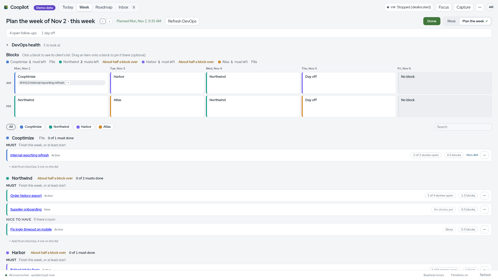

# 05. Planning model

All of this is pure code in `week/` and `plan/`: no I/O, no tokens, deterministic, unit tested.

## Half-days and slot boundaries

Working hours come from `[hours]` in config: a time zone, spans per weekday, a lunch, and one-day overrides ([week/hours.ts](../../week/hours.ts), decision D122).

- The **first span** of a day is the normal workday. It splits into **AM** and **PM** at lunch: the lunch start ends the morning and the lunch end starts the afternoon. With no lunch, it splits in the middle.
- **Spans after the first** (a split day with an evening) form an **EVE** slot.
- A weekday with no spans is a day off. Friday has no spans by default.
- Half-days are units of commitment, not strict clock windows. Hours exist to place meetings into AM or PM and to estimate capacity (decision D29; [docs/spec.md](../../docs/spec.md) section 6).

Risk, free time and meeting load count only inside working time ([week/risks.ts](../../week/risks.ts) `windows`).

## Focus blocks

A Focus Time row in Dataverse is a weekly **pattern**: for each weekday Mon to Thu, AM, PM or All Day, between a start date and an optional end date. A blank end date means ongoing. Coopilot expands patterns into blocks for the week (decisions D26, D27; [week/patterns.ts](../../week/patterns.ts), [sources/dataverse/normalize.ts](../../sources/dataverse/normalize.ts)).

- **Standing blocks** come from config (`[[standing_blocks]]`, for example Monday AM Internal). If Dataverse has a client block in the same half-day, both show and the slot is flagged double-booked (D30).
- A Mon to Thu half-day with no block is **Open**: free for client or internal work, offered to followed clients only (D28, D144).
- A client is **followed** while it has a Focus Time pattern that is ongoing, ends today or later, or ended within `follow_grace_days` (default 14); standing-block and "Keep following" clients always. Only followed clients get DevOps fetches ([week/follow.ts](../../week/follow.ts), [actions/follow.ts](../../actions/follow.ts)).

## PTO

My PTO comes from Dataverse Time Off Tracker rows: dates and the tracker title, never hours. Every PTO day is a whole day off: no risks, no picks, skipped as a planning target, zero free time. Hours are not used (decisions D105, D106; [week/pto.ts](../../week/pto.ts), [week/free.ts](../../week/free.ts)). When a tracker has detail rows, those dates are used; with none, every weekday from start to end (D109). Teammates' PTO shows only as "away".

## Friday overflow

Friday is not scheduled and has no focus blocks. The week shows it as a lighter overflow column with meetings and personal events. Picks can move there for catch-up without a prompt, even though Friday has no working hours by default (decisions D26, D238; [ui/WeekGrid.tsx](../../ui/WeekGrid.tsx)). Plan the day does not target Friday by default (D107).

## Risk rules

Evaluated per half-day that has a focus block ([week/risks.ts](../../week/risks.ts) `evaluateRisks`). Events marked free or working elsewhere are ignored; missing show-as counts as busy; tentative counts as busy. Declined and cancelled Outlook events never arrive ([sources/graph/normalize.ts](../../sources/graph/normalize.ts)). Thresholds are in `[risk]`; defaults below are the starter file's ([config/starter.ts](../../config/starter.ts)).

| Rule | Condition | Severity |
|---|---|---|
| Meeting load | Busy work meeting minutes inside the block ≥ `meeting_watch_minutes` (90) | Watch |
| Meeting load | ≥ `meeting_at_risk_minutes` (150) | At risk |
| Personal conflict | A busy personal (Google) timed event overlaps working time in the block | At risk |
| Personal conflict | A busy all-day personal event that day | Watch |
| Out of office | An Outlook out-of-office event overlaps the block, or an all-day one covers it | At risk |
| All-day busy | An all-day Outlook event that is busy (or has no show-as) | Watch |
| No focus window | Longest free stretch < `min_focus_window_minutes` (90) | At risk |
| Double-booked | More than one focus block in the half-day | At risk |

Unavailable time counts as busy but not as a meeting. A card shows one badge, ranked at risk before watch, then out of office, personal conflict, double-booked, no focus window, all-day, meetings ([week/risks.ts](../../week/risks.ts) `rankRisks`). The card's single status is At risk, Too much planned, Fits just or Fits ([plan/blockstatus.ts](../../plan/blockstatus.ts)).

## Client weekly budget

A client's budget is a whole number of blocks for the week ([plan/weekplan.ts](../../plan/weekplan.ts) `weekBudget`, `blockCounts`):

1. Start with the client's focus blocks that week, plus any Open half-days a week item of that client is pinned to.
2. Drop days off (PTO): "Thu AM: day off".
3. Drop half-days with **under 120 minutes free** after meetings and personal events: "Wed AM: mostly meetings".
4. Subtract whole blocks of unpaid borrowed time (rounded down, using the client's average block length).

Planned is the whole blocks of the client's **musts** only. The status reads "All 3 planned", "1 block free", "4 planned, 3 available" or "No blocks this week" ([plan/estimate.ts](../../plan/estimate.ts) `budgetWords`).

## Estimating

Two units, whole numbers only, never fractions on screen (decision D334; [plan/estimate.ts](../../plan/estimate.ts)):

- **Features** in whole **blocks**, 1 to 20, or empty to take what their stories add up to.
- **Stories** sized **S**, **M** or **L**: about an hour, a couple of hours, about a whole block. New stories default to M.
- Internally a block is four quarters: S = 1, M = 2, L = 4. That math is never shown.
- A story whose parent feature is on the same client's list nests under it (the feature is an **envelope**). Nested stories fill the feature's blocks and never add to the total. If they need more than the feature's blocks, the row says "Stories need more than 2 blocks. Raise to 3?"; if fewer, "needs more stories".
- Loose stories (no listed parent) are added up and rounded up to whole blocks together.
- Picks in Plan the day use the same S/M/L, with minutes per size from `[plan] size_s`, `size_m`, `size_l`.

The plan store enforces this: `week_features.blocks` is an integer 1 to 20 and only on features; `size` is S, M or L and only on stories (migration 19 in [store/plan-store.ts](../../store/plan-store.ts)).

## Musts and nice to haves

Each item on a client's week list is a **Must** (should be completed this week and definitely touched; counts against the budget) or a **Nice to have** (worked on if there's room; doesn't count). Lists come from DevOps in stack rank order; a local reorder is never written back. A must is a target, not a contract: one click moves it. Dropping or demoting a committed must offers a heads-up follow-up ([actions/registry.ts](../../actions/registry.ts) `weekplan.set_tier`, `weekplan.reorder`, `weekplan.headsup`; [plan/weeklist.ts](../../plan/weeklist.ts)).

## Follow-ups

A follow-up is something I owe someone: client, who (optional), what, channel, optional due date ([store/plan-store.ts](../../store/plan-store.ts) `follow_ups`). Rules open them deterministically; no AI ([plan/followups.ts](../../plan/followups.ts), [actions/followup-rules.ts](../../actions/followup-rules.ts)):

| Rule (kind in code) | Opens when | Closes when |
|---|---|---|
| DevOps update (`devops_update`) | A pick on a DevOps item is ticked done while the item is still open in DevOps | The item reaches a Completed or Removed state, or I change it in DevOps after the follow-up opened (D156) |
| Slip (`slip`) | A pick slips on or after its day on a committed client day | By me |
| Blocker nudge (`blocked`) | An open item assigned to me is blocked (fresh DevOps data only) | The block clears; reopens after 3 workdays if closed by hand while still blocked (D157) |
| Priorities (`priorities`) | A client block next week has no open work assigned to me | By me |
| Heads-up | A committed must is dropped or demoted, or committed work leaves the week | By me |
| Flex session ended | A flex session ends | By me |
| Manual or capture | I add it | By me |

Closing options: Close the loop (with how: Teams, email, DevOps, call, and a note), Not needed (closed quietly, not counted done), Snooze until a day, Delete (only for ones I added). Due badges: Due <day>, Due tomorrow, Due today, Overdue N days ([plan/due.ts](../../plan/due.ts)). Nothing is ever posted anywhere by a follow-up.

## Capture kinds

One capture box, saved at once to the local store ([plan/capture.ts](../../plan/capture.ts), [actions/capture-actions.ts](../../actions/capture-actions.ts)). Kind chips under the box: **Sort later**, **Follow-up**, **Draft story**, **Draft feature**. Rules highlight one while typing (an `@client` tag sets the client; "by Friday" style words set a due date). Unsorted captures wait in the Inbox. The stored kinds are `follow_up`, `draft` and `draft_feature` (CaptureKind), plus `left_off` and `dismissed` as sort results in the `captures` table.

## Worked example (demo week)

The demo data is fictional ([sources/demo/data.ts](../../sources/demo/data.ts)). Hours are 09:00 to 17:00 Mon to Thu with the split at 12:30, so AM is 210 minutes and PM is 270. Thursday is PTO. Thresholds are 90, 150 and 90. I worked these numbers by hand from the code's rules and an independent reviewer recomputed them; they were not read from a running demo (Not verified against the UI). An event is clipped into every half-day it overlaps ([week/placement.ts](../../week/placement.ts)).

Patterns: Northwind Mon PM and all of Wednesday; Harbor Tue AM and Thu AM; Atlas Tue PM and Thu PM; a standing Cooptimize block Mon AM.

| Block | Busy time in working hours | Free | Risks | Counts for budget? |
|---|---|---|---|---|
| Mon AM Cooptimize | Standup 9:00 to 9:15; proposal review 11:00 to 11:45; dentist (personal) 12:00 to 12:30 | 120 min, longest 105 | Personal conflict (at risk) | Yes |
| Mon PM Northwind | Dentist 12:30 to 13:00; status 13:00 to 13:30; data model review 15:00 to 16:00 | 150 min, longest 90 | Meeting load 1h 30m (watch); personal conflict (at risk) | Yes |
| Tue AM Harbor | Standup; sprint planning 10:00 to 11:00 | 135 min, longest 90 | None | Yes |
| Tue PM Atlas | Refinement 13:00 to 14:00; demo 14:00 to 15:30 (tentative, so busy); school pickup (personal) 15:30 to 16:00 | 90 min, longest 60 | Meeting load 2h 30m (at risk); personal conflict (at risk); no focus window (at risk) | No: mostly meetings |
| Wed AM Northwind | Standup; workshop 9:30 to 11:30; lunch and learn 12:00 to 12:30 (tentative, so busy) | 45 min, longest 30 | Meeting load 2h 45m (at risk); no focus window (at risk) | No: mostly meetings |
| Wed PM Northwind | Lunch and learn 12:00 to 12:45, of which 12:30 to 12:45 is in PM (tentative) | 255 min | None | Yes |
| Thu AM Harbor, Thu PM Atlas | PTO | 0 | None (PTO days have no risks) | No: day off |

Budgets: Northwind 2 blocks (Mon PM, Wed PM), Harbor 1 block (Tue AM), Atlas 0 ("No blocks this week"). If Northwind has a 2-block feature as a must plus two loose M stories as musts, planned is 2 + 1 = 3 and the status reads "3 planned, 2 available". The two M stories make 4 quarters, one block.

