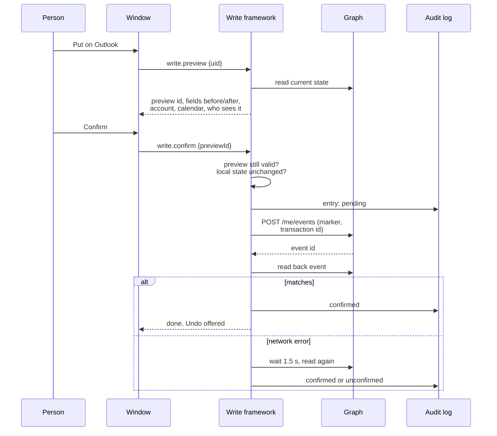

# 06. Write framework

Every change Coopilot makes outside the machine goes through one pattern. Nothing writes on a single click unless noted below ([actions/timebox-actions.ts](../../actions/timebox-actions.ts) header, [actions/devops-write-actions.ts](../../actions/devops-write-actions.ts) header, [actions/vm-actions.ts](../../actions/vm-actions.ts) header).

## The steps

1. **Named action.** The change is one of a fixed set of action names in the registry, with narrow inputs. Unknown input fields are refused ([actions/registry.ts](../../actions/registry.ts), `fields` helpers in [actions/timebox-actions.ts](../../actions/timebox-actions.ts)).
2. **Validation.** Inputs are checked for type, length and format (ids are positive whole numbers, dates are real dates, links must start with `https://dev.azure.com/`, and so on).
3. **Preview.** The server reads the target now and builds a preview: system, account or org, calendar or project, item, every field before and after, link changes, who will see it. The preview is held on the server for **5 minutes** under an id (`PREVIEW_MS`).
4. **Confirm.** The UI sends only the preview id. An expired preview is refused ("Review the change again"). If the local thing changed since the preview, confirm is refused.
5. **Revision check.** DevOps patches start with a JSON Patch `test` on `/rev`, so a change made by someone else since the preview fails with "Changed in DevOps since you loaded it" instead of overwriting it ([plan/devopswrite.ts](../../plan/devopswrite.ts), [sources/devops/write.ts](../../sources/devops/write.ts)). Outlook update and delete re-read the event and refuse unless the marker matches ([sources/graph/write.ts](../../sources/graph/write.ts)).
6. **Write.**
7. **Read back.** The target is read again and compared with what was meant. Only then is the write reported as done. If the read back fails on a network error, Coopilot waits 1.5 s and reads once more before settling it as "Not confirmed" ([actions/readback.ts](../../actions/readback.ts), decision D255).
8. **Audit log.** Every attempt is recorded with when, where, before and after values, status (pending, confirmed, unconfirmed, failed, refused) and attempt count ([store/plan-store.ts](../../store/plan-store.ts) `write_log`, `devops_write_log`, `azure_write_log`, `teams_status_log`). Settings > Data shows them with Undo and Retry.
9. **Retry.** Retry checks the target first, so a write that actually landed is not done twice. Outlook creates carry a transaction id for the same reason ([sources/graph/write.ts](../../sources/graph/write.ts) `createBody`).
10. **Undo.** An undo is itself a previewed, confirmed, logged write. Undo is a stack per target: the newest change must be undone first. An undo is refused if the target changed after Coopilot's change, because it would overwrite someone else's work ([actions/devops-write-actions.ts](../../actions/devops-write-actions.ts) undo section; open question Q68).

In demo mode, every confirm and retry is refused ([actions/dispatch.ts](../../actions/dispatch.ts) `DEMO_REFUSED`).

## Sequence: one write, end to end (Put a timebox on Outlook)

## Every action that writes outside the machine

| Action (registry) | Target | What it changes | Guardrails | Undo |
|---|---|---|---|---|
| Put a timebox on Outlook (`write.preview` / `write.confirm`, kind timebox) | Outlook, my calendar | Creates one Busy event "<client>: <item>", no attendees, no reminder, with the Coopilot marker | Write scope must be granted; preview and confirm | Deletes that event (marker checked) |
| Move, resize or remove a Coopilot event (kind timebox, sync) | Outlook | Time, show as, or delete, only on events with the marker | Marker must match on re-read; conflict when both sides changed | Puts it back (a sync from Outlook, kind sync, has no undo) |
| Change my own event (kind event) | Outlook | Time and show as of an event I organize with no other attendees | Not repeating, not all-day; marker never added; preview first (can be skipped with `confirm_own` off, still logged) | Puts the old values back |
| Send a help invite (`collab.preview_invite`, kind invite) | Outlook | Creates a meeting "<client>: help on <item>" with chosen Cooptimizers | Attendees only in allowed domains (`[collab] domains`, else my email's domain); marker `inv-...` | Cancels the meeting (sends a cancellation) |
| RSVP (`write.preview {rsvp}`, kind rsvp) | Outlook | Accept, tentative or decline, with optional note and proposed time, on a meeting someone else invited me to | Only Graph accept, tentativelyAccept or decline; refused for meetings I organize, Coopilot's, with nobody else, or cancelled; never PATCH, DELETE or cancel | A new response restoring the previous one; none when there was no previous response ([plan/timebox.ts](../../plan/timebox.ts) `undoOf`) |
| DevOps state change (`devops.preview`, kind state) | One client's DevOps | Item state, optional comment in the same patch | Write PAT for that client; identity matches Dataverse; state must exist for the type; `test /rev` | Puts the state back (and deletes that comment) |
| DevOps comment (kind comment) | One client's DevOps | Adds a comment | Same | Deletes the comment Coopilot added |
| Create in DevOps (kind create) | One client's DevOps | Creates a story or feature from a local draft: title, description, acceptance criteria, parent link, area and iteration from the parent, size or dates | Parent required and open; type from the process's backlog levels | Sets the item to its type's Removed state with a comment; never deletes |
| Set target date / Save dates (kind target_date) | One client's DevOps | Target date, and Start Date in the same patch when given | Only features and epics assigned to me; refused if the type has no such field | Puts the old dates back |
| Start, Stop (deallocate) my VM (`vm.preview` / `vm.confirm`) | Azure, my confirmed VM | Power state | Only the VM in the plan store; polled until Azure shows it, up to 15 minutes | None; the opposite action is offered |
| Start my VM now (`vm.start_now`) | Azure | Starts the VM from the morning prompt with no separate preview | Only when Settings > You "Start my VM without asking" is on (default on); only the confirmed VM; logged and polled | None |
| Delay 1h, Delay 2h, Skip tonight (`vm.preview`) | Azure, auto-shutdown schedule | Daily time or status of `shutdown-computevm-<vm>` | Only that schedule; put back the next morning automatically | Restore (`vm.restore`) |
| Teams status during focus (no registry action; runs from the focus timer) | Graph presence | My preferred presence: Busy or Do not disturb, expiring at the time left plus 5 minutes; cleared when focus ends | Only my own user; left alone after a manual change; logged; no preview | Cleared at session end |

Sources: [sources/graph/write.ts](../../sources/graph/write.ts), [actions/timebox-actions.ts](../../actions/timebox-actions.ts), [actions/outlook-sync.ts](../../actions/outlook-sync.ts), [actions/collab-actions.ts](../../actions/collab-actions.ts), [plan/rsvp.ts](../../plan/rsvp.ts), [actions/devops-write-actions.ts](../../actions/devops-write-actions.ts), [sources/devops/write.ts](../../sources/devops/write.ts), [actions/vm-actions.ts](../../actions/vm-actions.ts), [sources/azure/client.ts](../../sources/azure/client.ts), [actions/presence-actions.ts](../../actions/presence-actions.ts), [sources/graph/presence.ts](../../sources/graph/presence.ts).

Nothing writes to Dataverse, Google, other Teams data (no messages, no posts), or any other Azure resource ([CLAUDE.md](../../CLAUDE.md#hard-rules)).

## The calendar editing rule

Coopilot only edits what it created or what only I can see ([plan/caltier.ts](../../plan/caltier.ts), [sources/graph/write.ts](../../sources/graph/write.ts)). Each Outlook event falls in one tier:

| Tier | Which events | What Coopilot may do |
|---|---|---|
| Coopilot | Events with Coopilot's marker | Fully editable, two-way sync, conflict choice |
| Invite | Help invites Coopilot sent | Cancel only |
| Mine | I organize it, no other attendees, not repeating, not all-day | Move, resize, show as; marker never added |
| Meeting | Anyone else on it | Open in Outlook only; plus Accept, Tentative, Decline when someone else organizes it |

An event edited in Outlook is followed by its timebox. If both sides changed, Coopilot asks: keep Coopilot's or use Outlook's (decision D218). A Coopilot event deleted in Outlook is kept as "Removed in Outlook".

## The DevOps rules

From [actions/devops-write-actions.ts](../../actions/devops-write-actions.ts) and decision D250:

- Only the named writes above. No other field, no other endpoint.
- Writes use my personal write PAT for that client, read from the keyring and wrapped so it can't be printed. The company read PAT from Dataverse is never read on the write path.
- Before a PAT is saved, its identity is checked with `_apis/connectionData`; before each write, that identity must still match my DevOps email for the client in Dataverse, and the org must not have changed.
- Every request goes only to `https://dev.azure.com/<client-devops-org>/` for that client. Redirects are not followed; a redirect or HTML answer is treated as an invalid PAT.
- Work items are never deleted. The one delete in the code is a comment Coopilot itself added, removed on undo.
- Errors show DevOps's own `message` cut to 300 characters; bodies, headers and PATs are never logged.
