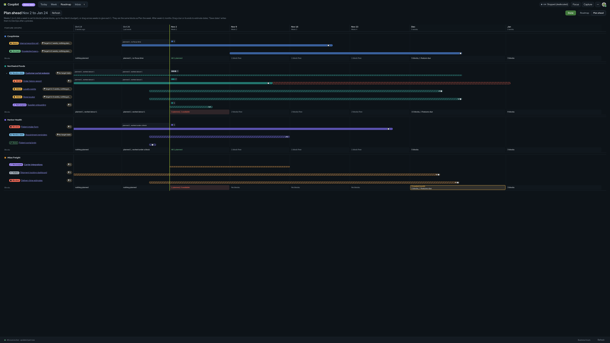

# 08. UI

A React 19 single-page app served by the local server and opened as a Chromium app window ([ui/main.tsx](../../ui/main.tsx), [ui/App.tsx](../../ui/App.tsx)). It holds no secrets and calls only `POST /api/action` ([ui/api.ts](../../ui/api.ts)).

## Views and modes

Four tabs, each with a mode switch at the right of its header, and two full-window overlays ([ui/nav.ts](../../ui/nav.ts), [ui/ModeSwitch.tsx](../../ui/ModeSwitch.tsx)).

| Tab | Mode | Address | Main file |
|---|---|---|---|
| Today | Now | `#/today` | [ui/Today.tsx](../../ui/Today.tsx) |
| Today | Plan (Plan the day) | `#/today/plan` | [ui/PlanDay.tsx](../../ui/PlanDay.tsx) |
| Today | Check-in | `#/today/checkin` | [ui/CheckIn.tsx](../../ui/CheckIn.tsx) |
| Today | Close out | `#/today/closeout` | [ui/CloseOut.tsx](../../ui/CloseOut.tsx) |
| Week | Week | `#/week` | [ui/WeekGrid.tsx](../../ui/WeekGrid.tsx) |
| Week | Plan the week | `#/week/plan` | [ui/PlanWeek.tsx](../../ui/PlanWeek.tsx) |
| Roadmap | Roadmap | `#/roadmap` | [ui/Roadmap.tsx](../../ui/Roadmap.tsx) |
| Roadmap | Plan ahead | `#/roadmap/ahead` | [ui/PlanAhead.tsx](../../ui/PlanAhead.tsx) |
| Inbox | (one view) | `#/inbox` | [ui/Inbox.tsx](../../ui/Inbox.tsx) |
| Overlay | Focus screen | `#/focus` | [ui/FocusScreen.tsx](../../ui/FocusScreen.tsx) |
| Overlay | Settings | `#/settings/<section>` | [ui/Settings.tsx](../../ui/Settings.tsx) |

Addresses can carry more: `#/today/plan/2026-11-03/PM` (a day and block), `#/today/closeout/<date>`, `#/week/plan/<monday>`, `#/inbox/<follow-up id>`. The parser rejects any other shape ([ui/nav.ts](../../ui/nav.ts) address parser); what the window then shows was not checked (Not verified).

Other pieces: the status bar groups source failures by root cause so a locked keyring shows once ([ui/status.ts](../../ui/status.ts), [ui/StatusBar.tsx](../../ui/StatusBar.tsx)); the VM chip in the header ([ui/Account.tsx](../../ui/Account.tsx)); the Quick capture dialog ([ui/Capture.tsx](../../ui/Capture.tsx)); the draft editor ([ui/DraftEditor.tsx](../../ui/DraftEditor.tsx)); the write preview dialogs ([ui/Timeboxes.tsx](../../ui/Timeboxes.tsx), [ui/DevOpsWrite.tsx](../../ui/DevOpsWrite.tsx)); "Needs help from..." ([ui/HelpFinder.tsx](../../ui/HelpFinder.tsx)); `/styleguide` ([ui/StyleGuide.tsx](../../ui/StyleGuide.tsx)).

## Keyboard shortcuts

From the one list in [ui/keys.ts](../../ui/keys.ts) `KEYS` (the key legend shows it and a test checks the command menu matches). Global keys never fire while typing in a field, and never reach views behind an open dialog or menu (`globalKeyAllowed`).

| Keys | Does |
|---|---|
| ← → ↑ ↓ | Move between half-days (↓ from the afternoon reaches the evening) |
| Enter, Space | Details of the selected half-day |
| A | Add work to the selected block |
| Tab, Shift Tab | Items and menus of the selected half-day, then the next part of the window |
| F6, Shift F6 | Next or previous region: top bar, week, panel, status bar |
| O | Open the focused work item in its client's Edge profile |
| Shift F10, Menu | Actions (⋯) for what has focus |
| 1 or T, 2, 3, 4 or L | Today, Week, Roadmap, Inbox |
| P | Plan mode for this tab, and back (I also works) |
| N | Quick capture |
| W | Week › Plan the week |
| C | Done, in Today › Plan |
| ← → | Previous or next day, in Today › Plan |
| [ and ] | Previous and next week |
| R | Refresh all sources |
| H | View range: business hours, 12 hours, 24 hours |
| V | Timelines on cards on or off (medium widths) |
| Ctrl K | Command menu |
| F | Focus timer |
| M | Today › Check-in |
| E | Today › Close out |
| , | Settings |
| ? | This list of keys |
| Esc | Close the menu or dialog on top; in a plan mode, back without saving |

Outside the window, `coopilot-open` is bound to Super + Alt + C (open) and Super + Alt + N (Quick capture) in the user's Hyprland config ([CLAUDE.md](../../CLAUDE.md#glossary-use-these-words-in-code-ui-and-chat); the binding file is not in this repo).

## Command menu

Ctrl+K (or ⋯ > Commands) lists every action in the registry with its title, group and shortcut. Because the menu, the dispatcher and a future chat panel all read the same list, a new action shows up everywhere at once ([actions/registry.ts](../../actions/registry.ts), [ui/menu.ts](../../ui/menu.ts), [ui/Menus.tsx](../../ui/Menus.tsx); decision D101). Item and day menus (⋯) are built from the same registry.

## Settings sections

In this order ([ui/Settings.tsx](../../ui/Settings.tsx) `SETTINGS_SECTIONS`):

| Section | Holds |
|---|---|
| You | Signed-in person, Sign out, Azure write log, Teams status log, Allow Teams status, Allow photos, Start my VM without asking |
| Working hours | `[hours]`: spans per weekday, lunch, one-day overrides |
| Standing blocks | `[[standing_blocks]]` |
| Planning | Sizes, carry-over, reminders, timer defaults, Use timeboxing, help sessions |
| Focus | Sounds, playlists, pause media, Teams status choices |
| Notifications | A switch per kind, quiet hours, test and sample notifications |
| Roadmap | Thresholds for the Roadmap states |
| Risk rules | `[risk]` thresholds |
| Clients | Per client: name, color, link browser and profile, open states, follow; DevOps write access |
| Connections | Microsoft sign-in and scopes, Google, app secrets |
| Display | Theme, view range, timelines, Show demo data |
| Data | Export, audit logs (Outlook and DevOps) with Undo and Retry, Reset local plan |

Every save goes through `settings.save`, which writes config with a backup ([actions/settings-actions.ts](../../actions/settings-actions.ts), [config/edit.ts](../../config/edit.ts)). The per-section contents above come from [CLAUDE.md](../../CLAUDE.md) and the config sections; not every control was checked in [ui/Settings.tsx](../../ui/Settings.tsx) (Not verified in full).

## Theming and brand tokens

- Three themes: **Cooptimize Dark** (default), **Cooptimize Light**, and **Neutral**, which follows the system light or dark setting ([config/schema.ts](../../config/schema.ts) `THEMES`, `DEFAULT_UI`; [ui/styles.css](../../ui/styles.css)).
- Tokens come in three layers in [ui/styles.css](../../ui/styles.css): primitives (palette), semantic (surface, text, border), and domain (client colors, risk, status). Themes override layers 2 and 3 under `data-theme` on `<html>`. Contrast is held to WCAG AA; a test checks token pairs ([ui/tokens.test.ts](../../ui/tokens.test.ts)).
- Clients use an eight-slot palette (teal, violet, ochre, blue, rose, earth, green, slate) or a hex color from config.
- Font: Red Hat Display, bundled ([ui/fonts/](../../ui/fonts/)).
- **Branding is being integrated in step 17.5** in the main checkout. This branch has the delivered brand assets ([assets/brand/](../../assets/brand/)) and the brief ([docs/design/brand-brief.md](../../docs/design/brand-brief.md)), but the UI may change after these docs were written.

## Reduced motion

The CSS has two `prefers-reduced-motion: reduce` rules: one stops the notice fade, one stops the VM chip's busy pulse ([ui/styles.css](../../ui/styles.css)). There are only a handful of animations or transitions in the stylesheet. No JavaScript checks the setting. Whether every animation is covered was not checked (see [90-doc-gaps.md](90-doc-gaps.md)).

## Responsive behavior

The week picks one of three layouts from the window width. Breakpoints come from what the content needs ([ui/viewport.ts](../../ui/viewport.ts)):

| Layout | Minimum width | What you see |
|---|---|---|
| Wide | 3002 px | Each Mon–Thu column has a 330 px rail plus an hour timeline; Friday at 0.6 width |
| Medium | 1134 px | Each Mon–Thu column is a compact card (at least 210 px), with an optional compact time ruler (V) |
| Narrow | below 1134 px | One day at a time; rail plus timeline while they fit (662 px), else the compact card |

So at **1920** px the week uses the medium layout, and at **3840** px (the author's ultrawide) it uses the wide layout. Demo screenshots at both sizes are in [docs/demo/](../demo/) (for example [17-plan-ahead-3840.png](../demo/17-plan-ahead-3840.png)).

