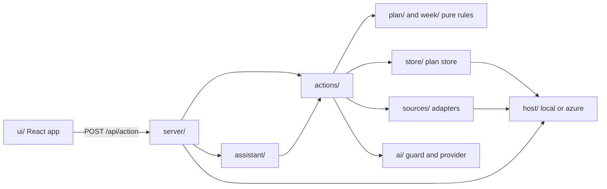
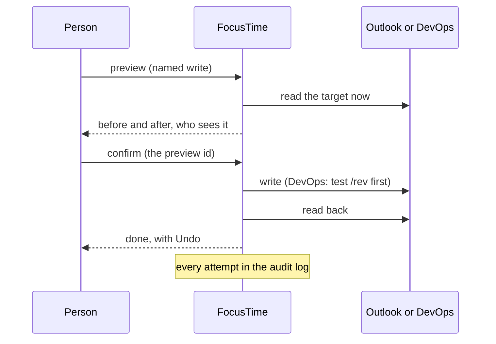

# Architecture

For engineers changing FocusTime, and IT wanting the big picture before [Security](security.md). Checked against `13cd461` on Nov 7, 2026.

FocusTime is one Node.js server (TypeScript, run directly by Node) that serves a React app and a JSON action API, keeps its data in one SQL database, and talks to Microsoft Graph, Dataverse, Azure DevOps, Google Calendar, Azure Resource Manager and OpenAI. The per-folder detail is in [docs/architecture.md](../architecture.md); this page is the overview.

## The parts

| Part | What it is | Where |
|---|---|---|
| Web app | React 19, built by Vite into static files; one page with tabs (Today, Week, Ahead, Inbox) and full-window panels (Settings, the Guide, these docs). Heavy panels load only when opened | `ui/`, `vite.config.ts` |
| Server | Node.js `http` server: sign-in, sessions, the action API, a few upload and media routes, the Teams bot endpoint, the built UI | `server/app.ts`, `server/main.ts` |
| Actions | Every operation the UI, the command menu, the assistant and the bot can run: named in one registry, validated, dispatched | `actions/registry.ts`, `actions/dispatch.ts` |
| Pure rules | The week from patterns and events, risks, fit, planning, notifications; no I/O | `week/`, `plan/` |
| Sources | Adapters for each outside system | `sources/` |
| Plan store | Azure SQL (dev and prod), every statement scoped to the signed-in person | `store/` |
| Host | The only code that touches the machine (secrets, keys, caches, notifications): `host/azure` hosted, `host/local` for the developer loop; picked by `FOCUSTIME_HOST` | `host/` |
| Scheduler and jobs | One in-process scheduler: per-person ticks (timer ends, reminders, notifications) and app jobs (polling, purge) | `server/scheduler.ts`, `server/ticks.ts` |
| Teams bot | An Azure Bot whose identity is a managed identity, calling `/teams/messages` on the same app; 1:1 chats only | `server/teams/`, `infra/modules/bot.bicep` |
| Assistant | One service for the in-app panel and the bot; reaches only the actions on its allowlist | `assistant/` |
| AI provider | Every AI request goes through `ai/` (guard, budget, request log) to OpenAI; a stub in the developer loop | `ai/` |
| Infrastructure | Bicep for the Container Apps environment and app, Azure SQL, Key Vault, the registry, monitoring, the bot, budgets | `infra/` |

### Running in Azure

- **Container Apps.** One Container App per environment (`ft-dev-app`, `ft-prod-app`), 0.5 vCPU and 1 GiB, HTTPS-only external ingress on port 8080, health probe on `/healthz` (no database call), single revision mode, at most one replica (`infra/modules/app.bicep`). Prod keeps one replica always; dev scales to zero after 300 seconds without a request (`infra/dev.bicepparam`).
- **Azure SQL.** Entra-only authentication: the app signs in with its system-assigned managed identity. Fixed-price DTU tiers: dev S0, prod S1 (`infra/modules/sql.bicep`, `infra/prod.bicepparam`).
- **Key Vault.** RBAC mode, soft delete and purge protection on. Holds the app secrets and the key that wraps the app's data key (see [Security](security.md#secrets)).
- **Image.** Built once per commit by `deploy-dev.yml` into dev's container registry; prod runs the same image by digest (see [Operations](operations.md#deploys)).
- **Monitoring.** Log Analytics (30 days) and workspace-based Application Insights (`infra/modules/monitoring.bicep`).

### Background jobs and job_claims

The scheduler (`server/scheduler.ts`) runs a fast pass every 5 seconds and a slow pass every 30 seconds, but only while someone has used FocusTime in the last 15 minutes. Otherwise it sleeps until the next stored due time (`scheduler_state`), making no database call, so the database can rest.

App jobs run at the start of each slow pass, each with its own next-due time (`server/main.ts`):

| Job | What it does |
|---|---|
| `people_refresh` | Reads people and client leads from Dataverse into the directory; ends sessions of anyone now known as a guest |
| `retention` | The daily purge (see [Data](data.md#retention)) |
| `meeting_capture` | Registered client calls: occurrences, transcripts after each call, the AI pass |
| `devops_poll` | Central DevOps reads: changed items per client, the change log |
| `requests_poll` | Shared polling of registered client chats, every 5 minutes in followers' working hours |

A job that must run once per period claims it with a unique insert in `job_claims` (`store/retention.ts` `claimPeriod`), so a restart or a second replica can't run it twice; a failed run gives its claim back. Hourly maintenance hard-deletes accounts past their 30 days and sweeps expired sessions.

## Module map

The host boundary is enforced: `host/boundary.test.ts` fails when a core module (`week/`, `plan/`, `actions/`, `sources/`, `store/`, `ai/`) touches files, processes, sockets or the keyring. Demo data is wired in one place (`server/main.ts` to `server/demo.ts` to `sources/demo/`), and `host/no-demo-leak.test.ts` fails if anything else imports it.

## The planning rules

The week, risks, free time, budgets and estimates are pure code in `week/` and `plan/`: no I/O, deterministic, unit tested. The words for each idea are in the [glossary](../../CLAUDE.md#glossary-use-these-words-in-code-ui-and-chat).

- **Half-days.** A person's working hours (`[hours]`, their own setting, read with `userZone()` in `week/zone.ts`) split each day into AM and PM at lunch (`week/hours.ts`). The hours only place meetings into AM or PM and estimate free time; a half-day is a unit of commitment, not a clock window.
- **Focus blocks.** Dataverse Focus Time rows are weekly patterns (Mon to Thu, AM, PM or All Day, a start and an optional end), expanded into the week's blocks (`week/patterns.ts`). Standing blocks are the person's own setting, none by default. A Mon to Thu half-day with no block is Open.
- **PTO.** Every PTO day is a whole day off: no risks, no to-dos, no free time (`week/pto.ts`, `week/free.ts`). Teammates' PTO shows only as "away".
- **Risks.** Checked per half-day that has a focus block (`week/risks.ts` `evaluateRisks`); events shown as free or working elsewhere don't count, tentative and missing show-as count as busy. The thresholds start from the team's Default (Admin) or the built-in values below.

| Rule | When | Shows as |
|---|---|---|
| Meeting load | Busy meeting minutes inside the block reach 90 (`meeting_watch_minutes`) | Watch |
| Meeting load | They reach 150 (`meeting_at_risk_minutes`) | At risk |
| Personal conflict | A busy personal (Google) event overlaps the block | At risk |
| Personal conflict | An all-day personal event that day | Watch |
| Out of office | An Outlook out-of-office event overlaps or covers the block | At risk |
| All-day busy | An all-day Outlook event that is busy or has no show-as | Watch |
| No focus window | The longest free stretch is under 90 minutes (`min_focus_window_minutes`) | At risk |
| Double-booked | More than one focus block in the half-day | At risk |

A card shows one status: At risk with its short reason, Too much planned, Fits just or Fits (`plan/blockstatus.ts`). Budgets and estimates are in hours (`plan/weekplan.ts`, `plan/estimate.ts`).

## A normal request

1. The browser calls `POST /api/action` with `{ action, input }`, its session cookie and the `X-CSRF` header.
2. `server/guard.ts` checks the Host and Origin against the public URL and that the call comes from FocusTime's own page (fetch metadata). Anything else gets 403.
3. `server/app.ts` finds the session (`store/accounts.ts`: 12 hours idle, 7 days at most) and checks the CSRF token for any state change.
4. `actions/dispatch.ts` looks the action up in the registry, validates its input and builds the person's context: their settings, their scoped plan store, their sources.
5. Every plan store statement goes through `store/scope.ts`, which adds the session's `user_id`; a user id never comes from the browser.
6. The answer is JSON. Source failures come back as a status with a plain message and a fix, never as another source's data.

## An external write

Every write to Outlook, DevOps, Teams presence or Azure is a named action through the write framework. Outlook and DevOps follow this shape:

- **Preview.** The server reads the target and holds a preview (every field before and after, the account, who will see it) for 5 minutes under an id (`PREVIEW_MS` in `actions/timebox-actions.ts`, `actions/devops-write-actions.ts` and `actions/vm-actions.ts`).
- **Confirm** sends only the preview id. A preview that expired or whose target changed is refused.
- **Write.** DevOps patches start with a `test` on `/rev`, so a change someone made since the preview fails instead of being overwritten. Outlook updates re-read the event and refuse it unless FocusTime's marker is on it.
- **Read back.** The target is read again and compared with what was meant before the write counts as done.
- **Audit log.** Every attempt with when, where, before and after, and its result (`write_log`, `devops_write_log`, `azure_write_log`, `teams_status_log`), shown in Settings › Activity with Undo and Retry where they apply.
- **Undo** is itself a previewed, confirmed and logged write, refused when the target changed after FocusTime's change.

Exceptions are listed in [Security](security.md#external-writes-and-the-audit-log): Teams presence during focus has no preview, the VM start has no undo, and plan store changes from the bot's buttons run at once with Undo.
