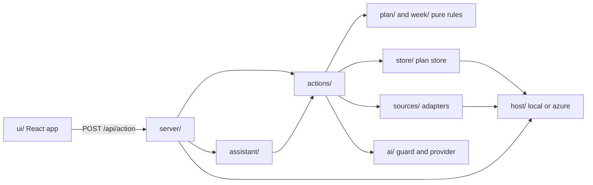
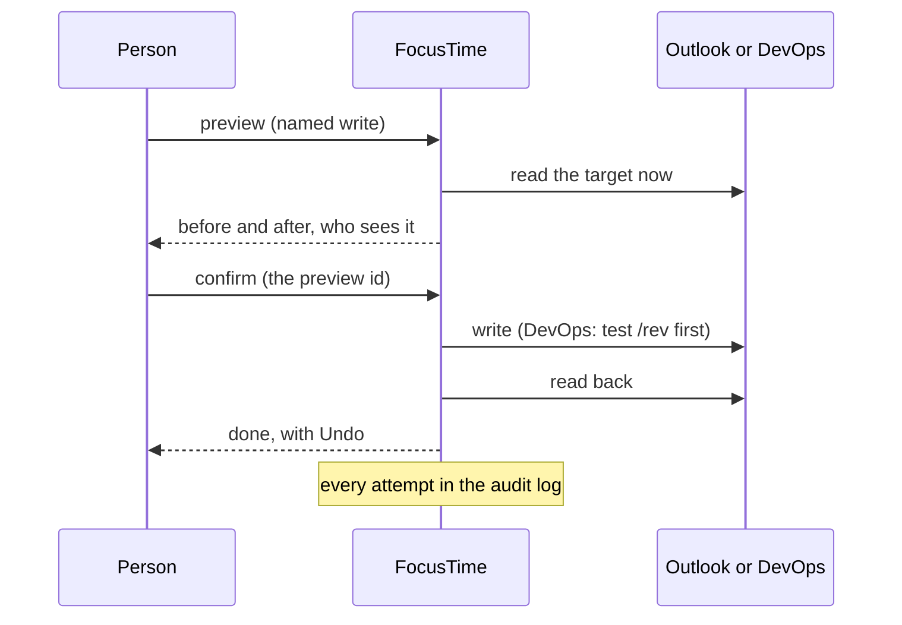
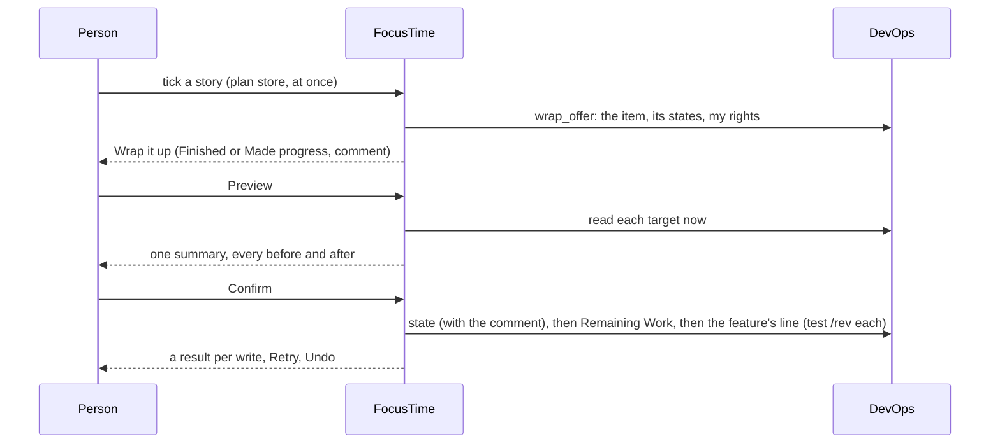

# Architecture

For engineers changing FocusTime, and IT wanting the big picture before [Security](security.md). Checked against `4088995` on Nov 7, 2026 (SR-2 parts against its own branch; Status's SR-3 parts against `feat/report-finish` on Nov 8); the assistant against `1e74410` with AS-3 (`feat/assistant-answers`); Deployment items against `feat/deployment-items` on Nov 8; the Inbox against `feat/inbox-everything` on Nov 8; Today's timeline against `feat/today-timeline` on Nov 8. Cooptimize's standards (KB-1) against `feat/coop-standards` on Nov 8; TX-1's parts against `fix/tx1-review` on Nov 8. The story card and Wrap it up (FN-1) against `feat/story-card-wrap-up` on Nov 10. One Week (WD-1) against `feat/wd1-week` on Nov 10. The block panel and Day (WD-2) against `feat/wd2-one-panel` on Nov 11.

FocusTime is one Node.js server (TypeScript, run directly by Node) that serves a React app and a JSON action API, keeps its data in one SQL database, and talks to Microsoft Graph, Dataverse, Azure DevOps, Google Calendar, Azure Resource Manager and OpenAI. The per-folder detail is in [docs/architecture.md](../architecture.md); this page is the overview.

## The parts

| Part | What it is | Where |
|---|---|---|
| Web app | React 19, built by Vite into static files; one page with tabs (Day, Week, Ahead, Status, Inbox; WD-1, RF-1) and full-window panels (Settings, the Guide, these docs). Heavy panels load only when opened | `ui/`, `vite.config.ts` |
| Server | Node.js `http` server: sign-in, sessions, the action API, a few upload and media routes, the Teams bot endpoint, the built UI | `server/app.ts`, `server/main.ts` |
| Actions | Every operation the UI, the command menu, the assistant and the bot can run: named in one registry, validated, dispatched | `actions/registry.ts`, `actions/dispatch.ts` |
| Pure rules | The week from patterns and events, risks, fit, planning, notifications; no I/O | `week/`, `plan/` |
| Sources | Adapters for each outside system | `sources/` |
| Plan store | Azure SQL (dev and prod), every statement scoped to the signed-in person | `store/` |
| Host | The only code that touches the machine (secrets, keys, caches, notifications): `host/azure` hosted, `host/local` for the developer loop; picked by `FOCUSTIME_HOST` | `host/` |
| Scheduler and jobs | One in-process scheduler: per-person ticks (timer ends, reminders, notifications) and app jobs (polling, purge) | `server/scheduler.ts`, `server/ticks.ts` |
| Teams bot | An Azure Bot whose identity is a managed identity, calling `/teams/messages` on the same app; 1:1 chats only | `server/teams/`, `infra/modules/bot.bicep` |
| Assistant | One service, two renderers: the in-app panel and the bot draw the same result; reaches only the actions on its allowlist | `assistant/`, `ui/Assistant.tsx`, `server/teams/render.ts` |
| AI provider | Every AI request goes through `ai/` (guard, budget, request log) to OpenAI; a stub in the developer loop | `ai/` |
| Infrastructure | Bicep for the Container Apps environment and app, Azure SQL, Key Vault, the registry, monitoring, the bot, budgets | `infra/` |

### Running in Azure

- **Container Apps.** One Container App per environment (`ft-dev-app`, `ft-prod-app`), 0.5 vCPU and 1 GiB, HTTPS-only external ingress on port 8080, health probe on `/healthz` (no database call), single revision mode, at most one replica (`infra/modules/app.bicep`). Prod keeps one replica always; dev scales to zero after 300 seconds without a request (`infra/dev.bicepparam`).
- **Azure SQL.** Entra-only authentication: the app signs in with its system-assigned managed identity. Fixed-price DTU tiers: dev S0, prod S1 (`infra/modules/sql.bicep`, `infra/prod.bicepparam`).
- **Key Vault.** RBAC mode, soft delete and purge protection on. Holds the app secrets and the key that wraps the app's data key (see [Security](security.md#secrets)).
- **Image.** Built once per commit by `deploy-dev.yml` into dev's container registry; prod runs the same image by digest (see [Operations](operations.md#deploys)).
- **Monitoring.** Log Analytics (30 days) and workspace-based Application Insights (`infra/modules/monitoring.bicep`).

### Background jobs and job_claims

The scheduler (`server/scheduler.ts`) runs a fast pass every 5 seconds and a slow pass every 30 seconds, but only while someone has used FocusTime in the last 15 minutes. Otherwise it sleeps until the next stored due time (`scheduler_state`), making no database call, so the database can rest.

App jobs run at the start of each slow pass, each with its own next-due time (`server/main.ts`):

| Job | What it does |
|---|---|
| `people_refresh` | Reads people and client leads from Dataverse into the directory; ends sessions of anyone now known as a guest |
| `retention` | The daily purge (see [Data](data.md#retention)) |
| `meeting_capture` | Registered client calls: occurrences, transcripts after each call, the AI pass |
| `devops_poll` | Central DevOps reads: changed items per client, the change log |
| `standards_sync` | KB-1: Cooptimize's standards from GitHub: at startup, then hourly while FocusTime is in use; never wakes an idle server |
| `requests_poll` | Shared polling of registered client chats, every 5 minutes in followers' working hours; also records their co-working calls (CW-1, `chat_calls`) |

A job that must run once per period claims it with a unique insert in `job_claims` (`store/retention.ts` `claimPeriod`), so a restart or a second replica can't run it twice; a failed run gives its claim back. Hourly maintenance hard-deletes accounts past their 30 days and sweeps expired sessions.

## Module map

The host boundary is enforced: `host/boundary.test.ts` fails when a core module (`week/`, `plan/`, `actions/`, `sources/`, `store/`, `ai/`) touches files, processes, sockets or the keyring. Demo data is wired in one place (`server/main.ts` to `server/demo.ts` to `sources/demo/`), and `host/no-demo-leak.test.ts` fails if anything else imports it.

## The planning rules

The week, risks, free time, budgets and estimates are pure code in `week/` and `plan/`: no I/O, deterministic, unit tested. The words for each idea are in the [glossary](../../CLAUDE.md#glossary-use-these-words-in-code-ui-and-chat).

- **Half-days.** A person's working hours (`[hours]`, their own setting, read with `userZone()` in `week/zone.ts`) split each day into AM and PM at lunch (`week/hours.ts`). The hours only place meetings into AM or PM and estimate free time; a half-day is a unit of commitment, not a clock window.
- **Focus blocks.** Dataverse Focus Time rows are weekly patterns (Mon to Thu, AM, PM or All Day, a start and an optional end), expanded into the week's blocks (`week/patterns.ts`). Standing blocks are the person's own setting, none by default. A Mon to Thu half-day with no block is Open.
- **PTO.** Every PTO day is a whole day off: no risks, no to-dos, no free time (`week/pto.ts`, `week/free.ts`). Teammates' PTO shows only as "away".
- **Risks.** Checked per half-day that has a focus block (`week/risks.ts` `evaluateRisks`); events shown as free or working elsewhere don't count, tentative and missing show-as count as busy. The thresholds start from the team's Default (Admin) or the built-in values below.

| Rule | When | Shows as |
|---|---|---|
| Meeting load | Busy meeting minutes inside the block reach 90 (`meeting_watch_minutes`) | Watch |
| Meeting load | They reach 150 (`meeting_at_risk_minutes`) | At risk |
| Personal conflict | A busy personal (Google) event overlaps the block | At risk |
| Personal conflict | An all-day personal event that day | Watch |
| Out of office | An Outlook out-of-office event overlaps or covers the block | At risk |
| All-day busy | An all-day Outlook event that is busy or has no show-as | Watch |
| No focus window | The longest free stretch is under 90 minutes (`min_focus_window_minutes`) | At risk |
| Double-booked | More than one focus block in the half-day | At risk |

- **Week's weekend columns and Evening band (WK-3).** Week is Monday to Friday; `week.load` adds Saturday or Sunday (`week/build.ts`, `weekendPlanned` in `actions/dispatch.ts`) when a timed or all-day calendar item, a planned or done to-do, a FocusTime timebox, a flex session or a promise due falls there, or always with the viewer's Show weekend (`ui/weekend.ts`, this browser's storage, sent as `weekend: true`). A weekend day is `kind: "weekend"`: no blocks, Open half-days, capacity or risks; the Board draws it as one quiet cell (`WeekendDay` in `ui/WeekGrid.tsx`, rows from `weekendRows` in `plan/evening.ts`), Today as a Weekend day, the phone as one more day chip. Items after a weekday's day shape go in the Evening band under PM (`eveningBand`), hidden when empty. Moves onto a weekend are allowed by drag, menu and assistant with the day's note (D947) and Undo.
- **Day's timeline and the shared timeline (TY-1).** `ui/Timeline.tsx` is the one hour grid: `Timeline` (hours, events side by side through `layoutEvents`, free gaps, the now line), `EventCard`, `useEventMenu`, `railNowOf`. Week's cards (`ui/WeekGrid.tsx`) and Day's timeline (`ui/DayTimeline.tsx`) both draw it, and `ui/ty1.test.ts` holds that to one copy. With the Timeline switch on (`ui.set_today_timeline`, `[ui] today_timeline`, the phone's own `today_timeline_phone`), Today shows each block as a client-coloured band with Week's header and its hours, with the block's checklist beside them (TY-2: the list view's `PickRow`, timed to-dos in time order, then "Not timeboxed yet"; above the hours and foldable under 1100 px), then the Evening band. The phone keeps a "Not timeboxed yet" tray above the hours instead. A timebox changes here with `timebox.add`, `update` and `remove`, at once with Undo; the arithmetic is pure in `plan/timeline.ts` (15-minute drop, clamp, nudge, next free stretch, the phone's list of times, whether a placeholder fits). `useBandDrag` in `ui/Timeboxes.tsx` is the one band drag, and `BandEditCtx` is what Today adds to it. Timebox my day runs `planMyDay` as before and holds the result in Today's state as placeholders; nothing is saved until ✓ or Accept all (`timebox.add_many`). The only way out of FocusTime is the existing Outlook path: a timebox marked for Outlook, through the existing preview and confirm.
- **One Week, one Day and the block panel (WD-1, WD-2).** Week has no modes: `ui/WeekGrid.tsx` draws `ui/BlockCard.tsx` per block. Day (`ui/Day.tsx`) shows any date with the same cards (`WeekGrid` with one day), under one header row, the urgent strip, a line of chips and the moment card. `ui/BlockPanel.tsx` is the one side panel for a block on both (a sheet on the phone), over the pure rules in `plan/blockpanel.ts` and `plan/addwork.ts`: what's on the block, its meetings, and one Add box that searches the client's DevOps work and my promises. It opens from "+ Add", a click on the block, or A and Enter, at `#/week/day/<date>/<half>` or `#/day/<date>/<half>`. A to-do dragged from a block onto the panel comes off the plan (`pick.take_off`, my plan store only, with Undo; `docs/ux/wd2/inventory.md` says what each kind of to-do does). Placing a story adds its feature to the week on the server (`afterPick` in `actions/dispatch.ts`, from the cached DevOps read only). Plan the week and Plan the day were removed; `docs/ux/wd1/inventory.md` says where each of their parts went.
- **No confirm, no musts (CF-1).** Nothing confirms a day or a week, and every feature on the week counts the same. A day has work when its blocks have a to-do (`hasWorkOn` in `plan/modes.ts`), and a week when anything is placed (`weeksWithWork` in the plan store); the morning card and the reminders read those. After any action that changes which features are on a week (`WEEK_CHANGES` in `actions/dispatch.ts`), `publishWeek` writes that week's features (type, title, link) for Team and the status report, never for a past week. The old Confirm and tier actions stay registered and answer plainly without changing anything (`plan/no-confirm.ts`). The stored confirm times and tiers stay in the database, unread. `docs/ux/cf1/inventory.md` lists every part.
- **Deployment items (DP-2).** What a deployment moves, by the client's data platform. The seeded catalog is `config/deploy-catalog.ts`; `plan/deploy-items.ts` is pure (a client's list over the catalog, defaults, what a client switch keeps, matching spoken names); `actions/deploy-item-actions.ts` is `deploy.items` and `deploy.config_save` (a FocusTime admin or the client's lead). `ui/DeployItems.tsx` holds the checkboxes (Quick capture and Deployment details), the row's "4 items" chip and the settings editor, shown in Admin › Clients and on a lead's client page in Settings. `ui/TimeField.tsx` is the time twin of AH-5's `DateField`. The assistant's `plan_deployment` matches the items named against the client's own list on the server. See [Data](data.md#deployment-items-dp-2).
- **Deployment to-dos and after-hours time (WK-3, DP-0).** A Deployment is a to-do (`picks.todo_kind = 'deployment'`) with a window (`window_start`, `window_end`, local times) and optional links (`links`) and note; `deploy.add` and `pick.set_kind` make one, and the window decides its half (`windowHalf` in `plan/deploy.ts`). `afterHours` in `plan/deploy.ts` adds up the week's time outside the day shape (a Deployment's window outside the person's hours, all of it on a weekend or PTO day; other to-dos placed in an evening or on a weekend; timeboxes after the day's end), returned by `week.load` as `afterHours` and shown as "3h after hours this week". Done on a Deployment offers Tell <client> through LP-1's Close the loop (`DeployedOffer` in `ui/Deploy.tsx`). The assistant's `plan_deployment` proposes `deploy.add`, run only on Confirm.
- **Ahead's tree (AH-6).** Grid and Gantt fold the same tree (`plan/gantt-tree.ts`): a level for the whole tree (Show: Epics · Features · Stories, names from the process model) with per-row carets on top, the rows on screen, and a collapsed row's roll-up (its children's earliest start to latest end). The Gantt (`ui/ahead/Gantt.tsx`) draws one row height for label and bar, status as the bar's look (`barTreatment` in `plan/gantt.ts`), one callout marker per row with its popover and fixes, and arrow caps past the edges (`capText`). View choices (level, carets, Show callouts, column width) are per browser (`ui/ahead/prefs.ts`).
- **Ahead's toolbar (AH-6).** One toolbar (`ui/ahead/Toolbar.tsx`) for Grid, Gantt, Readiness and Backlog, over one filter state: the filters in the plan store (`ahead.filters`), the level, carets and Show callouts in this browser, all mirrored in Ahead's address query. `plan/ahead-view.ts` is the pure part: the Dates quick picks against today, the query (`toQuery`, `fromQuery`, `withQuery`), where a control can't apply and why (`notHere`), and the summary line with its chips. Every mode filters through `filterRows` (`plan/ahead-model.ts`): Grid and Gantt directly, Readiness (`fixGroups` with the filters) and Backlog (`backlogOf`) on its kept rows. Readiness was Gaps until AH-6; its code name stays `fix`.
- **Readiness you can finish (AH-7).** `plan/readiness.ts` is the pure part: Start here's urgency rule (`startHere`, `START_RULE`), the counts by kind (`kindCounts`, `toggleKind`), skips that last 14 days (`liveSkips`) and progress (`fills`, `addFixed`, `fixedSince`). `fixClient` (`plan/fixnext.ts`) also returns the skipped entries, the pieces my change set fills (`pending`) and a just-fixed entry kept to fade out (`leaving`). Skips are `ahead.skip` and `ahead.unskip`, kept in the plan store's `kv` (`ahead_skips`); the write framework records each saved fix after a `fields` write lands (`aheadLanded` → `ahead_fixed`); `ahead.load` returns the live skips and this week's count. `ui/ahead/FixNext.tsx` draws the counts, Start here, a fix per missing piece (AH-5's popover editors) and Skipped; `ui/ahead/Ahead.tsx` keeps the skips, the fade, the Undo toast and the progress line.
- **Status and the client report (SR-1, SR-2).** The Status tab (Week › Status before WD-1) reads `status.load` (My features: my planned or touched features per client) and `status.report` (one client's whole report), both in `actions/status-actions.ts` over the pure rules in `plan/status-report.ts`. Kat's watermark is Dataverse `accounts.coop_statuslastsenton`, read with the app's access (`statusSent`); a comment counts by its modified date (else created). The client report keeps the watermark as it is and treats an empty one as 1900-01-01 (`clientReportWindow`); My features falls back to Monday 7:00 AM ET when it's missing or older than 35 days (`reportWindow`). The report's body is every feature with a comment in the window, in backlog stack-rank order, comments oldest first (`reportBody`); comments are read live from DevOps (at most 60 features a client, `reportCandidates`) and never stored. No update yet (`noUpdateYet`) is the features active this week (Week › Team's `week_commitments`, my week plan, DevOps' change log) without a comment. Upcoming PTO is the client team's days away from Dataverse's Time Off Tracker (`teamPto`, dates only; `ptoRuns`). Writes are SR-1's `comment` and `comment_edit` and SR-3's `comment_delete` (my own comment in the window; undo posts it again) through the write framework.
- **Finishing the report (SR-3).** Upcoming PTO and Holidays is the next 14 days: the team's Time Off Tracker days and Dataverse's Working Days Calendar rows with Holiday Observed = Yes (`sources/dataverse/holidays.ts`), each source failing on its own with a note (`ptoSection`, `upcomingRows`). "You worked on this" is `contributions` in `plan/status-report.ts`: since the watermark, a story under the feature assigned to me and changed, my state change or comment from DV-1's change log, a story I created through FocusTime (the write log), my to-do or timebox, or my comment on the feature; no new DevOps read. Such features with no comment of mine are Needs your update (`needsYou` on `status.load` and `status.report`) and get a suggested line from `status.suggest`: one standard-tier AI request per client through `ai/` (GD-2 scrub, Internal exempt, held in memory 6 hours), or the template "Worked on: …" with AI off. The client report takes `added` feature ids (Add a feature over `catalog`, the client's feature tier in backlog order). Lines are typed and kept in the browser (`ui/status-lines.ts`, `localStorage`) until Push all. The nudge counts Needs your update first and opens `#/week/status/needs`.
- **Status's dot (RF-1).** The Status tab shows no number: a dot while SR-3's Needs your update isn't empty. `plan/status-dot.ts` is the rule, pure: `dotDays` reads a built week (`week/build.ts`) as days with their working start, `working` (a work day, not the catch-up day, not a weekend, not a whole PTO day) and `scheduled` (working with a focus block on a half that isn't PTO); `dotSchedule` takes the days whose working hours end between the last send and the next (a day still under way at the send is the next report's) (`lastKatRun`, `nextKatRun`: Monday 7:00 AM New York) and makes the last scheduled one red from its start and the one before it amber, until the send; with no scheduled day it uses the working days, and with none at all there is no dot. `status.load` adds `dot`, `sendsAt`, `zone` and `serverNow` (`dotFor` in `actions/status-actions.ts`; the days come from `workdaysFor` in `actions/dispatch.ts`: Dataverse focus blocks and PTO through the sources' caches, standing blocks and working hours, no calendars). The tab (`ui/StatusMark.tsx`) turns on the server's clock (`serverNow` gives the skew), reads again every 30 minutes while shown, on coming back into view after 10 minutes, and a minute after the send, and is a ring for amber and a filled dot for red, with its reason as the tooltip and label (`dotText`). The phone's ⋯ shows it beside Status.

A card shows one status: At risk with its short reason, Too much planned, Fits just or Fits (`plan/blockstatus.ts`). Budgets and estimates are in hours (`plan/weekplan.ts`, `plan/estimate.ts`).

## Cooptimize's standards in the AI (KB-1)

`server/standards-job.ts` runs the sync (`sources/github/standards.ts`, GET only) into `standards_articles` (`store/standards-store.ts`). `plan/standards.ts` is the pure part: the contract, retrieval, what goes with a request, and what happens to the answer. `actions/standards.ts` gives the draft paths one lookup, with the client's data platform and source systems from its Rules.

**Retrieval** (`retrieveStandards`). Match keys are exact, in snake_case: the text's words and runs of up to three words against each article's `layer`, `artifact` and `technology`, plus title words. A domain joins only through a specific key, so ordinary words don't bring one in. In a domain that's in play, an article matches by artifact or a title word, then layer, then technology; the domain's layer-agnostic articles are its general ones. The client's platform adds that platform's articles. `domain: source` articles ride on any SQL or Power BI work when the client's Source systems name them (`d365` serves both; None excludes them). The title index of every active article always goes. Matched articles go whole up to 6,000 tokens, narrowest scope first; the rest are listed as left out.

**Drafts.** `stories.draft`, `capture.prepare` and `conversations.draft_item` get `standards` in their input and the rules in their instructions. In code afterwards (`shapeItem`): "Follows <title>: ..." acceptance lines get the article's link at the synced commit, citations of anything not sent are dropped, and hand-written Bronze or Silver SQL is reworded as configure or regenerate. The draft keeps `standards` (`StandardsUsed`: commit, titles and links, left out, overrides, notes), shown by `ui/StandardsNote.tsx`.

**Ask.** The intent round's `standards` topic goes to `standardsAnswer` in `assistant/service.ts`: the matching articles only, no client, one `assistant.standards` request. The answer is shown only if its quote is really in the article it names; otherwise "Not in the standards".

## A normal request

1. The browser calls `POST /api/action` with `{ action, input }`, its session cookie and the `X-CSRF` header.
2. `server/guard.ts` checks the Host and Origin against the public URL and that the call comes from FocusTime's own page (fetch metadata). Anything else gets 403.
3. `server/app.ts` finds the session (`store/accounts.ts`: 12 hours idle, 7 days at most) and checks the CSRF token for any state change.
4. `actions/dispatch.ts` looks the action up in the registry, validates its input and builds the person's context: their settings, their scoped plan store, their sources.
5. Every plan store statement goes through `store/scope.ts`, which adds the session's `user_id`; a user id never comes from the browser.
6. The answer is JSON. Source failures come back as a status with a plain message and a fix, never as another source's data.

## An external write

Every write to Outlook, DevOps, Teams presence or Azure is a named action through the write framework. Outlook and DevOps follow this shape:

- **Preview.** The server reads the target and holds a preview (every field before and after, the account, who will see it) for 5 minutes under an id (`PREVIEW_MS` in `actions/timebox-actions.ts`, `actions/devops-write-actions.ts` and `actions/vm-actions.ts`).
- **Confirm** sends only the preview id. A preview that expired or whose target changed is refused.
- **Write.** DevOps patches start with a `test` on `/rev`, so a change someone made since the preview fails instead of being overwritten. Outlook updates re-read the event and refuse it unless FocusTime's marker is on it.
- **Read back.** The target is read again and compared with what was meant before the write counts as done.
- **Audit log.** Every attempt with when, where, before and after, and its result (`write_log`, `devops_write_log`, `azure_write_log`, `teams_status_log`), shown in Settings › Activity with Undo and Retry where they apply.
- **Undo** is itself a previewed, confirmed and logged write, refused when the target changed after FocusTime's change.

Exceptions are listed in [Security](security.md#external-writes-and-the-audit-log): Teams presence during focus has no preview, the VM start has no undo, and plan store changes from the bot's buttons run at once with Undo.

## The Inbox

One read model, one list. `actions/inbox-actions.ts` gathers conversations, promises, sends, captures and drafts (`inbox.list`), and the pure rules in `plan/inbox-items.ts` decide which views each item is in; the badge, the rail and every count read that.

**Everything** (IB-2, `ui/inbox/InboxPage.tsx`, `ui/inbox/model.ts`) is the default: every row by its latest activity, grouped by day, newest or oldest first. The left-hand views are the same list with only that status on, so there is one model. The address says where I am (`#/inbox/everything`, `#/inbox/needs-you`, and the older ones); an item's address carries no view, so the page holds the place while one is open. A row can be in several views (a late linked promise is in Needs you, Promises and In progress): a chip matches any of them, and its one tag is the first in `STATUS_ORDER`. A chat's chatter joins the list as rows with status Chatter, off by default.

- **Remembered per person** in settings rows: `[ui] inbox_sort`, `inbox_statuses`, `inbox_grouping`, `inbox_clients`. New keys, so an older build skips them. The older `inbox_view` is no longer read for the default and is no longer written.
- **New since you last looked.** `inbox.list` returns `lastLooked` and `now`. The page holds the marker for the visit, so a reload doesn't move the divider under me, and calls `inbox.looked` with that `now` once the divider has come into view (at once when there is none to reach). See [Data](data.md).
- **Long lists.** All rows arrive in one read (one person's Inbox is thousands at most). The page draws 120 and adds 120 as the end comes near, each row is memoized, and CSS `content-visibility` skips the layout of rows out of view. No windowing library, so day headings stay plain `position: sticky`.
- **Timestamps.** `ui/stamp.ts` is the one formatter ("Today 4:07 PM", "Yesterday 6:58 PM", "Fri, Nov 6, 4:07 PM"), always in the person's zone; `ui/Stamp.tsx` adds the full time on hover. Which screens use it is listed in `docs/ux/ib2/date-inventory.md`.

## The assistant

One service (`assistant/service.ts`) answers the in-app panel and the Teams bot; it reaches only the actions on its allowlist (`assistant/allowlist.ts`), through the person's own dispatch. A message goes:

1. **The server reads my words first** (`assistant/resolve.ts`): to-dos, items and features of my clients by `#id`, whole title, "the story for …" or (AS-3) part of a feature's title ("the Data Staleness items", "the feature name they're under is data staleness"). Matches in two clients, or two items that fit equally, are a question with choices (AS-2); nothing of any client goes to the AI before I choose.
2. **The intent round** (`assistant.intent`) sees only my words, the screen and, for a follow-up, my earlier request with client names and ids hidden. It names the tools a change needs, or (AS-3) says it is a question: a topic (`plan_check`, `capabilities`, `agenda`, `promises`, `waiting`, `readiness`, `deployments`, `status_updates`, `done`, `calls`, `items`, `general`), a period, and whether it follows up the last request.
3. **A change** goes to the answer round (`assistant.answer`) with one client's matches as quoted data; each write becomes a proposal with the button's own preview, run only on Confirm (AS-1, AS-2).
4. **A question** (AS-3) is answered from my own data. `assistant/context.ts` reads the period (one `week.load` per week it touches, and only what the topic needs of `ahead.load`, `status.load`, `inbox.list` and `meeting.mine`), keeps only my clients (`isMine`), and bounds it: at most 14 days, 40 to-dos, 12 promises, 10 waiting, 12 gaps, 12 features without an update, 6 calls and 10 after-hours parts (`CONTEXT_LIMITS`). `assistant/answer.ts` composes the answer on the server, grouped by client: each line names a real block, to-do, `#id` or promise with its link, and what couldn't be read is said ("Not known"). Up to 3 suggested steps are FocusTime plan proposals (`SUGGEST_TOOLS`: `move_plan`, `confirm_week`); a tap builds the proposal with its preview and still needs Confirm. Only a `general` question about one client sends that client's context to the AI (`assistant.question`), as quoted JSON of at most 16,000 characters; a general question across clients asks which client first.
5. **Memory.** The answer's turn keeps what a follow-up needs (`assistant_turns.pending_json`: my words, the client, the topic and period, the items, to-dos and promises it referred to) for 2 hours (`CONVERSATION_MINUTES`), with its suggestions; a question's choices still wait 10 minutes (AS-2). It is my history: in Export, removed by Clear, pruned at 30 days, never shown to admins.

With AI off, not set up or over a cap, any message gets one line saying so and the command menu; there is no canned list of what the assistant can do. "What can you help me with?" is a question like any other (`capabilities`): what it does, with up to 6 example questions built from my own week, each a tap. "help" and "open FocusTime" always answer without AI, and "what's next" and "today" do while AI is unavailable, in both channels (`assistant/quick.ts`). `scripts/assistant-eval.ts --url <host>` asks the golden set in a demo session and prints the answers (not in CI).

### One Assistant, two renderers

There is one Assistant. The in-app panel and the Teams bot are two renderers of the same result, and the rule is that nothing else differs:

- **One path.** A Teams 1:1 message reaches `assistant.handle` like the panel's, as the same person, under the same allowlist, client boundary and AI settings. Only two things happen before it, and both only make sense in Teams: `capture:` (TB-2: saved at once, no AI) and the reply to the Close out prompt.
- **A neutral result.** The Assistant returns the words, cards, links, proposals and choices, with links as app addresses. It knows nothing about a channel's layout.
- **A renderer per channel.** `ui/Assistant.tsx` for the panel; `server/teams/render.ts` and `server/teams/cards.ts` (Adaptive Cards) for Teams. A renderer draws and adds no logic. Its switch over card kinds is exhaustive, so a new kind doesn't compile until it is drawn.
- **Same actions.** Confirm, Undo and a refreshed preview call the same service methods from both. Follow-ups share one 2-hour memory across channels.
- **Where a card can't hold it** (over 24 KB or 9 cards, or a preview over 20 rows or 12,000 characters), Teams shows the first part and "Open in FocusTime", a link to the same answer (`#/ask/<turn>`). A DevOps change that can't be shown whole has no Confirm in Teams.

**The parity test is the rule** (`assistant/parity.test.ts`, in CI). Every Ask topic, every assistant tool, every golden question in `assistant/answers.test.ts` and AS-2's flows run through the panel's entry and through the real bot core on fakes, and must return the same result, draw all of it as cards, and make the same writes. A new capability without a case there fails the build; add the case, and the drawing if it is a new kind of card.

## The story card and Wrap it up (FN-1)

A work item's title anywhere opens FocusTime's story card, never DevOps. Finishing work on a story goes through one sheet, Wrap it up, from every place that ticks a to-do.

- **One link.** `ui/WorkLink.tsx` turns a DevOps edit URL into the card's address, `#/item/<client>/<id>`, an overlay over the place underneath. Item menus copy the DevOps link instead of opening it.
- **One read.** `item.card` checks the client is one the person can see before reading anything, reads the item, its parent and epic, its children and its latest 50 comments with the company read PAT, sanitizes the HTML on the server and keeps the result a minute per person. FocusTime's own context (my to-dos, timeboxes and promises on the item) comes from the plan store.
- **One wrap-up flow.** A tick lands at once (TX-1c, with Undo). On a client with my write PAT, for an item I can change that isn't done yet, Wrap it up opens over it: Finished (the type's done state by category, the one I use most chosen) or Made progress (state kept, New moves to In Progress, the time left), a comment with Suggest, and the optional line on the feature for Monday's status. `wrapup.preview` asks the write framework for one preview of every write; `wrapup.confirm` writes them in order, each with its own result and Retry. The card's own changes use the same writes: `comment`, `state`, and Ahead's change set as one `fields` write.
- **The same in Teams.** The bot's Done and Partly propose `wrap_up`, which runs `wrapup.apply` on Confirm: the same writes, previewed again.

## The rhythm's check-ins (TX-1)

A check-in about timeboxes has no schedule, badge or reminder of its own. It rides on the two moments the day already has: the top of Day's Midday check-in and of Close out, and in Teams the rhythm's check-in and close out cards when that person has them on.

- `plan/progress.ts` (pure): which timeboxes qualify (`sessionRows`), what each answer does (`outcomeOf`, `planOutcome`) and the words.
- `actions/progress-actions.ts`: `checkin.sessions`, `checkin.answer`, `checkin.all_to_plan`, `checkin.undo` and `checkin.offer_close`. Only the plan store changes. All went to plan reads the rows afresh and settles them in one transaction (`settleAll`).
- `ui/TimeboxCheckin.tsx` and `server/teams/rhythm.ts` (`sessionCards`, `sessionTap`) call those same actions.
- `devops.progress_offer` (read only) builds the end of day offer. Writes go through the write framework as `remaining_work` or `comment`, each previewed and confirmed in Close out. A Teams card only points there.
