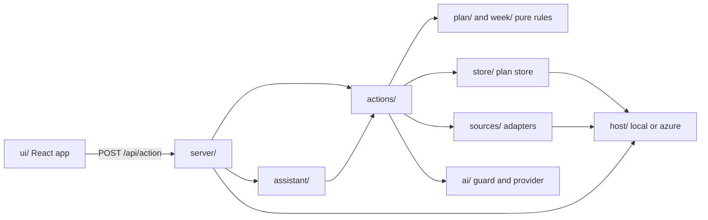
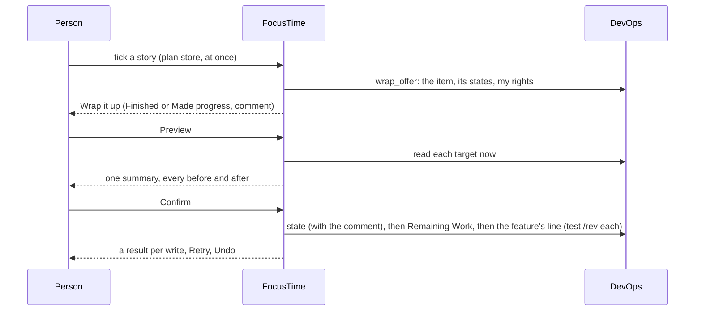
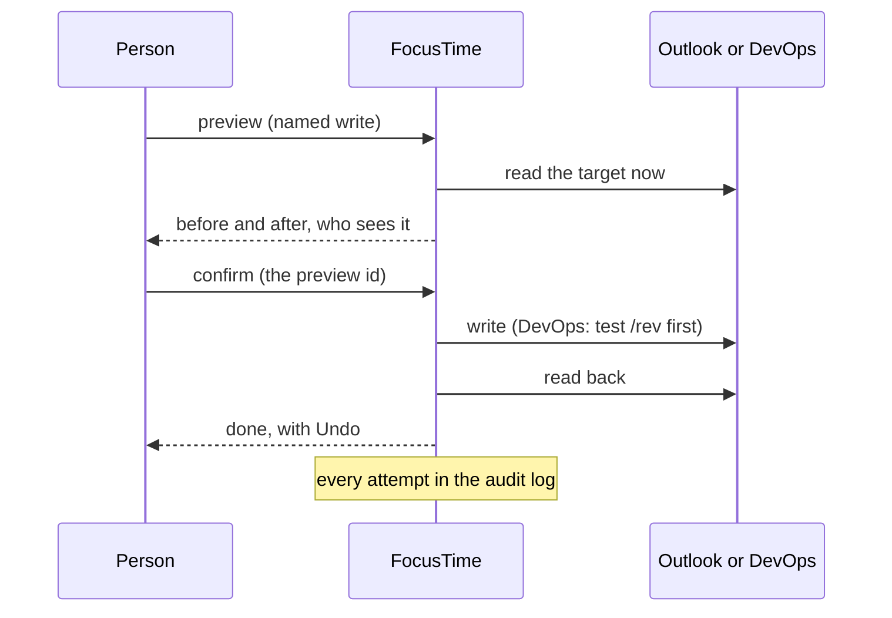

# Architecture

For engineers changing FocusTime, and IT wanting the big picture before [Security](security.md). Checked against `2f4c0ea` on Nov 13, 2026.

FocusTime is one Node.js server (TypeScript, run directly by Node) that serves a React app and a JSON action API, keeps its data in one SQL database, and talks to Microsoft Graph, Dataverse, Azure DevOps, Google Calendar, calendar links, Azure Resource Manager, OpenAI and public GitHub. Code names that differ from what people see are in the [names table](README.md#names-in-the-code). The per-file detail is in [docs/architecture.md](../architecture.md); this page is the overview.

## The parts

| Part | What it is | Where |
|---|---|---|
| Web app | React 19, built by Vite into static files: five tabs (Day, Week, Backlog, Status, Inbox), the block panel, the story card over any screen, and full-window panels (Settings, Admin, Code, Client calls, the Guide, these docs). Heavy panels load only when opened | `ui/`, `vite.config.ts` |
| Server | Node.js `http` server: sign-in, sessions, the action API, a few upload and media routes, the Teams bot endpoint, the built UI | `server/app.ts`, `server/main.ts` |
| Actions | Every operation the UI, the command menu, the assistant and the bot can run (396 of them): named in one registry, validated, dispatched | `actions/registry.ts`, `actions/dispatch.ts` |
| Pure rules | The week from patterns and events, risks, free time, planning, the Inbox's rules, notifications; no I/O | `week/`, `plan/` |
| Sources | One adapter per outside system, and the demo's fakes | `sources/` |
| Plan store | Azure SQL (dev and prod), every statement scoped to the signed-in person | `store/` |
| Host | The only code that touches the machine (secrets, keys, caches, notifications): `host/azure` hosted, `host/local` for the developer loop; picked by `FOCUSTIME_HOST` | `host/` |
| Scheduler | One in-process scheduler: app jobs (polling, the purge), each person's ticks (timer ends, reminders, Teams messages) and start-up work | `server/scheduler.ts`, `server/ticks.ts`, `config/background-policy.ts` |
| Teams bot | An Azure Bot whose identity is a managed identity, calling `/teams/messages` on the same app; 1:1 chats only | `server/teams/`, `infra/modules/bot.bicep` |
| Assistant | One service, two renderers: the in-app panel and the bot draw the same result; reaches only the actions on its allowlist | `assistant/`, `ui/Assistant.tsx`, `server/teams/render.ts` |
| AI provider | Every AI request goes through `ai/` (guard, budget, request log) to OpenAI; a stub when no key is set | `ai/` |
| Infrastructure | Bicep for the Container Apps environment and app, Azure SQL, Key Vault, the registry, monitoring, the bot, budgets | `infra/` |

### Running in Azure

- **Container Apps.** One Container App per environment (`ft-dev-app`, `ft-prod-app`), 0.5 vCPU and 1 GiB, HTTPS-only external ingress on port 8080, liveness and startup probes on `/healthz` (no database call), single revision mode, at most one replica (`infra/modules/app.bicep`). Prod keeps one replica always; dev scales to zero (`minReplicas` 0 in `infra/dev.bicepparam`). **Not verified:** how long dev stays awake after the last request; `infra/` doesn't set it, so it is Container Apps' default (300 seconds when this was written).
- **Azure SQL.** Entra-only authentication: the app signs in with its system-assigned managed identity. Fixed-price DTU tiers: dev S0, prod S1 (`infra/modules/sql.bicep`, `infra/prod.bicepparam`).
- **Key Vault.** RBAC mode, soft delete and purge protection on. Holds the app secrets and the key that wraps the app's data key (see [Security](security.md#secrets)).
- **Image.** Built once per commit by `.github/workflows/deploy-dev.yml` into dev's container registry; prod runs the same image by digest (see [Operations](operations.md#deploys)).
- **Monitoring.** Log Analytics (30 days) and workspace-based Application Insights (`infra/modules/monitoring.bicep`).

### Background work

The scheduler (`server/scheduler.ts`) runs a fast pass every 5 seconds and a slow pass every 30 seconds, but only while someone has used FocusTime in the last 15 minutes. Otherwise it sleeps until the next stored due time (`scheduler_state`), making no database call, so the database can rest.

Every piece of background work has a name in `BACKGROUND` (`config/background-policy.ts`), which also says what it does outside production ([Operations](operations.md#what-runs-on-its-own)). The app jobs run at the start of each slow pass, each with its own next-due time (`server/main.ts`):

| Job | What it does |
|---|---|
| `requests_poll` | Reads every registered client chat with a follower's own sign-in, every 5 minutes in followers' working hours, then sorts new messages with AI; records co-working calls (`chat_calls`) |
| `conversations_upkeep` | Runs after each chat read and does nothing: no escalation, reminder or follow-through draft is made |
| `meeting_capture` | Registered client calls: lays out occurrences, looks for transcripts after each call, runs the AI pass |
| `devops_poll` | Central DevOps reads: each client's changed items, once for everyone, with a change log |
| `people_refresh` | People, levels and client leads from Dataverse into the directory, once a day; ends sessions of anyone now known as a guest |
| `standards_sync` | Cooptimize's standards from public GitHub: at start, then hourly while FocusTime is in use |
| `retention_purge` | The daily purge (see [Data](data.md#retention)) |
| `maintenance` | Hourly: hard deletes of accounts past their 30 days, ended sessions |
| `conversation_ownership_backfill` | A one-time move of conversations to shared owners; does nothing once done |

A job that must run once per period claims it with a unique insert in `job_claims` (`claimPeriod` in `store/retention.ts`), so a restart or a second replica can't run it twice; a failed run gives its claim back. Each person's ticks (the timer, reminders, Web Push, the Teams bot's messages, Teams status, the VM's automatic start, calendar refresh while focus runs) run in the fast and slow passes for the people using FocusTime (`server/ticks.ts`).

## Module map

The host boundary is enforced: `host/boundary.test.ts` fails when a core module (`week/`, `plan/`, `actions/`, `sources/`, `store/`, `ai/`) touches files, processes, sockets or the keyring. Demo data is wired in one place (`server/main.ts` to `server/demo.ts` to `sources/demo/`), and `host/no-demo-leak.test.ts` fails if anything else imports it.

## The screens

Where each screen lives and what it reads. Every read is one action, so the assistant and the tests reach the same data.

| Screen | UI | Reads | Rules |
|---|---|---|---|
| Day | `ui/Day.tsx`, `ui/DayTimeline.tsx`, `ui/PhoneDay.tsx` | `week.load`, `inbox.today` | `plan/blockpanel.ts`, `plan/timeline.ts`, `plan/cardfold.ts` |
| Week | `ui/WeekGrid.tsx`, `ui/BlockCard.tsx` | `week.load` | `week/`, `plan/weekdays.ts`, `plan/evening.ts`, `plan/boardsuggest.ts` |
| Block panel | `ui/BlockPanel.tsx` | `week.load`, its Add box's searches | `plan/blockpanel.ts`, `plan/addwork.ts` |
| Backlog | `ui/ahead/` (`Ahead.tsx`, `Grid.tsx`, `Gantt.tsx`, `Toolbar.tsx`, `Bulk.tsx`) | `ahead.load`, `ahead.people` | `plan/gantt-tree.ts`, `plan/ahead-view.ts`, `plan/backlog-status.ts`, `plan/readiness.ts`, `plan/fixnext.ts` |
| Status | `ui/Status.tsx`, `ui/StatusMark.tsx` | `status.load`, `status.report` | `plan/status-report.ts`, `plan/status-dot.ts` |
| Inbox | `ui/inbox/` | `conversations.suggestions`, `inbox.list`, `capture.load` | `plan/slim-inbox.ts`, `plan/inbox-items.ts` |
| Story card | `ui/StoryCard.tsx`, `ui/StoryCardEdit.tsx`, `ui/WrapUp.tsx` | `item.card` | `plan/item-card.ts` |
| New form | `ui/NewItem.tsx`, `ui/ThreeQuestions.tsx` | `new.*`, `devops.preview` | `actions/new-item-actions.ts` |
| Code | `ui/code/` | `code.clients`, `code.repos`, `code.folder`, `code.find`, `code.file` | `plan/code.ts` |
| Client calls | `ui/meetings/` | `meeting.mine`, `meeting.review` | `plan/meetings.ts`, `plan/meeting-views.ts` |
| Midday check-in, Close out | `ui/Checkin.tsx`, `ui/CloseOut.tsx`, `ui/TimeboxCheckin.tsx` | `week.load`, `checkin.sessions` | `plan/progress.ts` |
| Focus screen | `ui/FocusScreen.tsx` | `timer.*` | `plan/timer.ts` |
| Settings, Admin | `ui/Settings.tsx`, `ui/settings/` | `settings.load`, `admin.load` | `config/` |
| DevOps patterns | `ui/patterns/` (`#/patterns`, only for people an admin turned on) | `patterns.status` | `plan/patterns/` |
| The Guide, these docs | `ui/guide/`, `ui/docs/` | `guide.*`, `docs.access` | `scripts/tech-docs.ts` (at build time) |

Where the window is (tab, date, open panel, filters) is one pure model in `ui/nav.ts`, mirrored in the address (`#/day/<date>/<half>`, `#/week/day/<date>/<half>`, `#/backlog?…`, `#/inbox/<list>`, `#/item/<client>/<id>`, `#/code/<client>/<repo>/<path>`), so Back and a copied link land in the same place. Older addresses still land on the nearest screen.

## The planning rules

The week, risks, free time and estimates are pure code in `week/` and `plan/`: no I/O, deterministic, unit tested. The words for each idea are in the [glossary](../../CLAUDE.md#glossary-use-these-words-in-code-ui-and-chat).

- **Half-days.** A person's working hours (`[hours]`, their own setting, read with `userZone()` in `week/zone.ts`) split each day into AM and PM at lunch (`week/hours.ts`). The hours only place meetings into AM or PM and estimate free time; a half-day is a unit of commitment, not a clock window.
- **Focus blocks.** Dataverse Focus Time rows are weekly patterns (Monday to Thursday, AM, PM or All Day, a start and an optional end), expanded into the week's blocks (`week/patterns.ts`). Standing blocks are the person's own setting, none by default. A Monday to Thursday half-day with no block is Open. Friday is the catch-up day.
- **PTO.** Every PTO day is a whole day off: no risks, no to-dos, no free time (`week/pto.ts`, `week/free.ts`). Teammates' PTO shows only as "away".
- **Risks.** Checked per half-day that has a focus block (`evaluateRisks` in `week/risks.ts`); events shown as free or working elsewhere don't count, tentative and missing show-as count as busy. The thresholds start from the team's Default (Admin) or the built-in values below (`config/starter.ts`).

| Rule | When | Shows as |
|---|---|---|
| Meeting load | Busy meeting minutes inside the block reach 90 (`meeting_watch_minutes`) | Watch |
| Meeting load | They reach 150 (`meeting_at_risk_minutes`) | At risk |
| Personal conflict | A busy personal event overlaps the block | At risk |
| Personal conflict | An all-day personal event that day | Watch |
| Out of office | An Outlook out-of-office event overlaps or covers the block | At risk |
| All-day busy | An all-day Outlook event that is busy or has no show-as | Watch |
| No focus window | The longest free stretch is under 90 minutes (`min_focus_window_minutes`) | At risk |
| Double-booked | More than one focus block in the half-day | At risk |

- **One status.** A card shows At risk with its short reason only when the calendar cuts into the block; how much is planned never makes a status (`plan/blockstatus.ts`). Watch shows only on hover. The block panel says the free time left ("1h free", "No free time").
- **Hours, never blocks.** Sizes and estimates are hours (`plan/estimate.ts`, `plan/weekplan.ts`): XS 30 minutes, S 1h, M 2h, L 4h, and unsized work counts as the person's own Count unsized work as. A to-do's time left starts at its size and moves only with a check-in answer or a new size (`pickNeed` in `plan/types.ts`).
- **No confirm.** Nothing confirms a day or a week, and every feature on a week counts the same. A day has work when its blocks have a to-do (`hasWorkOn` in `plan/modes.ts`), and a week when anything is placed. After any action that changes which features are on a week (`WEEK_CHANGES` in `actions/dispatch.ts`), `publishWeek` writes that week's features (type, title, link) for the team view and the status report, never for a past week. The old confirm and tier actions answer plainly and change nothing (`plan/no-confirm.ts`).

## Week and Day

- **One card per block.** `ui/WeekGrid.tsx` draws `ui/BlockCard.tsx` per block on Week and, with one day, on Day. Day shows any date under one header row (Previous, the date, Today, Cards or Timeline, Timebox my day, + Add, More), with the urgent strip, one line of chips and the moment card above the blocks.
- **Which days show.** Monday to Thursday always, Friday as the catch-up day unless hidden (`[ui] show_catch_up_day`), and Saturday or Sunday when a calendar item, a to-do, a timebox, a flex session or a promise falls there, or always with the person's Show weekend (`[ui] show_weekend_days`). The day in focus takes about twice a working day's width; when the grid is too narrow, days fold to strips in a fixed order (weekend, catch-up day, past days, then farthest from the focus) (`plan/weekdays.ts`). Items after a weekday's working hours sit in the Evening band under PM (`plan/evening.ts`).
- **The block panel.** `ui/BlockPanel.tsx` is the one side panel for a block on both screens (a sheet on the phone), over `plan/blockpanel.ts` and `plan/addwork.ts`: what's on the block, its meetings, and one Add box that searches the client's DevOps work and my promises. Placing a story adds its feature to the week (`afterPick` in `actions/dispatch.ts`, from the cached DevOps read only). A to-do dragged onto the panel comes off the plan (`pick.take_off`, with Undo).
- **The timeline.** `ui/Timeline.tsx` is the one hour grid, drawn by Week's cards and Day's Timeline view (`ui/DayTimeline.tsx`). A timebox changes with `timebox.add`, `update` and `remove`, at once with Undo; the arithmetic is pure in `plan/timeline.ts`. Timebox my day places every untimed to-do into free gaps as placeholders, saved only with Accept all (`timebox.add_many`). Only a timebox marked for Outlook leaves FocusTime, through the Outlook write's preview.
- **Suggestions on empty blocks.** An empty block today or on the next working day offers that client's unfinished to-dos, then my open stories in backlog order, at most four (`plan/boardsuggest.ts`), from the plan store and the DevOps read already loaded: no AI and no DevOps request. Keeping one runs the usual add or move; Clear is a `markers` row of kind `sg_clear`.
- **Deployments and after-hours time.** A Deployment is a to-do with a window, linked items and ticked deployment items (`picks.todo_kind = 'deployment'`; `plan/deploy.ts`, `plan/deploy-items.ts`, the catalog in `config/deploy-catalog.ts`). `afterHours` in `plan/deploy.ts` adds up the week's time outside working hours ("3h after hours this week"). Done on a Deployment offers to tell the client through Close the loop.

## Backlog

- **One tree, two views.** Grid and Gantt fold the same tree (`plan/gantt-tree.ts`): a level for the whole tree (Epics, Features, Stories, named from the process), per-row chevrons, and a collapsed row's roll-up. The Gantt (`ui/ahead/Gantt.tsx`) draws status as the bar's look (`barTreatment` in `plan/gantt.ts`) and one callout per row.
- **One row of filters.** `ui/ahead/Toolbar.tsx`: Clients, People, Needs attention, Search, Filter (Epic, Dates, Levels, one level as a list) and More. The filters are in the plan store (`ahead.filters`), the level and chevrons in the browser, all mirrored in the address (`plan/ahead-view.ts`).
- **Needs attention.** Items I may change that miss stories, a target date, an owner or a size, or are stale, near the top of each backlog, each with its fix and Skip (`plan/fixnext.ts`, `plan/readiness.ts`). Skips last 14 days (`ahead_skips` in `kv`); fixes saved this week are counted (`ahead_fixed`).
- **The change set.** Edits (start, target, size, assignee, state) wait in `ahead_changes` and `ahead_state_changes` until Save, which writes one DevOps `fields` patch per item through the write framework. Review shows conflicts only for fields changed in DevOps since they were staged. The bulk bar over ticked rows stages the same changes (`ahead.stage_bulk`). Backlog never reorders DevOps.

## Status

- **My features and a client's report.** `status.load` (my planned or touched features per client) and `status.report` (one client's whole Monday report), both in `actions/status-actions.ts` over `plan/status-report.ts`.
- **The window.** The report goes out Mondays at 7:00 AM New York time. Its window starts at the report's last send for that client (Dataverse `accounts.coop_statuslastsenton`, read with the app's access); My features falls back to Monday 7:00 AM when that is missing or older than 35 days.
- **The report.** Every feature with a comment in the window, in backlog order, comments oldest first; comments are read live from DevOps (at most 60 features a client) and never stored. No update yet lists the features active this week without a comment. Upcoming PTO and Holidays covers the next 14 days from the Time Off Tracker and the Working Days Calendar (dates only).
- **Needs your update.** Features I worked on since the window opened (a story of mine changed, my state change or comment, a story I created through FocusTime, my to-do or timebox) without a comment of mine. `status.suggest` drafts a line with one AI request per client, held in server memory 6 hours, or the template "Worked on: …" with AI off. Lines are kept in the browser until Push all.
- **The dot.** The Status tab shows a dot while Needs your update isn't empty: amber, then red on the last scheduled working day before the send (`plan/status-dot.ts`). It reads again every 30 minutes while shown and on coming back into view after 10 minutes.

## The Inbox

Three lists (`ui/inbox/InboxPage.tsx`), each with a count, client chips, rows grouped by client that open in place. The list used last is a settings row (`[ui] inbox_view`).

- **From chats** is `conversations.suggestions`: conversations in chats I may see (member now, client followed) that the sorting step judged to need a DevOps item, with no linked or likely item, quiet at least 4 working hours in my own hours and at most 7 days, and not dismissed by me (`isSuggestion` in `plan/slim-inbox.ts`). The judgment comes from the same `conversations.update` request that sorts the messages; there is no other AI request. Showing a row writes `inbox_marks.suggested_at` once; Dismiss, Create and Link write its outcome.
- **Promises** is `inbox.list`'s promise rows, late first. Reading them first settles my open chat promises (`settlePromises`): one clears as done when its linked item is finished, or as expired when I never touched it, 7 days after its due day or after it was found. No job runs it and no AI is asked. Cleared ones show 14 days under Cleared on their own; Put back reopens one for good.
- **Captures** is `capture.load`: captures with no kind (To sort) and drafts not in DevOps, by client.
- **The count** (the tab and `inbox.today`) is suggestions plus late or due-today promises, so it agrees with the lists. `inbox.today` also carries Day's urgent strip and the From chats chip.
- **Kept, not shown.** Conversation ownership, snooze, merges, held messages, Unsorted and Chatter stay in the database with their actions; no screen draws them.

## The story card, Edit and Wrap it up

A work item's title anywhere opens FocusTime's story card, never DevOps.

- **One link.** `ui/WorkLink.tsx` turns a DevOps edit URL into the card's address. Item menus copy the DevOps link instead of opening it.
- **One read.** `item.card` checks the client is one the person can see, then reads the item, its parent and epic, its children and its latest 50 comments with the company read PAT, sanitizes the HTML on the server and keeps the result a minute per person. My to-dos, timeboxes and promises on the item come from the plan store.
- **Edit.** Title, description and acceptance criteria with light formatting, and Move to another parent, each one DevOps patch behind a revision test (`item_edit`, `reparent`), written in the field's own format (`devops.edit_offer`, `actions/devops-write-actions.ts`; [Integrations](integrations.md#azure-devops)).
- **Wrap it up.** A tick lands at once with Undo. On a client with my write PAT, for an item I can change that isn't done, Wrap it up offers Finished or Made progress, a comment and the feature's status line; `wrapup.preview` asks the write framework for one preview of every write and `wrapup.confirm` writes them in order. In Teams, Done and Partly propose the same writes.

## Creating work

- **Capture** (`ui/Capture.tsx`, `capture.add`): one line saved at once to the plan store with Undo; its kind chips make it a promise, a draft story, a draft feature, or leave it To sort. A draft gets an AI-prepared DevOps version in the background when AI is on.
- **The New form** (`ui/NewItem.tsx`, `actions/new-item-actions.ts`): any level the client's process has, with client, level, title, parent, assignee, target date, and three optional questions (Where is it?, What should change?, How will we know it's right?, `ui/ThreeQuestions.tsx`). Enter opens the write preview; Save as draft keeps it local. Before the preview the type's fields are read, so a required field without a default is refused there.
- **Break down** (`ui/BreakDownPanel.tsx`, `stories.*`): AI proposes child items from the parent and the same client's past items; nothing is written until Create all after one batch preview.

## Code

A read-only view of any client's repos for every Cooptimizer (`ui/code/`, `actions/code-actions.ts`, `actions/code-git.ts`, `sources/devops/git.ts`). Each read checks who is asking and the client's Rule, writes the view log row for a file before returning its text, and keeps folder lists and file text in server memory at most 5 minutes. Files are colored by Prism in its manual mode, each piece drawn as text, so nothing in a file runs. No AI, no background work. The rules are on [Security](security.md#client-code).

## Check-ins about timeboxes

A check-in about timeboxes has no schedule, badge or reminder of its own. It rides on the Midday check-in and Close out, and in Teams on the rhythm's check-in and close out cards when that person has them on.

- `plan/progress.ts` (pure): which timeboxes qualify, what each answer does, and the words.
- `actions/progress-actions.ts`: `checkin.sessions`, `checkin.answer`, `checkin.all_to_plan`, `checkin.undo` and `checkin.offer_close`. Only the plan store changes.
- `devops.progress_offer` (read only) builds the end of day offer. Its writes (`remaining_work` or a comment) go through the write framework, previewed and confirmed in Close out.

## Cooptimize's standards in the AI

`server/standards-job.ts` syncs Cooptimize's standards repo (`sources/github/standards.ts`, GET only) into `standards_articles` (`store/standards-store.ts`). `plan/standards.ts` is the pure part: retrieval, what goes with a request, and what happens to the answer.

- **Retrieval** (`retrieveStandards`): exact keys from the text's words against each article's layer, artifact and technology, plus title words and the client's data platform and source systems. Matched articles go whole up to 6,000 tokens; the title index always goes.
- **Drafts.** `stories.draft`, `capture.prepare` and `conversations.draft_item` get the standards in their input. Afterwards, in code (`shapeItem`), cited acceptance lines get the article's link, and citations of anything not sent are dropped.
- **Ask.** A standards question gets only the matching articles and no client; the answer shows only when its quote is really in the article, otherwise "Not in the standards".

## The assistant

One service (`assistant/service.ts`) answers the in-app panel and the Teams bot; it reaches only the actions on its allowlist (`assistant/allowlist.ts`), through the person's own dispatch.

1. **The server reads my words first** (`assistant/resolve.ts`): to-dos, items and features of my clients by `#id`, title or part of a title. Matches in two clients, or two items that fit equally, become a question with choices; nothing of any client goes to the AI before I choose.
2. **The intent round** (`assistant.intent`) sees only my words, the screen and, for a follow-up, my earlier request with client names and ids hidden. It names the tools a change needs, or says it is a question with a topic and a period.
3. **A change** goes to the answer round (`assistant.answer`) with one client's matches as quoted data; each write becomes a proposal with the button's own preview, run only on Confirm.
4. **A question** is answered from my own data, read through the same actions as the screens and bounded (`CONTEXT_LIMITS` in `assistant/context.ts`: 14 days, 40 to-dos, 12 promises and so on). `assistant/answer.ts` composes the answer on the server, grouped by client. Only a general question about one client sends that client's context to the AI (`assistant.question`), at most 16,000 characters.
5. **Memory.** A follow-up's context is kept 2 hours on my own history row (`assistant_turns.pending_json`); my history is in Export, removed by Clear, pruned at 30 days, never shown to admins.

With AI off, not set up or over a cap, a message gets one line saying so and the command menu. "help" and "open FocusTime" always answer without AI, and "what's next" and "today" do while AI is unavailable (`assistant/quick.ts`).

### One Assistant, two renderers

- **One path.** A Teams 1:1 message reaches `assistant.handle` like the panel's, as the same person, under the same allowlist, client boundary and AI settings. Only `capture:` and the reply to the Close out prompt are handled before it, in Teams.
- **A neutral result.** The Assistant returns words, cards, links, proposals and choices, with links as app addresses.
- **A renderer per channel.** `ui/Assistant.tsx` for the panel; `server/teams/render.ts` and `server/teams/cards.ts` (Adaptive Cards) for Teams. A renderer draws and adds no logic; its switch over card kinds is exhaustive.
- **Where a card can't hold it** (over 24 KB or 9 cards, or a preview over 20 rows or 12,000 characters), Teams shows the first part and Open in FocusTime (`#/ask/<turn>`). A DevOps change that can't be shown whole has no Confirm in Teams.
- **The parity test is the rule** (`assistant/parity.test.ts`, in CI): every topic, tool and golden question runs through the panel's entry and the real bot core, and must return the same result, draw all of it as cards and make the same writes.

## A normal request

1. The browser calls `POST /api/action` with `{ action, input }`, its session cookie and the `X-CSRF` header.
2. `server/guard.ts` checks the Host and Origin against the public URL and that the call comes from FocusTime's own page (fetch metadata). Anything else gets 403.
3. `server/app.ts` finds the session (`store/accounts.ts`: 12 hours idle, 7 days at most) and checks the CSRF token for any state change.
4. `actions/dispatch.ts` looks the action up in the registry, validates its input and builds the person's context: their settings, their scoped plan store, their sources.
5. Every plan store statement goes through `store/scope.ts`, which adds the session's `user_id`; a user id never comes from the browser.
6. The answer is JSON. Source failures come back as a status with a plain message and a fix, never as another source's data.

## An external write

Every write to Outlook, DevOps, Teams, email or Azure is a named action through the write framework. Outlook and DevOps follow this shape:

- **Preview.** The server reads the target and holds a preview (every field before and after, the account, who will see it) under an id: 5 minutes for Outlook, DevOps, the VM, Close the loop and invites (`PREVIEW_MS` in `actions/timebox-actions.ts`, `actions/devops-write-actions.ts`, `actions/vm-actions.ts`; `LOOP_PREVIEW_MS`, `INVITE_PREVIEW_MS`), 10 minutes for Send feedback (`actions/feedback-actions.ts`).
- **Confirm** sends only the preview id. A preview that expired or whose target changed is refused.
- **Write.** DevOps patches start with a `test` on `/rev`, so a change someone made since the preview fails instead of being overwritten. Outlook updates re-read the event and refuse it unless FocusTime's marker is on it.
- **Read back.** The target is read again and compared with what was meant before the write counts as done.
- **Audit log.** Every attempt with when, where, before and after, and its result (`write_log`, `devops_write_log`, `azure_write_log`, `teams_status_log`, `loop_sends`), shown in Settings › Activity with Undo and Retry where they apply.
- **Undo** is itself a previewed, confirmed and logged write, refused when the target changed after FocusTime's change.

The exceptions are listed in [Security](security.md#external-writes-and-the-audit-log): Teams presence during focus has no preview, the VM has no undo and its automatic start no preview, and plan store changes from the bot's buttons run at once with Undo.

## Look and style

- **Icons.** One family (Lucide, through `lucide-react`), named by what the thing is in `ui/icons.tsx`: the only place the app's controls and marks get an icon. 16 px at the Default text size and scaled with it, a 1.5 px stroke, the color of the text beside it. The DevOps type icons (`ui/TypeIcon.tsx`), the brand marks (`ui/brand/`) and photos are not icons.
- **Type and spacing.** Four sizes off one base (`--fs-1` to `--fs-4`) and three weights; no literal font sizes. Text size (Default, Large, Larger) scales them and the spacing that pairs with text.
- **The rules' home.** [docs/design/style-guide.md](../design/style-guide.md): colors, type, components, contrast and themes, and in section 11 the controls, icons and rows (pill controls, tabs as an icon and a word, one-line rows). `ui/StyleGuide.tsx` shows the parts.

History: how each part got here is in [docs/decisions.md](../decisions.md).
