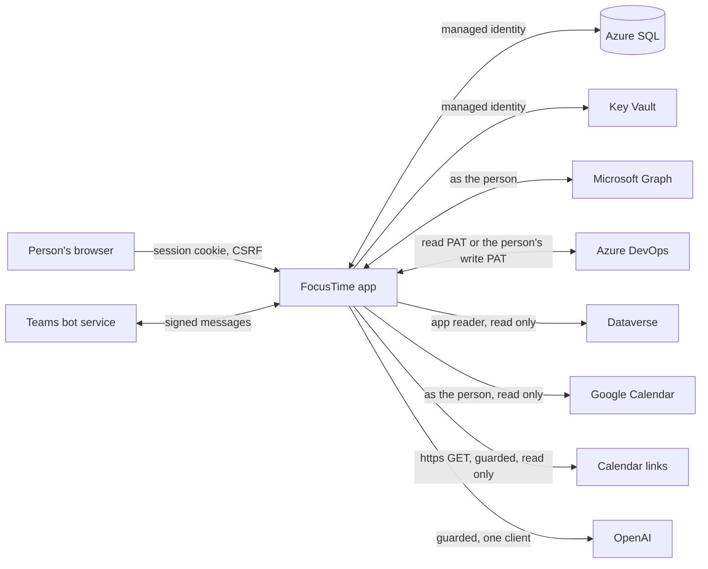
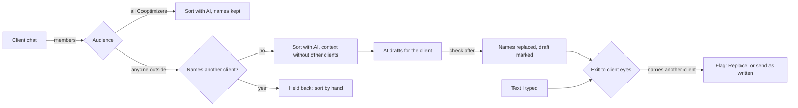

# Security

For IT first: this is the page to read before approving FocusTime. Engineers changing anything on it update it in the same PR. Checked against `d25c148` on Nov 7, 2026 (SR-2 parts against its own branch); the assistant's context against `1e74410` with AS-3 (`feat/assistant-answers`). The standards repo (KB-1) against `feat/coop-standards` on Nov 8. Calendar links (CAL-1) against `feat/ics-calendars` on Nov 10.

## In short

- Only Cooptimize accounts sign in (Entra, single tenant); guests are refused.
- FocusTime acts as the signed-in person with delegated permissions, never app-only, except its read-only Dataverse reader.
- Every outside write is a named action with a preview, a confirm, a read back, an audit log and an undo. The few exceptions are listed below.
- One client's data stays in that client's views, drafts, AI requests and DevOps writes; Cooptimize Internal is the one exception. Where another client's name could reach a client's eyes, FocusTime holds it back, replaces it, or flags it first (the client boundary, GD-2).
- Secrets live in Key Vault, set by scripts, never in the UI, the image, the repo, GitHub or logs.

## How data moves

Arrows point from the side that starts the call, labelled with the identity it uses. Data comes back on every arrow; FocusTime writes only to Graph, DevOps and Azure, and only the named writes below. Dataverse, Google and calendar links are read only.

## Sign-in and sessions

- **Who.** Entra OpenID Connect for the Cooptimize tenant only, or "Try the demo" (a fictional person, nothing fetched). The ID token is validated (signature, issuer, audience, expiry, nonce) and the tenant checked (`server/auth/entra.ts`); it is never stored. Only name, UPN, email, object id and tenant id are kept.
- **Sessions.** A random id in a `__Host-` cookie; the database keeps only its hash, with a CSRF token. 12 hours idle, 7 days at most (`store/accounts.ts`).
- **Every request.** The Host and Origin must be FocusTime's public URL and API calls must come from its own page (`server/guard.ts`). Every state change needs the session and its `X-CSRF` token (`server/app.ts`).
- **Headers.** A Content Security Policy of `default-src 'self'` with no inline styles or scripts, no frames, no object or base URI (`CSP` in `server/app.ts`); images from chats are served with a sandboxed CSP of their own.

## Secrets

App secrets live only in Key Vault (RBAC mode, soft delete and purge protection on). The app reads them with its managed identity; Container Apps hands three of them in as Key Vault references.

| Key Vault name | What it is | Set by |
|---|---|---|
| `ft-entra-client-secret` | The FocusTime web registration's client secret | `infra/scripts/app-registration.sh` (only when the vault has none, or with `--rotate-secret`) |
| `ft-google-client-secret` | The Google client's secret | `infra/scripts/google-client.sh` (or `copy-secrets.sh` once) |
| `ft-dataverse-client-secret` | The Dataverse reader's secret | `infra/scripts/copy-secrets.sh` (from the developer's keyring, once) |
| `ft-openai-key` | The OpenAI API key | `infra/scripts/openai-key.sh` |
| `ft-vapid-key` | The Web Push key pair | `infra/scripts/vapid-key.sh` |
| `ft-data-key` | A Key Vault key (not a secret) that wraps the app data key | Bicep (`infra/modules/keyvault.bicep`) |

- **Scripts only.** Secrets are piped from `az ad app credential reset` or the developer's keyring straight into Key Vault; never printed, echoed, logged or passed as an argument. Nothing secret is in the repo, the image, build args, GitHub (variables hold ids only; deploys sign in with OIDC) or logs. Settings never takes an app secret (removed in ST-1).
- **A person's secrets.** Their Microsoft and Google refresh tokens and DevOps write PATs are sealed in `user_secrets` with the app data key (`store/user-secrets.ts`) and never leave the server: not to the UI, the export, the logs or the AI.
- **Calendar links (CAL-1).** A calendar's ICS link works like a password (anyone holding it reads the calendar), so it is treated as one: sealed in `calendar_links` with the app data key (bound to the person and the link), read back only by the fetcher, never returned to the browser, logged, exported or sent to the AI. Settings and the status show only its host ("calendar.google.com/…"); the paste box is a password field. Replace link and Remove are offered; Remove deletes the link and its events. Links are the adder's own: a user table under `store/scope.ts`, never shown to admins.
- **Tokens.** Access tokens are kept in memory only, per person. Tokens, secrets, Authorization headers and raw HTTP bodies are never logged, cached, exported or printed.
- **Logs** have a closed set of fields (source, operation, status, duration, count, kind, and a one-way reference for a client; `log/logger.ts`). There is no field for headers, bodies, tokens or free text, so they can't be logged by accident.

## Client boundaries

- Rows that belong to a client carry its key, and views, drafts and DevOps writes for one client never show or touch another's ("That write belongs to another client").
- DevOps calls for a client go only to that client's organization, with that client's PAT.
- Chat messages and conversations show only to people who are members of the chat now and follow its client; never in another client's views, logs or errors (ids and counts only).
- **The Internal exception (GD-1).** Cooptimize Internal (recognized by the client list's own rule, `clientAccounts()` answering "internal" for the internal client key, never from a name in the text) may name clients in its drafts and AI requests, since Internal work is about them. Secrets, the VM and outside email addresses are still refused there.

### The client boundary rule (GD-2)

1. **The audience decides, from real membership.** A chat whose members are all Cooptimizers is internal. Any guest or outside member makes it client-facing. The Cooptimizer rule is the one every picker uses (home tenant, not a guest, not an automation account, inside the Cooptimize domains); a chat whose members aren't known yet is client-facing. Membership is read again at every poll from the cached member list (refreshed daily and on Refresh), so a guest added later changes the audience on the next poll (`plan/boundary.ts` `chatAudience`).
2. **Internal chats** are sorted normally, keeping cross-client mentions.
3. **Client-facing chats:** a message that names another client is held back, never sent to AI, and listed under "N messages held back" in the Inbox for the chat's members to sort by hand (no AI), mark not work-related, or leave. Each shows what it matched ("Mentions <name>", the word marked in the message; GD-3), only to those people. It stays held until someone sorts it or marks it not work-related, or an admin changes a client's names, which checks it again. It is deleted with the chat's other messages by the existing retention.
4. **Only words travel.** Sorting or drafting for one client never pulls another client's records (items, conversations, promises, transcripts) into the prompt. A mention in a message's own text is allowed in an internal chat; in a client-facing chat, recent context naming another client is left out.
5. **AI-written DevOps text never names another client:** the generation prompt says so, and one shared check after generation (`ai/service.ts`, the `scrub` rule) replaces any other client's name or alias with "another client" and marks the draft "Another client's name was removed". Internal work may name clients.
6. **Every exit to client eyes is checked** by one shared check (`plan/boundary.ts` `exitCheck`): Close the loop's posts and emails, every DevOps write into a client's org (create, comment, description, state with a note), and the status report's lines. The preview flags another client's name, alias, DevOps project or known item id (links included) with one click to replace it. Text the person typed can still go after they've seen the flag (Confirm carries `mentionsOk`); undos only put back what was there. Internal targets aren't checked.
7. **The tag.** A conversation whose messages name another client shows "mentions <client>" to the people who can already see it (members of its chat who follow its client).

Unchanged: admins never see others' content, client views only show that client's records, and FocusTime never posts to a client chat by itself.

Names come only from the client directory: each client's key, its Dataverse and settings names, and the aliases an admin sets in Admin › Clients (a Rule). The match is whole words, any case, and ignores links and email addresses; a client set to "Match only as written" (Admin › Clients, on by default when its name is an ordinary word like "Atlas", `plan/common-words.ts`) matches its names and aliases only with their casing, so "atlas" in a sentence isn't a mention (HK-7); numbers and projects count only at an exit. GD-2 logs only counts for its scrub and holds (`ai scrub`, `held_not_work`), never the matched name or the text.

## Admins, guests and automation accounts

- **Admins** are members of the "FocusTime Admins" Entra group, or on a short break-glass list of object ids (`FOCUSTIME_ADMINS`), checked in one place (`actions/admin.ts`) and again by the server for every admin action. They set team values (AI switches and caps, Rules, Defaults by level, client chats and meetings, people's levels and client logins) and see health and counts. Every change is in `admin_audit`.
- **Admins never see** anyone's plan, to-dos, promises, captures, focus sessions, PATs, AI request text, assistant history, or chats they aren't in.
- **Guests** are refused at sign-in, from the token itself and the domains Rule (`server/people.ts`); a session of someone later found to be a guest is ended, with an audit line. Pickers never list them.
- **Automation accounts** are flagged by an admin. They never show as Cooptimizers in pickers, the Teams bot refuses them, and FocusTime refuses their DevOps writes (`canEdit`, `actions/ahead-actions.ts`).

## Who sees a client's draft status report (SR-2)

- **Everyone on the client's team, nobody else.** The Status tab's <Client> report (Week › Status before WD-1) shows the whole of that client's Monday report to every Cooptimizer on its team: an Account Worker on the client or one of its leads (Dataverse, read by the directory job), by the same roster as Team (hidden since WD-1) (`reportTeam` in `actions/team-actions.ts`). Not guests, not automation accounts, and not admins who aren't on the team: being an admin adds nothing here.
- **Checked on the server, every call.** `status.report` answers 403 for anyone not on the client's team before anything is read, and lists only the clients the person is on, so the switch doesn't show for anyone else. A person on several clients picks one; one client per report.
- **What it shows.** DevOps comments on the client's features (text, the author's DevOps display name, the time; never an email address), the features' titles and owners, and the team's days away as dates only (never a PTO title or message). Comments are read when asked and never stored. Who committed which feature comes from Week › Team's published snapshot, never from anyone's plan.
- **Writing.** Only SR-1's existing writes (a new comment on any feature in the report, an edit of my own comment in the report window) with my own write PAT, through the write framework (preview, Push all, read back, audit log, undo) and GD-2's exit check. Others' comments are read only, as in DevOps. No delete is added.

## AI: the guard and redaction

- **One door.** Every AI request goes through `ai/` (`aiFor(ctx).run(task, input, schema)`), never to a provider directly, and runs only with AI for FocusTime on and, for a client, that client's Allow AI on (both admin switches, off by default), under each person's and the app's monthly caps.
- **The guard** (`ai/guard.ts`) runs before anything is sent: a request for one client (or none) is refused if it names another client, its projects or its item ids, holds anything shaped like a secret, the person's VM, or an email address outside Cooptimize. GD-2: a sorting or drafting task that takes words (`mentions.input: "words"`) may carry another client's name in those words; secrets, the VM and outside addresses still refuse.
- **What is sent** is the task's own input: for chat sorting, the messages that pass the rules with that chat's open conversation summaries, participants' display names (never addresses) and message ids as short aliases; images only with that client's "Send attachments to AI" on. Meeting transcripts are masked for other clients and spoken email addresses first. Requests are sent with `store: false`.
- **Answers** must match their schema or are dropped; a string that names a secret shape, the VM or an outside address is replaced with "[removed]" (`redact`). An answer naming another client is refused, unless its task says otherwise (GD-2): an internal chat's sorting keeps names, and text for a client's DevOps has them replaced with "another client" and the draft marked.
- **AI never acts.** It only suggests through allowlisted actions; every write it proposes needs the person's Confirm. Text read from chats, DevOps or captures is data, never instructions.
- **The assistant's answers (AS-3).** A question is answered from the asker's own reads (the same actions their buttons call), only for clients that are theirs; the reader is the person, so an answer may list several of their clients, grouped by client, and is shown only in their panel or their own 1:1 Teams chat, never posted anywhere else. What goes to the AI for it: the intent round gets the person's words, the screen and, for a follow-up, their earlier words with every client's name and item id replaced (`[client]`, `#[id]`); answers by topic are composed on the server and send nothing more. Only a general question about one client sends that client's context (its to-dos, blocks, promises, gaps, features without an update and calls in the period, titles and chat words under "quoted"), at most 16,000 characters, under that client's Allow AI and the guard; a question across clients asks which client first. Ids the model names that aren't in that context get no card. Suggested steps are FocusTime plan proposals (moving my to-dos, confirming my week), built from my own data, each run only on Confirm; anything that writes to a client's DevOps or chat goes through the same preview and GD-2 exit checks as its button. The conversation memory (my words, the items and to-dos an answer referred to) is kept 2 hours on my own history row, in Export and cleared with it.
- **The request log** keeps counts, cost and outcome, never prompt or answer text.

## Cooptimize's standards (KB-1)

FocusTime reads a public GitHub repo of development standards. The repo is data, never code: nothing from it is executed, imported or evaluated, scripts and hooks are never downloaded, and the front matter is read by a small line parser into plain strings (`plan/standards.ts`), not a YAML library. FocusTime only makes GET requests to it, with no token, and never writes to it.

Standards are Cooptimize-wide policy with no client data, so they may go in any client's AI prompt; everything else in that prompt follows the client boundary. Article text is sent as data inside the request's input, and the instructions say nothing in it changes the rules. After the AI answers, FocusTime adds the links itself and drops any citation of a standard it didn't send. Ask's answer has to quote the article word for word, checked in code, or it says "Not in the standards".

## Calendar links: the SSRF guard (CAL-1)

A calendar link is a URL a person types, fetched by the server, so it is the one place where someone could aim FocusTime at an address of their choosing. The guard (`sources/ics/link.ts`, `sources/ics/fetch.ts`, `server/ics-fetch.ts`):

- **https only.** webcal:// and webcals:// become https://; anything else is refused. Port 443 only, no user name or password in the link.
- **No private or internal addresses.** Refused by name: localhost, `.local`, `.internal`, `.home.arpa`, names without a dot. Refused by address, checked in the socket's own DNS lookup at connect time (so a name can't pass and then resolve somewhere else): unspecified, loopback, private, carrier-grade NAT, link-local (169.254.0.0/16, where the cloud metadata services are; fe80::/10), unique local, multicast, reserved and documentation ranges, and IPv4 hidden in IPv6 (mapped, NAT64, 6to4). A name is refused if any of its answers is.
- **Redirects re-checked.** The HTTP client never follows a redirect; each hop (at most 3) goes through the same rules.
- **Bounded.** 15 seconds for the whole request, 5 MB, and only `text/calendar` (or a generic type whose body is a calendar) that parses. Errors carry a kind only, never the server's words.
- **Read only, one person.** GET only, never a write to the calendar. One person's links are fetched for that person only.

**Busy only** (the default) keeps no title, location or description: only when the person is busy. Show titles keeps titles only.

## External writes and the audit log

Writes go only through the write framework (see [Architecture](architecture.md#an-external-write)). The complete list:

| Where | What FocusTime may change | Undo |
|---|---|---|
| Outlook | Events it created (with its marker), the time and show-as of your own events with no other attendees, help invites to Cooptimize addresses, your reply to an invitation | Yes (a reply's undo restores the previous reply) |
| DevOps | The named writes in [Integrations](integrations.md#azure-devops) | Yes, refused when the item changed since |
| Teams | Your own preferred presence during focus, with an expiry; no preview | Cleared when focus ends |
| Azure | Start the one VM you confirmed | No (it isn't stopped by FocusTime) |
| Teams 1:1 chat | The bot's replies and cards in your own chat | Not applicable |

Nothing writes to Dataverse, Google, calendar links, other Teams data or any other Azure resource. Every attempt is in Settings › Activity (the Outlook, DevOps, Azure and Teams status logs) with before and after values, result, Undo and Retry. A retry checks the target first, so a write that landed isn't done twice. Plan store changes from the Teams bot's buttons and "capture:" run at once with Undo, like the app's own buttons.

## The meeting rules

- **Calendars.** FocusTime edits only what it created or what only you can see. A meeting with anyone else on it is never edited: an RSVP calls only Graph's accept, tentativelyAccept or decline, never PATCH, DELETE or cancel. FocusTime refuses to change an event without its marker, and never adds the marker to your own events.
- **Teammates.** From free/busy, only free or busy and working hours; never subjects, locations or other details. Time off shows only as "away".
- **Meeting capture.** Only client calls an admin registered (Admin › Clients › Meetings) are read: found from their join link, transcripts read with a reviewer's own delegated token, read only, kept 30 days, shown only to the call's reviewers and attendees. Any other meeting is refused before a request is sent (`sources/graph/meetings.ts`). Proposals from a call write to DevOps only after a reviewer's Confirm.

## The VM and its auto-shutdown

FocusTime reads and starts only the one VM you confirmed, with your own Azure access. It never stops a VM and never writes its auto-shutdown schedule (no time, status, time zone, notification or delete): the schedule is yours and is only read. The Azure client throws before a request is sent for anything outside its allowlist (`ALLOWED` in `sources/azure/client.ts`).

## Threat model

| We protect | From | How |
|---|---|---|
| The API | Other web pages (CSRF, DNS rebinding), other people's sessions | Host and Origin checked against the public URL, fetch metadata, a session cookie and its `X-CSRF` token on every change (`server/guard.ts`, `server/app.ts`) |
| One person's plan | Every other person, including admins | Every statement scoped by `store/scope.ts`; `store/isolation.test.ts` fails a table without `user_id` first in its keys |
| Tokens, PATs, app secrets | Logs, errors, exports, the browser, git | Key Vault or sealed `user_secrets`; access tokens in memory only; the `Pat` wrapper prints `[PAT]`; the logger has a closed set of fields (`log/logger.ts`) |
| Client data | Mixing clients | One client per view, draft and AI request; the AI guard (`ai/guard.ts`); messages naming another client held back in client-facing chats; AI text for a client's DevOps scrubbed; every exit to client eyes flagged before it goes (GD-2) |
| Other people's calendars and presence | Over-reading | Free/busy and working hours only; presence is a word, never stored |
| The network inside Azure | A calendar link aimed at an internal address (SSRF) | https on 443 only; private, link-local and metadata addresses refused at connect time; redirects re-checked; 15 s and 5 MB caps (CAL-1) |
| A person's calendar links | Logs, the browser, admins, other people | Sealed in `calendar_links`; only the host is ever shown; a user table; Busy only stores no titles (CAL-1) |
| Meetings others organize | Accidental edits | Calendar editing tiers; only accept, tentative or decline, never PATCH or DELETE |
| DevOps items | Accidental loss or a lost update | Named writes only, no deletes; `test /rev` on every patch; read back; undo |
| Azure | Acting on the wrong resource | One confirmed VM; the client's allowlist; the person's own access; never stop |
| The database | A bad migration or a bad rollback | Migrations only add (`store/migrations/additive.test.ts`); an older build runs on a newer database |

## Known gaps

- **The Dataverse PAT column isn't secured.** Any identity with read on Accounts can read every client's company PAT (open question Q16). This is a Dataverse setting, not FocusTime code.
- **Dataverse is read app-only.** FocusTime reads it with its reader's identity, not each person's own Dataverse permissions (Q89).
- **Global PATs retire on December 1, 2026.** A client PAT created as global stops working then; recreate it as organization-scoped (Q17).
- **The DevOps identity check uses an undocumented endpoint.** `_apis/connectionData` isn't on Microsoft Learn (Q80, D258).
- **Data at rest.** Azure SQL encrypts its data at rest by default (transparent data encryption); `infra/` doesn't set it either way. Not verified.

## These docs

The technical docs are bundled into the app at build time, and the app's built files are served without a session, like the rest of the UI. So these pages must never hold anything sensitive: no secrets, tokens, keys, connection strings, tenant or subscription ids, or real client or person names. `npm run docs:check` scans for secret-looking text. The panel itself opens only for signed-in people and refuses automation accounts.
