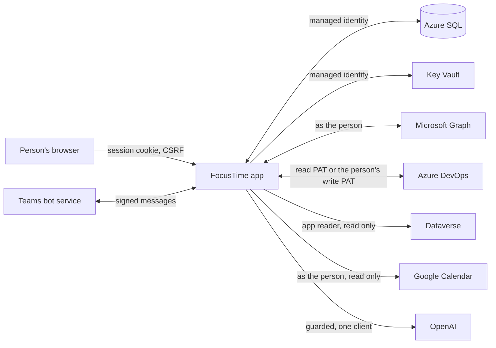

# Security

For IT first: this is the page to read before approving FocusTime. Engineers changing anything on it update it in the same PR. Checked against `13cd461` on Nov 7, 2026.

## In short

- Only Cooptimize accounts sign in (Entra, single tenant); guests are refused.
- FocusTime acts as the signed-in person with delegated permissions, never app-only, except its read-only Dataverse reader.
- Every outside write is a named action with a preview, a confirm, a read back, an audit log and an undo. The few exceptions are listed below.
- One client's data stays in that client's views, drafts, AI requests and DevOps writes; Cooptimize Internal is the one exception.
- Secrets live in Key Vault, set by scripts, never in the UI, the image, the repo, GitHub or logs.

## How data moves

Arrows point the way data is written. Graph and DevOps are two-way only for the named writes below; Dataverse and Google are read only.

## Sign-in and sessions

- **Who.** Entra OpenID Connect for the Cooptimize tenant only, or "Try the demo" (a fictional person, nothing fetched). The ID token is validated (signature, issuer, audience, expiry, nonce) and the tenant checked (`server/auth/entra.ts`); it is never stored. Only name, UPN, email, object id and tenant id are kept.
- **Sessions.** A random id in a `__Host-` cookie; the database keeps only its hash, with a CSRF token. 12 hours idle, 7 days at most (`store/accounts.ts`).
- **Every request.** The Host and Origin must be FocusTime's public URL and API calls must come from its own page (`server/guard.ts`). Every state change needs the session and its `X-CSRF` token (`server/app.ts`).
- **Headers.** A Content Security Policy of `default-src 'self'` with no inline styles or scripts, no frames, no object or base URI (`CSP` in `server/app.ts`); images from chats are served with a sandboxed CSP of their own.

## Secrets

App secrets live only in Key Vault (RBAC mode, soft delete and purge protection on). The app reads them with its managed identity; Container Apps hands three of them in as Key Vault references.

| Key Vault name | What it is | Set by |
|---|---|---|
| `ft-entra-client-secret` | The FocusTime web registration's client secret | `infra/scripts/app-registration.sh` (only when the vault has none, or with `--rotate-secret`) |
| `ft-google-client-secret` | The Google client's secret | `infra/scripts/google-client.sh` (or `copy-secrets.sh` once) |
| `ft-dataverse-client-secret` | The Dataverse reader's secret | `infra/scripts/copy-secrets.sh` (from the developer's keyring, once) |
| `ft-openai-key` | The OpenAI API key | `infra/scripts/openai-key.sh` |
| `ft-vapid-key` | The Web Push key pair | `infra/scripts/vapid-key.sh` |
| `ft-data-key` | A Key Vault key (not a secret) that wraps the app data key | Bicep (`infra/modules/keyvault.bicep`) |

- **Scripts only.** Secrets are piped from `az ad app credential reset` or the developer's keyring straight into Key Vault; never printed, echoed, logged or passed as an argument. Nothing secret is in the repo, the image, build args, GitHub (variables hold ids only; deploys sign in with OIDC) or logs. Settings never takes an app secret (removed in ST-1).
- **A person's secrets.** Their Microsoft and Google refresh tokens and DevOps write PATs are sealed in `user_secrets` with the app data key (`store/user-secrets.ts`) and never leave the server: not to the UI, the export, the logs or the AI.
- **Tokens.** Access tokens are kept in memory only, per person. Tokens, secrets, Authorization headers and raw HTTP bodies are never logged, cached, exported or printed.
- **Logs** have a closed set of fields (source, operation, status, duration, count, kind, and a one-way reference for a client; `log/logger.ts`). There is no field for headers, bodies, tokens or free text, so they can't be logged by accident.

## Client boundaries

- Rows that belong to a client carry its key, and views, drafts and DevOps writes for one client never show or touch another's ("That write belongs to another client").
- DevOps calls for a client go only to that client's organization, with that client's PAT.
- Chat messages and conversations show only to people who are members of the chat now and follow its client; never in another client's views, logs or errors (ids and counts only).
- Text FocusTime writes into a client's DevOps never names another client: the preview refuses it.
- **The Internal exception (GD-1).** Cooptimize Internal (recognized by the client list's own rule, `clientAccounts()` answering "internal" for the internal client key, never from a name in the text) may name clients in its drafts and AI requests, since Internal work is about them. Secrets, the VM and outside email addresses are still refused there.

## Admins, guests and automation accounts

- **Admins** are members of the "FocusTime Admins" Entra group, or on a short break-glass list of object ids (`FOCUSTIME_ADMINS`), checked in one place (`actions/admin.ts`) and again by the server for every admin action. They set team values (AI switches and caps, Rules, Defaults by level, client chats and meetings, people's levels and client logins) and see health and counts. Every change is in `admin_audit`.
- **Admins never see** anyone's plan, to-dos, promises, captures, focus sessions, PATs, AI request text, assistant history, or chats they aren't in.
- **Guests** are refused at sign-in, from the token itself and the domains Rule (`server/people.ts`); a session of someone later found to be a guest is ended, with an audit line. Pickers never list them.
- **Automation accounts** are flagged by an admin. They never show as Cooptimizers in pickers, the Teams bot refuses them, and FocusTime refuses their DevOps writes (`canEdit`, `actions/ahead-actions.ts`).

## AI: the guard and redaction

- **One door.** Every AI request goes through `ai/` (`aiFor(ctx).run(task, input, schema)`), never to a provider directly, and runs only with AI for FocusTime on and, for a client, that client's Allow AI on (both admin switches, off by default), under each person's and the app's monthly caps.
- **The guard** (`ai/guard.ts`) runs before anything is sent: a request for one client (or none) is refused if it names another client, its projects or its item ids, holds anything shaped like a secret, the person's VM, or an email address outside Cooptimize.
- **What is sent** is the task's own input: for chat sorting, the messages that pass the rules with that chat's open conversation summaries, participants' display names (never addresses) and message ids as short aliases; images only with that client's "Send attachments to AI" on. Meeting transcripts are masked for other clients and spoken email addresses first. Requests are sent with `store: false`.
- **Answers** must match their schema or are dropped; a string that names a secret shape, the VM or an outside address is replaced with "[removed]" (`redact`). An answer naming another client is refused.
- **AI never acts.** It only suggests through allowlisted actions; every write it proposes needs the person's Confirm. Text read from chats, DevOps or captures is data, never instructions.
- **The request log** keeps counts, cost and outcome, never prompt or answer text.

## External writes and the audit log

Writes go only through the write framework (see [Architecture](architecture.md#an-external-write)). The complete list:

| Where | What FocusTime may change | Undo |
|---|---|---|
| Outlook | Events it created (with its marker), the time and show-as of your own events with no other attendees, help invites to Cooptimize addresses, your reply to an invitation | Yes (a reply's undo restores the previous reply) |
| DevOps | The named writes in [Integrations](integrations.md#azure-devops) | Yes, refused when the item changed since |
| Teams | Your own preferred presence during focus, with an expiry; no preview | Cleared when focus ends |
| Azure | Start the one VM you confirmed | No (it isn't stopped by FocusTime) |
| Teams 1:1 chat | The bot's replies and cards in your own chat | Not applicable |

Nothing writes to Dataverse, Google, other Teams data or any other Azure resource. Every attempt is in Settings › Activity (the Outlook, DevOps, Azure and Teams status logs) with before and after values, result, Undo and Retry. A retry checks the target first, so a write that landed isn't done twice. Plan store changes from the Teams bot's buttons and "capture:" run at once with Undo, like the app's own buttons.

## The meeting rules

- **Calendars.** FocusTime edits only what it created or what only you can see. A meeting with anyone else on it is never edited: an RSVP calls only Graph's accept, tentativelyAccept or decline, never PATCH, DELETE or cancel. FocusTime refuses to change an event without its marker, and never adds the marker to your own events.
- **Teammates.** From free/busy, only free or busy and working hours; never subjects, locations or other details. Time off shows only as "away".
- **Meeting capture.** Only client calls an admin registered (Admin › Clients › Meetings) are read: found from their join link, transcripts read with a reviewer's own delegated token, read only, kept 30 days, shown only to the call's reviewers and attendees. Any other meeting is refused before a request is sent (`sources/graph/meetings.ts`). Proposals from a call write to DevOps only after a reviewer's Confirm.

## The VM and its auto-shutdown

FocusTime reads and starts only the one VM you confirmed, with your own Azure access. It never stops a VM and never writes its auto-shutdown schedule (no time, status, time zone, notification or delete): the schedule is yours and is only read. The Azure client throws before a request is sent for anything outside its allowlist (`ALLOWED` in `sources/azure/client.ts`).

## These docs

The technical docs are bundled into the app at build time, and the app's built files are served without a session, like the rest of the UI. So these pages must never hold anything sensitive: no secrets, tokens, keys, connection strings, tenant or subscription ids, or real client or person names. `npm run docs:check` scans for secret-looking text. The panel itself opens only for signed-in people and refuses automation accounts.
