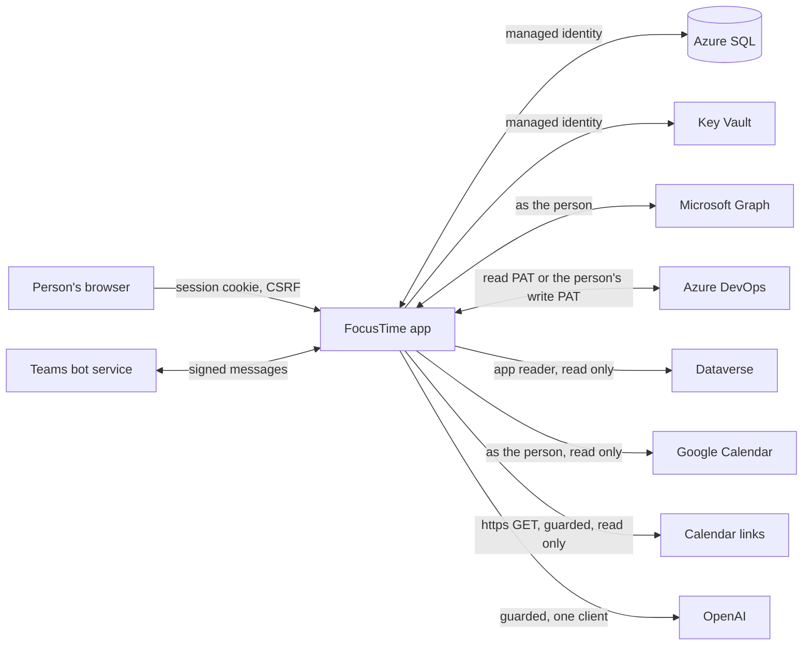
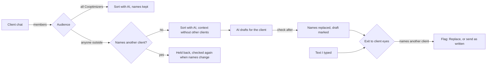

# Security

For IT first: this is the page to read before approving FocusTime. Engineers changing anything on it update it in the same pull request. Checked against `2f4c0ea` on Nov 13, 2026; Whose request against the ID-1 branch on Nov 17, 2026; shared deployments against the DP-3 branch on Nov 18, 2026.

## In short

- Only Cooptimize accounts sign in (Entra, single tenant); guests are refused.
- FocusTime acts as the signed-in person with delegated permissions, never app-only, except its read-only Dataverse reader and the company DevOps read PAT (one per client, used for the shared DevOps store, Code and the patterns page). The Teams bot replies as itself, only in a person's 1:1 chat.
- Every outside write is a named action with a preview, a confirm, a read back, an audit log and an undo. The few exceptions are listed below.
- Before a new DevOps item is previewed, DevOps checks it without saving it (`validateOnly=true`, with the person's own write PAT). The request is built in one function that always adds the flag; it is logged as a check by kind and status only, never its fields or the token (RQ-1).
- One client's data stays in that client's views, drafts, AI requests and DevOps writes; Cooptimize Internal is the one exception. Where another client's name could reach a client's eyes, FocusTime holds it back, replaces it, or flags it first (the client boundary).
- Client code is the one thing every Cooptimizer may read across clients: read only, never kept, never sent to AI, every file opened logged for admins.
- Secrets live in Key Vault, set by scripts, never in the UI, the image, the repo, GitHub or logs.
- Outside production, nothing happens on its own: a test site doesn't read chats or transcripts on a schedule, run AI in the background, change Teams status or message anyone unless that person switched it on for themselves. Production is `FOCUSTIME_ENV` exactly `prod`; anything else is a test site.

## How data moves

Arrows point from the side that starts the call, labelled with the identity it uses. Data comes back on every arrow; FocusTime writes only to Graph, DevOps and Azure, and only the named writes below. Dataverse, Google and calendar links are read only. Not drawn: the person's own VM through Azure Resource Manager (as the person) and Cooptimize's public standards repo on GitHub (anonymous, read only).

## Sign-in and sessions

- **Who.** Entra OpenID Connect for the Cooptimize tenant only, or "Try the demo" (a fictional person, nothing fetched). The ID token is validated (signature, issuer, audience, expiry, nonce) and the tenant checked (`server/auth/entra.ts`); it is never stored. Only name, UPN, email, object id and tenant id are kept.
- **Sessions.** A random id in a `__Host-` cookie; the database keeps only its hash, with a CSRF token. 12 hours idle, 7 days at most (`store/accounts.ts`).
- **Every request.** The Host and Origin must be FocusTime's public URL and API calls must come from its own page (`server/guard.ts`). Every state change needs the session and its `X-CSRF` token (`server/app.ts`).
- **Whose request.** Every request and job runs as the session's or the job's own person, through one function (`signedContext`; [Who is asking](architecture.md#who-is-asking)). One person's identity never reaches another's request: each context is built from that person's own runtime and stored sign-in.
- **Headers.** A Content Security Policy of `default-src 'self'` with no inline styles or scripts, no frames, no object or base URI (`CSP` in `server/app.ts`); images from chats are served with a sandboxed CSP of their own.

### Compression

PF-2: the server compresses the app's files and a short named list of large reads ([Architecture](architecture.md#what-the-server-sends-compressed)). Compressing a secret in the same answer as text someone else can choose lets an attacker who can watch the answers' sizes guess the secret a piece at a time (the BREACH family of attacks). So:

- **Data is compressed only from one list.** `COMPRESSED_READS` in `server/compress-data.ts`: the week, Backlog, Status, the Inbox's lists and Code's listings and files, none of which carries a secret. The decision is made where every JSON answer is written (`writeJson`), from the action the call named; any other route or action is never compressed, so a new one is safe by default.
- **Never compressed, whatever its size, even if someone adds it to the list:** anything under `/auth/` (sign-in and sign-out, their state, the session and CSRF cookies), any answer that sets a cookie, `auth.*`, `push.*` (the server's key, a device's subscription), the DevOps write PAT actions, `calendar_link.*` (a private calendar address is a secret) and `settings.*`. `NEVER_COMPRESSED` refuses them at the writer and `server/compress-data.ts`'s tests fail if one is put on the list. Health, version, the database state, push-to-talk, transcript uploads, chat images and the Teams bot's endpoint (it streams its own answer, with its own token check) are never compressed either.
- **The CSRF token** is never in a body: it goes in a cookie and comes back in the `X-CSRF` header.
- **Nothing compressed is kept.** Files are compressed once from the build, which is the same for everyone. Data is compressed for its one answer. Every compressed answer says `Vary: Accept-Encoding`, data stays `no-store`, and the headers above are unchanged.

## Secrets

App secrets live only in Key Vault (RBAC mode, soft delete and purge protection on). The app reads them with its managed identity; Container Apps hands three of them in as Key Vault references.

| Key Vault name | What it is | Set by |
|---|---|---|
| `ft-entra-client-secret` | The FocusTime web registration's client secret | `infra/scripts/app-registration.sh` (only when the vault has none, or with `--rotate-secret`) |
| `ft-google-client-secret` | The Google client's secret | `infra/scripts/google-client.sh` (or `infra/scripts/copy-secrets.sh` once) |
| `ft-dataverse-client-secret` | The Dataverse reader's secret | `infra/scripts/copy-secrets.sh` (from the developer's keyring, once) |
| `ft-openai-key` | The OpenAI API key | `infra/scripts/openai-key.sh` |
| `ft-vapid-key` | The Web Push key pair | `infra/scripts/vapid-key.sh` |
| `ft-data-key` | A Key Vault key (not a secret) that wraps the app data key | Bicep (`infra/modules/keyvault.bicep`) |

- **Scripts only.** Secrets are piped from `az ad app credential reset` or the developer's keyring straight into Key Vault; never printed, echoed, logged or passed as an argument. Nothing secret is in the repo, the image, build args, GitHub (variables hold ids only; deploys sign in with OIDC) or logs. Settings never takes an app secret.
- **A person's secrets.** Their Microsoft and Google refresh tokens and DevOps write PATs are sealed in `user_secrets` with the app data key (`store/user-secrets.ts`) and never leave the server: not to the UI, the export, the logs or the AI.
- **A person's Pocket key (PK-2).** Sealed in their `user_secrets` (account `pocket-key`; the last check, a time and a count, beside it as `pocket-check`), read back only wrapped in `PocketKey` (prints as `[Pocket key]`) for the one list call. The paste box is a password field; the key goes to the server once and never comes back to the browser, an address, a log line or an error. Disconnect deletes both rows at once. The actions take no person: each acts on the signed-in person's own secrets, so nobody can use, see or learn of another's key or connection, admins included.
- **My Pocket recordings in Calls (MC-2b, PK-4).** Listed only when the person opens Calls, presses Refresh or presses Check Pocket again (at most once in 5 minutes), and one recording read only on their Continue, each with their own key read for that request. The list keeps only their own recordings (`whoseKept`: by the recorder's address, theirs or a Pocket address they set; or the one recorder of every recording under the key when it isn't another FocusTime person's). Of an item under someone else's address only that address is read; it is only counted. The counts are numbers only, held with the list; each kept one is an id, a time, a length and a title, returned to that person alone and held 5 minutes in the server's memory keyed by their user id (`createPocketHold`), never in the database, the browser's storage, Export or a log. A recording is brought in only by an id from that person's own held list (an id from someone else's list, one never listed or one older than 5 minutes is refused before Pocket is asked), only onto a call they review (`canConfirm`) that it goes with (half the call, or half the recording and 5 minutes of it inside the call), or as a call only they see. Its transcript is then client data under the transcript rules: the call's reviewers and attendees only, 30 days, never in Export or logs, the AI only through `meeting.capture` after Continue and with the client's Allow AI. Speakers are numbered; Pocket's speaker names and summaries are never read. Logs say only the outcome. Admins never see a person's recordings, list or connection.
- **My Pocket addresses (PK-4).** The addresses a person says their Pocket account uses, up to 3, sealed in their `user_secrets` as `pocket-addresses` beside the key; shown only to them on their own Settings page; never in Export, logs or an admin view; removed with Remove, Disconnect and Delete my data. Set my Pocket address accepts one only when its hash is among the recorders of the list just read for that person (held as SHA-256 hashes for 5 minutes, never the addresses) and it isn't an address another FocusTime person is known by; any other address is refused in the same words, 5 refusals a list. FocusTime never offers other people's names or addresses to choose from. The remaining risk, an organization key listing a colleague who isn't a FocusTime person, is in `docs/open-questions.md`.
- **Calendar links.** A calendar's ICS link works like a password (anyone holding it reads the calendar), so it is treated as one: sealed in `calendar_links` with the app data key (bound to the person and the link), read back only by the fetcher, never returned to the browser, logged, exported or sent to the AI. Settings shows only its host; the paste box is a password field. Remove deletes the link and its events. Links are the adder's own: a user table, never shown to admins.
- **Tokens.** Access tokens are kept in memory only, per person. Tokens, secrets, Authorization headers and raw HTTP bodies are never logged, cached, exported or printed.
- **Logs** have a closed set of fields (source, operation, status, duration, count, kind, and a one-way reference for a client; `log/logger.ts`). There is no field for headers, bodies, tokens or free text, so they can't be logged by accident.

## Client boundaries

- Rows that belong to a client carry its key, and views, drafts and DevOps writes for one client never show or touch another's ("That write belongs to another client").
- DevOps calls for a client go only to that client's organization, with that client's PAT.
- Chat messages and conversations show only to people who are members of the chat now and follow its client; never in another client's views, logs or errors (ids and counts only).
- **The Internal exception.** Cooptimize Internal (recognized by the client list's own rule, `clientAccounts()` answering "internal" for the internal client key, never from a name in the text) may name clients in its drafts and AI requests, since Internal work is about them. Secrets, the VM and outside email addresses are still refused there.

### The client boundary rule

1. **The audience decides, from real membership.** A chat whose members are all Cooptimizers is internal. Any guest or outside member makes it client-facing. The Cooptimizer rule is the one every picker uses (home tenant, not a guest, not an automation account, inside the Cooptimize domains); a chat whose members aren't known yet is client-facing. Membership is read again at every poll from the cached member list (refreshed daily and on Refresh), so a guest added later changes the audience on the next poll (`chatAudience` in `plan/boundary.ts`).
2. **Internal chats** are sorted normally, keeping cross-client mentions.
3. **Client-facing chats:** a message that names another client is held back and never sent to AI. It stays held until an admin changes a client's names, which checks it again (`held_recheck`), and it is deleted with the chat's other messages by the usual retention. No screen lists held messages and, since RM-1, no action sorts one by hand; only the count reaches the members of its chat.
4. **Only words travel.** Sorting or drafting for one client never pulls another client's records (items, conversations, promises, transcripts) into the prompt. A mention in a message's own text is allowed in an internal chat; in a client-facing chat, recent context naming another client is left out.
5. **AI-written DevOps text never names another client:** the generation prompt says so, and one shared check after generation (the `scrub` rule in `ai/service.ts`) replaces any other client's name or alias with "another client" and marks the draft "Another client's name was removed". Internal work may name clients.
6. **Every exit to client eyes is checked** by one shared check (`exitCheck` in `plan/boundary.ts`): Close the loop's posts and emails, every DevOps write into a client's org (create, comment, description, state with a note), and the status report's lines. The preview flags another client's name, alias, DevOps project or known item id (links included) with one click to replace it. Text the person typed can still go after they've seen the flag (Confirm carries `mentionsOk`); undos only put back what was there. Internal targets aren't checked.
7. **The tag.** A conversation whose messages name another client carries "mentions <client>" for the people who can already see it.

Unchanged by any of this: admins never see others' content, client views only show that client's records, and FocusTime never posts to a client chat by itself.

Names come only from the client directory: each client's key, its Dataverse and settings names, and the aliases an admin sets in Admin › Clients (a Rule). The match is whole words, any case, and ignores links and email addresses; a client set to "Match only as written" (Admin › Clients, on by default when its name is an ordinary word, `plan/common-words.ts`) matches its names and aliases only with their casing; numbers and projects count only at an exit. The boundary logs only counts for its scrub and holds, never the matched name or the text.

### Client code

Every Cooptimizer may read every client's code in Code, read only, so people can borrow working code from one client to start the same job at another. It covers code read through that tab and nothing else: work items, chats, promises, transcripts and reports keep every rule above.

- **Who.** A signed-in Cooptimizer by the people rule (`notCooptimizer` in `plan/person-match.ts`): never a guest, a person outside the Cooptimize domains or an automation account. A demo session reads only the demo's invented repos. Checked on every read: the client list, a repo list, a folder, Find, By kind, Search names, Search inside files and a file (`actions/code-actions.ts`).
- **The per-client Rule.** "Who can read this client's code" (Admin › Clients) is Whole company by default; Its team only uses the client status report's team check (`reportTeam().onClient`). Everyone else sees the client listed, greyed, with "Only <client>'s team can open this", and no repo names. A change is in `admin_audit` like any Rule.
- **What is read.** Only the client's registered DevOps project, its default branch, through the reader's allow list ([Integrations](integrations.md#azure-devops)). Never a write.
- **Nothing of the code is kept.** Not in the database, on disk, in logs, Application Insights, error messages, Export or the browser's storage; the stored last place keeps only that Code was the tab (`#/code`), never a client, repo, path or search. Folder lists, file names and file text may sit in the server's memory 5 minutes, reached only after the access check. Every response is no-store, and the service worker never caches `/api`. PF-2: Code's answers are compressed for that one answer; the plain copy and the compressed copy are zeroed once written, and nothing compressed is kept.
- **Drawn as text.** The coloring library (Prism, `ui/code/`) only cuts text into pieces; each piece is a text node, so an `.html` or `.svg` file shows its source and nothing in it runs. The library loads only when Code opens, in its manual mode, and makes no network call.
- **By kind and Search names read names only.** Both read each repo's list of file names (the read Find uses) and sort them into reports, semantic models, pipelines and the rest by folder and file names alone (`plan/code-kinds.ts`); no file is opened to sort, search or label anything. A search across clients asks for one client at a time, only the clients the person may read; a client set to Its team only is left out and named with the reason. It lists names from several clients on one screen, grouped by client: with Search inside files' list of files, the one place more than one client shows together, and only names. The words typed are matched in the browser and never sent, stored or put in the address.
- **Search inside files asks DevOps, and reads no file.** The search box switches Names · Inside files. Inside files asks each client's own DevOps code search which files hold the words ([Integrations](integrations.md#azure-devops)); FocusTime downloads no file to search it and builds or keeps no index. What leaves FocusTime: the words typed, to that client's DevOps organization, in the request's body, with the company read token in its header; nothing else and nowhere else. The words pass through FocusTime's server for this search only and are never stored, logged, put in an error message, Application Insights or the view log (`server/code-inside-words.test.ts`); the address and the browser's storage never hold them. What comes back is shown as files (name, kind by the file name rules, repo, path, match count), never lines: no text of a file shows until a person opens it, which is logged as a file open. The same checks run per client, a client set to Its team only is left out and named, and only files in that client's own repos on their default branch are listed. A client's DevOps needs Microsoft's Code Search extension; FocusTime never installs or changes anything there, and a client without it says so.
- **Where is it?, picked from the client's code (RB-3).** The New form's and the draft editor's first question offers the client's real reports, models, tables, pipelines and database objects as a person types (`ui/WhereLookup.tsx`, `plan/where-lookup.ts`). It reads only the client the item is for, through `code.kinds` with the same checks as Code (a client set to Its team only, a token without Code (read) or someone who isn't a Cooptimizer gets the plain box and one quiet line, and nothing is read), once, the first time the box is used with a client chosen. RB-3b: a report's pages, a model table's measures and columns, and a one-file model's tables are listed when asked for through `code.inner`, on the server, from only the files that listing needs, chosen from the repo's own file names (never from the request): a legacy report's `report.json`; a report in today's format's `pages.json` and each `page.json`, four at a time, at most 60 pages (past that the level isn't offered); a table's own `.tmdl` file and the model's other `.tmdl` files that may declare its measures, at most 8; a `model.bim` within Code's 1 MB text limit. Only names come back. The names live only in the form's memory while it is open: never in the browser's storage, the service worker's cache, the plan store or a log. A pick writes plain words into the box, the same as typing them: no path, repo, id or kind is kept with a draft, sent with the create or written to DevOps. The list and what is read for it never go to an AI, and the assistant has no tool for them (`ui/where-lookup-boundary.test.ts`); text left in the box travels as that box's text always did. RB-3b: while the form is open it remembers, in its memory only, which words in the box were picked and from which client's code; when the form's client changes, each pick still in the box as written is taken out (the typed words stay), one line says so, and Undo puts them back saying whose code they are from. Nothing of this is saved, sent or kept, and a create or save is never held up by it. Words copied by hand, or a draft saved and reopened under another client, aren't covered (open questions).
- **No AI, nothing on its own.** Code never goes to an AI, and the assistant, the Teams bot and notifications can't reach it. Every read comes from a click.
- **The view log.** `code_views` (an app table) keeps when, who (id and name), the client, the repo, the path and what happened (repo opened, file opened, Find used), never content, for 12 months. Listed by kind and Searched names are one row per client whose file names were read (RB-3: and "Listed for Where is it?" one row per client, saying whether it was the New form or the draft editor; RB-3b: "Pages listed", "Measures and columns listed" and "Tables listed" one row per listing with the repo and the report's, table's or model's file, never a row per file opened for it), and Searched inside files one row per client whose DevOps was asked, with no repo, no path and never the words typed. A file's row is written before its text is returned, a names row before any name is returned and a Searched inside files row before DevOps is asked; if it can't be written, nothing is returned and nothing is asked. Only admins read it (Admin › Audit › Code views). The panel says so: "Opening a file is logged for FocusTime admins: who, which file and when."

## Admins, guests and automation accounts

- **Admins** are members of the "FocusTime Admins" Entra group, or on a short break-glass list of object ids (`FOCUSTIME_ADMINS`), checked in one place (`actions/admin.ts`) and again by the server for every admin action. They set team values (AI switches and caps, Rules, Defaults by level, client chats and meetings, people's levels and client logins, invites) and see health and counts. Every change is in `admin_audit`.
- **Admins see** Code views (who opened which client's repo or file, listed it by kind, searched its names or listed them, a report's pages or a model's tables and measures for Where is it?, and when), never any code through it.
- **Admins never see** anyone's plan, to-dos, promises, captures, focus sessions, PATs, AI request text, assistant history, or chats they aren't in.
- **Guests** are refused at sign-in, from the token itself and the domains Rule (`server/people.ts`); a session of someone later found to be a guest is ended, with an audit line. Pickers never list them.
- **Automation accounts** are flagged by an admin. They never show as Cooptimizers in pickers, the Teams bot and the technical docs refuse them, and FocusTime refuses their DevOps writes (`canEdit`, `actions/ahead-actions.ts`).

## Who sees a shared deployment

- **Only the people on it.** A deployment (DP-3) is read and changed only through the person's own to-do for it; `store/deployments.ts` answers about a deployment only to someone in its `deployment_people`. Not an admin, not the client's lead, not a teammate who isn't on it: being an admin or a lead adds nothing.
- **Who can be added.** Cooptimizers who have signed in to FocusTime, chosen with the shared people picker; checked again on the server for every id a form sends (`deployPeopleOf` in `actions/dispatch.ts`): never a guest, an automation account, someone outside Cooptimize's domains or a typed address.
- **Anyone on it changes anything**, sees who else a change is for before saving, and a save made on an older version is refused. Each takes only themselves off; the last one off deletes it. Deleting a person's data takes them off and leaves it for the others.
- **Outlook stays each person's own.** Being added writes nothing to anyone's calendar. A hold is the person's own timebox for the deployment, put on Outlook only by their own press, through the write framework under their own sign-in: no attendees, nobody emailed, only the title, the window and Busy. One person's Outlook state is never shown to another.

## Who sees a client's status report

- **Everyone on the client's team, nobody else.** Status's client report shows the whole of that client's Monday report to every Cooptimizer on its team: an Account Worker on the client or one of its leads (Dataverse, read by the directory job; `reportTeam` in `actions/team-actions.ts`). Not guests, not automation accounts, and not admins who aren't on the team: being an admin adds nothing here.
- **Checked on the server, every call.** `status.report` answers 403 for anyone not on the client's team before anything is read, and lists only the clients the person is on. One client per report.
- **What it shows.** DevOps comments on the client's features (text, the author's DevOps display name, the time; never an email address), the features' titles and owners, and the team's days away as dates only (never a PTO title or message). Comments are read when asked and never stored. Who committed which feature comes from the published team snapshot, never from anyone's plan.
- **Writing.** A new comment on any feature in the report, and an edit or delete of my own comment in the report window, with my own write PAT, through the write framework (Push all opens the one DevOps preview, a client at a time; read back, audit log, undo) and the client boundary's exit check. Others' comments are read only.

## AI: the guard and redaction

- **One door.** Every AI request goes through `ai/` (`aiFor(ctx).run(task, input, schema)`), never to a provider directly, and runs only with AI for FocusTime on and, for a client, that client's Allow AI on (both admin switches, off by default), under each person's and the app's monthly caps.
- **The guard** (`ai/guard.ts`) runs before anything is sent: a request for one client (or none) is refused if it names another client, its projects or its item ids, holds anything shaped like a secret, the person's VM, or an email address outside Cooptimize. A sorting or drafting task that takes words (`mentions.input: "words"`) may carry another client's name in those words; secrets, the VM and outside addresses still refuse.
- **What is sent** is the task's own input: for chat sorting, the messages that pass the rules with that chat's open conversation summaries, participants' display names (never addresses) and message ids as short aliases; images only with that client's "Send attachments to AI" on. Meeting transcripts are masked for other clients and spoken email addresses first. Requests are sent with `store: false`.
- **Answers** must match their schema or are dropped; a string that names a secret shape, the VM or an outside address is replaced with "[removed]" (`redact`). An answer naming another client is refused, unless its task says otherwise: an internal chat's sorting keeps names, and text for a client's DevOps has them replaced with "another client" and the draft marked.
- **AI never acts.** It only suggests through allowlisted actions; every write it proposes needs the person's Confirm. Text read from chats, DevOps or captures is data, never instructions. The AI never sets a status, resolves anything or clears a promise; promises clear by rules in code.
- **The assistant's answers.** A question is answered from the asker's own reads (the same actions their buttons call), only for clients that are theirs, and shown only in their panel or their own 1:1 Teams chat. The intent round gets the person's words, the screen and, for a follow-up, their earlier words with every client's name and item id replaced (`[client]`, `#[id]`); answers by topic are composed on the server and send nothing more. Only a general question about one client sends that client's context, at most 16,000 characters, under that client's Allow AI and the guard; a question across clients asks which client first. Suggested steps are FocusTime plan proposals built from my own data, each run only on Confirm; anything that writes to a client's DevOps or chat goes through the same preview and exit checks as its button. The conversation memory is kept 2 hours on my own history row, in Export and cleared with it.
- **The request log** keeps counts, cost and outcome, never prompt or answer text. For a failed request it also keeps the provider's HTTP status as a number with the failure's kind ("provider:400"), and the App Insights line its tier ("standard" or "flex"); Last 20 requests (in your Settings, under AI and assistant) shows the status ("Failed · HTTP 400"). Never a body, a message or a header (MC-1d).

## Cooptimize's standards

FocusTime reads a public GitHub repo of development standards. The repo is data, never code: nothing from it is executed, imported or evaluated, scripts and hooks are never downloaded, and the front matter is read by a small line parser into plain strings (`plan/standards.ts`), not a YAML library. FocusTime only makes GET requests to it, with no token, and never writes to it.

Standards are Cooptimize-wide policy with no client data, so they may go in any client's AI prompt; everything else in that prompt follows the client boundary. Article text is sent as data inside the request's input, and the instructions say nothing in it changes the rules. After the AI answers, FocusTime adds the links itself and drops any citation of a standard it didn't send. Ask's answer has to quote the article word for word, checked in code, or it says "Not in the standards".

## Calendar links: the SSRF guard

A calendar link is a URL a person types, fetched by the server, so it is the one place where someone could aim FocusTime at an address of their choosing. The guard (`sources/ics/link.ts`, `sources/ics/fetch.ts`, `server/ics-fetch.ts`):

- **https only.** webcal:// and webcals:// become https://; anything else is refused. Port 443 only, no user name or password in the link.
- **No private or internal addresses.** Refused by name: localhost, `.local`, `.internal`, `.home.arpa`, names without a dot. Refused by address, checked in the socket's own DNS lookup at connect time (so a name can't pass and then resolve somewhere else): unspecified, loopback, private, carrier-grade NAT, link-local (169.254.0.0/16, where the cloud metadata services are; fe80::/10), unique local, multicast, reserved and documentation ranges, and IPv4 hidden in IPv6 (mapped, NAT64, 6to4). A name is refused if any of its answers is.
- **Redirects re-checked.** The HTTP client never follows a redirect; each hop (at most 3) goes through the same rules.
- **Bounded.** 15 seconds a request (at most 3 redirects, each with its own 15 seconds), 5 MB, and only `text/calendar` (or a generic type whose body is a calendar) that parses. Errors carry a kind only, never the server's words.
- **Read only, one person.** GET only, never a write to the calendar. One person's links are fetched for that person only.

**Busy only** (the default) keeps no title, location or description: only when the person is busy. Show titles keeps titles only.

## External writes and the audit log

Writes go only through the write framework (see [Architecture](architecture.md#an-external-write)). In the UI every change to a client's DevOps opens the one preview in `ui/DevOpsWrite.tsx`, one client per preview, and is written only on its Confirm; `ui/one-preview.test.ts` keeps every other file from calling the preview and confirm actions itself ([Architecture](architecture.md#the-one-devops-preview)). The complete list:

| Where | What FocusTime may change | Undo |
|---|---|---|
| Outlook calendar | Events it created (with its marker; a shared deployment's hold is one, on your own calendar only), the time and show-as of your own events with no other attendees, help invites to Cooptimize addresses, your reply to an invitation | Yes (a reply's undo restores the previous reply) |
| DevOps | The named writes in [Integrations](integrations.md#azure-devops), Send feedback's story in Cooptimize's own DevOps among them | Yes, refused when the item changed since |
| Teams presence | Your own preferred presence during focus, with an expiry; no preview | Cleared when focus ends |
| Teams chat and email | Close the loop: one message in the promise's chat or a 1:1 chat with someone at Cooptimize, or one email draft (or email) in your own mailbox, after its preview and Send; an admin's invite to a Cooptimizer who hasn't signed in, the same way | No (never edited, deleted or resent; Retry only reads back) |
| Azure | Start the one VM you confirmed, and Stop (deallocate) it after a preview; the start before your day, when you turned it on, on production only | No |
| Teams 1:1 chat | The bot's replies and cards in your own chat | Not applicable |

Nothing writes to Dataverse, Google, calendar links, other Teams data, the standards repo or any other Azure resource. Every attempt is in Settings › Your data (the Outlook, DevOps, Azure and Teams status logs, and Close the loop's sends) with before and after values, result, Undo and Retry. A retry checks the target first, so a write that landed isn't done twice. Plan store changes from the Teams bot's buttons and "capture:" run at once with Undo, like the app's own buttons.

## The meeting rules

- **Calendars.** FocusTime edits only what it created or what only you can see. A meeting with anyone else on it is never edited: an RSVP calls only Graph's accept, tentativelyAccept or decline, never PATCH, DELETE or cancel. FocusTime refuses to change an event without its marker, and never adds the marker to your own events.
- **Teammates.** From free/busy, only free or busy and working hours; never subjects, locations or other details. Time off shows only as "away".
- **Meeting capture.** Only client calls an admin registered (Admin › Clients › <client> › Calls) are read: found from their join link, transcripts read with a reviewer's own delegated token, read only, kept 30 days, shown only to the call's reviewers and attendees. Any other meeting is refused before a request is sent (`sources/graph/meetings.ts`). Proposals from a call write to DevOps only through the one DevOps preview and a reviewer's Confirm there (MC-1e: `meeting_create` and `meeting_comment`, the same write framework as every other DevOps write; the call's page has no write path of its own, which `ui/meetings/one-door.test.ts` checks). A field the client's process requires is asked for before the preview. A call's comment goes only on a story-level item: the AI is given only those to comment on, and the server refuses any other. A promise from a call stays in FocusTime.
- **A call's meeting on Day and Week (MC-1d).** The browser marks a meeting as a call only by matching it against the calls the server already returned to that person (`meeting.mine`: the ones they review or attend), by its start and end; nothing about other meetings is sent anywhere, and anyone else sees an ordinary meeting.
- **Which calls have a transcript (MC-4).** Asked of Teams only when the person opens Calls or presses Refresh, Check again or Check more there, with their own delegated sign-in, for Teams meetings on their own calendar organized at Cooptimize. Only whether one exists: the Graph client's gate allows the `exists` purpose for the lookup by join link and the transcript list only while that person's check is open, only for the links it took from their calendar, and refuses a transcript's content with it (`sources/graph/meetings.ts`, `actions/call-exists.ts`; tested). The answers are held 15 minutes in the server's memory keyed by the person, and in the page while Calls is open; never in the database, a log, Export or browser storage. Nothing is sent to an AI until the person presses Review with a client chosen, and then only under AI for FocusTime and that client's Allow AI. Hiding a call keeps only which meeting and when (`call_hides`, a user table scoped by `store/scope.ts`); Skip all and close only changes the person's own proposals on calls they review and writes nothing to DevOps.
- **The Transcript view (MC-1d).** `meeting.transcript` returns a call's stored lines to the same people as its review, and refuses anyone else as if there were no such call. It loads when the view opens and is held only in that view's memory: never in browser storage or the installed app's caches. It is read only and gone with the stored transcript at 30 days. The log keeps a count of lines, never a line.
- **A transcript a reviewer uploads (PK-1).** A Teams .vtt or .docx, or a Pocket export (a zip holding one PDF, or the PDF), up to 5 MB. What a file is comes from its first bytes, never its name, and nothing is written to disk. A zip that isn't a .docx is opened in memory (`actions/transcript-file.ts`, node:zlib, no dependency): at most 20 entries and 20 MB unpacked in all, counted as each entry inflates whatever its header claims, no archive inside, exactly one file FocusTime reads; an entry's name is only compared, never used as a path; encrypted and Zip64 entries are refused. A PDF is read by pdf.js in a worker thread the server starts for that one file (`server/pdf-text.ts`): text only, at most 500 pages, ended after 10 seconds, with its own memory limit, and ended if the server grows by more than 512 MB while it reads (pdf.js decodes streams outside that limit), at most 2 at once with 8 waiting (more are told to try again); nothing in the file is run, opened or followed (no scripts, fonts compiled to code, forms, links or attachments), and the thread's network calls are cut off before pdf.js loads. A refusal names what was found by kind and count, never a file's name or words; any other error while reading is refused in fixed words and logged by kind only. The text parsers scan in linear time, so a file of unclosed tags can't hold the server. Only the lines are kept (30 days, as every transcript); the file is gone after reading. The log has the kind, the sizes and the counts. A Pocket export has no names and no times: its speakers show as Speaker 1, Speaker 2, nothing guesses who they are, and the AI step is told the labels aren't people; a promise from it is someone's only when its own words name them, and otherwise is noted with the call.
- **A failed AI step (MC-1d).** A pass that fails is the call's own state, "The AI step failed", with its reason; nothing is proposed from half a call. The meeting job tries it again by itself up to 3 times, 15 minutes apart, in production only (the job doesn't run elsewhere), never for a failure a retry can't fix (AI off or not allowed for the client, not set up, a budget or a guard refusal, or the AI service refusing the request itself). Outside production a failed pass gets no next try at all. Each try is counted before it runs, so a restart can't add one. Retries and Propose again run the same pass as before: no new prompt, schema or model, and nothing reaches DevOps without a reviewer's Confirm.

## Test sites

Dev shares the Entra registration, Dataverse, the DevOps read PAT, the Graph tenant and the Azure subscription with prod, so a background job on dev would act on the same people and client data a second time. `config/background-policy.ts` is the one place that decides what runs from the environment, and it fails safe: a missing or misspelled `FOCUSTIME_ENV` is a test site. On a test site, a button acts only for the person who pressed it: Refresh reads chats with that person's sign-in and nobody else's, and Check now looks for one call's transcript with theirs. Teams status is never changed from a test site, even from a button. The chat poll's `FOCUSTIME_REQUESTS_POLL=on` is the one override, for a declared watch period, and Admin › Health says so while it is on. The full list is in [Operations](operations.md#what-runs-on-its-own).

## The VM and its auto-shutdown

FocusTime reads, starts and stops (deallocates) only the one VM you confirmed, with your own Azure access. Stop runs only from your Confirm after its preview; FocusTime never stops a VM on its own. It never writes the VM's auto-shutdown schedule (no time, status, time zone, notification or delete): the schedule is yours and is only read. The Azure client throws before a request is sent for anything outside its allowlist (`ALLOWED` in `sources/azure/client.ts`), and its two writes refuse any query parameter but api-version.

The one write without a preview is the start before your day, and only because you turned it on. It runs only on production (`FOCUSTIME_ENV` exactly `prod`, checked first, before any setting or token is read), at most once a day (a claim in the database), never stops anything, and is logged as automatic. Admins never see or control anyone's VM; the assistant and the Teams bot can't start or stop it.

## Threat model

| We protect | From | How |
|---|---|---|
| The API | Other web pages (CSRF, DNS rebinding), other people's sessions | Host and Origin checked against the public URL, fetch metadata, a session cookie and its `X-CSRF` token on every change (`server/guard.ts`, `server/app.ts`) |
| One person's plan | Every other person, including admins | Every statement scoped by `store/scope.ts`; `store/isolation.test.ts` fails a table without `user_id` first in its keys |
| Tokens, PATs, app secrets | Logs, errors, exports, the browser, git | Key Vault or sealed `user_secrets`; access tokens in memory only; the `Pat` wrapper prints `[PAT]`; the logger has a closed set of fields (`log/logger.ts`) |
| Client data | Mixing clients | One client per view, draft and AI request; the AI guard (`ai/guard.ts`); messages naming another client held back in client-facing chats; AI text for a client's DevOps scrubbed; every exit to client eyes flagged before it goes |
| Client code | Leaking out of FocusTime, or to people a client restricted | Read only; never stored, logged or sent to AI; the per-client Rule; every file opened logged for admins before its text is returned |
| Other people's calendars and presence | Over-reading | Free/busy and working hours only; presence is a word, never stored |
| The network inside Azure | A calendar link aimed at an internal address (SSRF) | https on 443 only; private, link-local and metadata addresses refused at connect time; redirects re-checked; 15 s and 5 MB caps |
| A person's calendar links | Logs, the browser, admins, other people | Sealed in `calendar_links`; only the host is ever shown; a user table; Busy only stores no titles |
| Meetings others organize | Accidental edits | Calendar editing tiers; only accept, tentative or decline, never PATCH or DELETE |
| DevOps items | Accidental loss or a lost update | Named writes only, no deletes of items; `test /rev` on every patch; read back; undo |
| Azure | Acting on the wrong resource | One confirmed VM; the client's allowlist; the person's own access; Stop only after a preview; never the schedule |
| The database | A bad migration or a bad rollback | Migrations only add (`store/migrations/additive.test.ts`); an older build runs on a newer database |

## Known gaps

- **The Dataverse PAT column isn't secured.** Any identity with read on Accounts can read every client's company PAT (open question Q16). This is a Dataverse setting, not FocusTime code.
- **Dataverse is read app-only.** FocusTime reads it with its reader's identity, not each person's own Dataverse permissions (Q89).
- **Global PATs retire on December 1, 2026.** A client PAT created as global stops working then; recreate it as organization-scoped (Q17).
- **The DevOps identity check uses an undocumented endpoint.** `_apis/connectionData` isn't on Microsoft Learn (Q80).
- **Public endpoints.** Azure SQL, Key Vault, the container registry and the bot are reachable on their public endpoints (`publicNetworkAccess: 'Enabled'` in `infra/modules/`); there are no private endpoints. Azure SQL's firewall allows only Azure services; every request still needs Entra or managed identity access.
- **People can erase their own outside-write log.** Settings › Your data's rows (and `loop_sends`, which holds the text sent) are user rows, removed with Delete my data. `admin_audit` has no age limit.
- **Data at rest.** Azure SQL encrypts its data at rest by default (transparent data encryption); `infra/` doesn't set it either way. **Not verified.**

## These docs

The technical docs are bundled into the app at build time, and the app's built files are served without a session, like the rest of the UI. So these pages must never hold anything sensitive: no secrets, tokens, keys, connection strings, tenant or subscription ids, or real client or person names. `npm run docs:check` scans for secret-looking text. The panel itself opens only for signed-in people and refuses automation accounts.

History: the rules here come from the hard rules in [CLAUDE.md](../../CLAUDE.md) and the decisions in [docs/decisions.md](../decisions.md).
